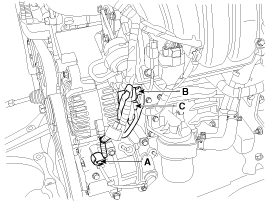
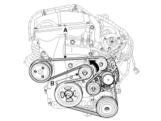
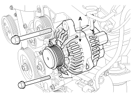
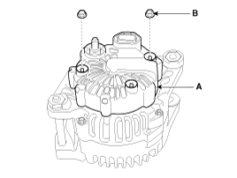
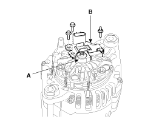
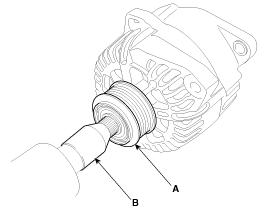
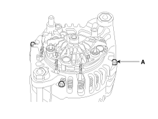
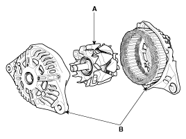
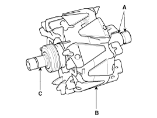
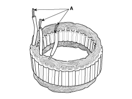

# Kia Sportage: Alternador: Procedimentos de reparo

[Home](../../index.md) / [Manual de Serviço e Reparo do Kia Sportage SL](../sportage-482.md) / [Sistema Elétrico do Motor](sportage-530.md) / [Sistema de Carregamento](sportage-537.md) / Procedimentos de reparo do alternador

## Remoção e Instalação

1. Desconecte o terminal negativo da bateria primeiro, depois o terminal positivo.

   ```
   Torque de aperto :
   Terminal (+) : 7,8 ~ 9,8N.m (0,8 ~ 1,0kgf.m, 5,8 ~ 7,2lb-ft)
   Terminal (-) : 4,0 ~ 6,0N.m (0,4 ~ 0,6kgf.m, 3,0 ~ 4,4lb-ft)
   ```

2. Desconecte as conexões do interruptor do compressor de ar condicionado (A), do alternador (B) e do cabo do terminal "B" do alternador (C).

   

3. Desmonte a correia (A) após girar o regulador de tensão da correia (B) no sentido anti-horário.

   

4. Retire o parafuso através e, em seguida, remova o alternador (A).

   ```
   Torque de aperto :
   49,0 ~ 63,7N.m (5,0 ~ 6,5kgf.m, 36,2 ~ 47,0lb-ft)
   ```

   

5. A instalação é o contrário do desmonte.

## Desmontagem

1. Remova a capa do alternador (A) usando uma vareta após desafinar os parafusos (B).

   

2. Remova o guia do anel de deslizamento (A) e, em seguida, desafine os parafusos de montagem e desconecte a montagem do suporte do pincel (B).

   

3. Remova o pulley (A) usando o SST (09373-27000) (B).

   

4. Desafine os 4 parafusos através (A).

   

5. Desconecte o rotor (A) e a cobertura (B).

   

6. A montagem é o contrário da desmontagem.

## Inspeção

Inspeção do Rotor

1. Verifique a continuidade entre os anéis de deslizamento (C).

   

2. Verifique se não há continuidade entre os anéis de deslizamento e o rotor (B) ou o eixo do rotor (A).

3. Se o rotor falhar em qualquer uma das verificações de continuidade, substitua o alternador.

Inspeção do Estator

1. Verifique a continuidade entre cada par de fios (A).

   

2. Verifique se não há continuidade entre cada fio e o núcleo do enrolamento.

3. Se o enrolamento falhar em qualquer uma das verificações de continuidade, substitua o alternador.
