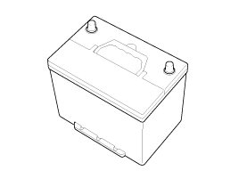

# Kia Sportage: Bateria: Descrição e Operação

[Home](../../index.md) / [Manual de Serviço e Reparo do Kia Sportage SL](../sportage-482.md) / [Sistema Elétrico do Motor](sportage-530.md) / [Sistema de Carregamento](sportage-537.md) / Bateria: Descrição e Operação

## Descrição

1. A bateria maintenance-free, como o próprio nome indica, é totalmente maintenance-free e não possui tampas removíveis nas células.

2. Nunca é necessário adicionar água à bateria maintenance-free.

3. A bateria está completamente selada, exceto por pequenos orifícios de ventilação na tampa.

   

   > **Nota**
   >
   > - Após desconectar e reconectar o cabo negativo da bateria, reinicie algumas partes que exigem procedimentos de reinicialização. (Consulte o grupo BE - Informações Gerais)
