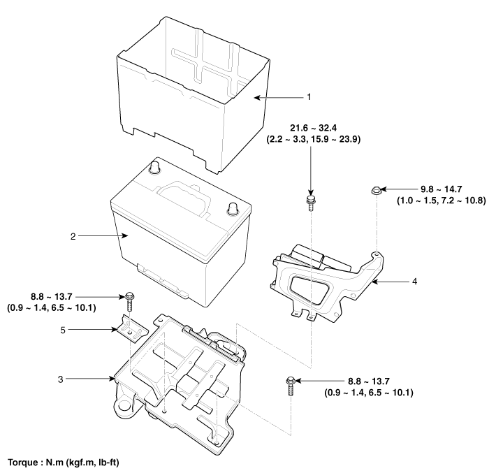

# Kia Sportage: Bateria: Componentes e Localização dos Componentes

[Home](../../index.md) / [Manual de Serviço e Reparo do Kia Sportage SL](../sportage-482.md) / [Sistema Elétrico do Motor](sportage-530.md) / [Sistema de Carregamento](sportage-537.md) / Componentes e Localização da Bateria

## Componentes

| 1. Isolamento da bateria 2. Bateria 3. Tray da bateria | 4. Montagem do ECM e suporte 5. Aro de montagem da bateria |
| --- | --- |
