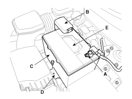
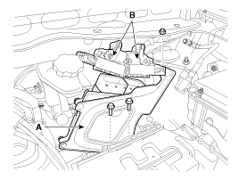
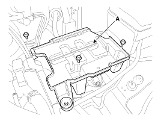
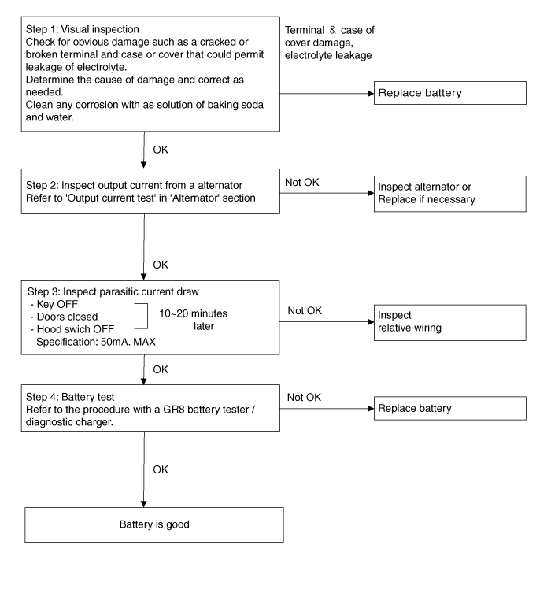
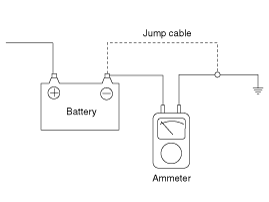
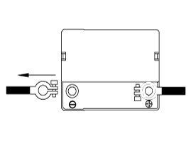

# Kia Sportage: Bateria: Procedimentos de Reparo

[Home](../../index.md) / [Manual de Serviço e Reparo do Kia Sportage SL](../sportage-482.md) / [Sistema Elétrico do Motor](sportage-530.md) / [Sistema de Carregamento](sportage-537.md) / Procedimentos de Reparo da Bateria

## Remoção e Instalação

1. Remova a bateria.

   ```
   Desconecte o terminal negativo da bateria (A).
   Torque de aperto:
   4,0 ~ 6,0 N.m (0,4 ~ 0,6 kgf.m, 3,0 ~ 4,4 lb-ft)
   ```

   ```
   Desconecte o terminal positivo da bateria (B).
   Torque de aperto:
   7,8 ~ 9,8 N.m (0,8 ~ 1,0 kgf.m, 5,8 ~ 7,2 lb-ft)
   ```

   | (3) | Remova a placa de isolamento da bateria (C). |
   | --- | --- |

   | (4) | Remova o suporte de montagem da bateria (D) e a bateria (E). |
   | --- | --- |

   ```
   Torque de aperto:
   Parafuso do suporte: 8,8 ~ 13,7 N.m (0,9 ~ 1,4 kgf.m, 6,5 ~ 10,1 lb-ft)
   ```

   

2. Remova o dutamento e a assembléia do filtro de ar. (Consulte o grupo EM).

3. Remova o ECM (A) após desconectar os conectores (B). (Consulte o grupo FL)

   

4. Remova a prateleira da bateria (A).

   ```
   Torque de aperto:
   8,8 ~ 13,7 N.m (0,9 ~ 1,4 kgf.m, 6,5 ~ 10,1 lb-ft)
   ```

   

5. A instalação deve ser feita no sentido contrário à remoção.

   > **Cuidado**
   >
   > - Ao instalar a bateria, fixe corretamente o suporte de montagem na prateleira.

## Inspeção

Fluxo de Diagnóstico da Bateria



Inspeção da Corrente Parasitária do Veículo

1. Desligue todos os dispositivos elétricos, e então desligue o interruptor de ignição.

2. Feche todas as portas, exceto a capota do motor, e então trave todas as portas.

   | (1) | Desconecte o conector do interruptor da capota. |
   | --- | --- |

   | (2) | Feche o porta-malas. |
   | --- | --- |

   | (3) | Feche as portas ou remova os interruptores das portas. |
   | --- | --- |

3. Aguarde alguns minutos até que os sistemas elétricos do veículo entrem em modo de sono.

   > **Nota**
   >
   > - Para uma medição precisa da corrente parasitária do veículo,
   todos os sistemas elétricos devem entrar em modo de sono. (Isso leva
   pelo menos uma hora ou no máximo um dia.) No entanto, uma corrente
   parasitária aproximada do veículo pode ser medida após 10~20 minutos.

4. Conecte um amperímetro em série entre o terminal (-) da bateria e o cabo de terra, e então desconecte o suporte do cabo de terra do terminal (-) da bateria lentamente.

   > **Cuidado**
   >
   > - Cuide para que os fios de lead do amperímetro não se soltem
   do terminal (-) da bateria e do cabo de terra para prevenir a reconfiguração da bateria. Em caso de reconfiguração da bateria, conecte novamente o cabo da bateria, e então ligue o motor ou acione o interruptor de ignição por mais de 10 segundos. Repita o procedimento a partir do item 1.
   > - Para prevenir a reconfiguração da bateria durante a inspeção,
   > - Conecte um cabo de salto entre o terminal (-) da bateria e o cabo de terra.
   > - Desconecte o cabo de terra do terminal (-) da bateria.
   > - Conecte um amperímetro entre o terminal (-) da bateria e o cabo de terra.
   > - Após desconectar o cabo de salto, leia o valor da corrente do amperímetro.

   

5. Leia o valor da corrente do amperímetro.

   | • | Se a corrente parasitária estiver acima do valor limite, busque
   por circuitos anormais removendo um a um os fusíveis e verificando a
   corrente parasitária. |
   | --- | --- |

   | • | Verifique novamente a corrente parasitária e busque por unidades suspeitas removendo uma a uma as unidades conectadas ao circuito anormal. |
   | --- | --- |

   ```
   Valor limite (após 10~20 minutos): Abaixo de 50mA
   ```

## Limpeza

1. Certifique-se de que o interruptor de ignição e todos os acessórios estão na posição OFF.

2. Desconecte as barras da bateria (começando pela negativa).

3. Remova a bateria do veículo.

   > **Cuidado**
   >
   > - Cuidado deve ser tomado no caso de a caixa da bateria estar rachada ou com vazamento, para proteger a pele do eletrolito.
   > - Luvas de borracha pesada (não as de uso doméstico) devem ser usadas ao remover a bateria.

   

4. Inspeção do suporte da bateria para danos causados pela perda do
   eletrolito. Se houver danos ácidos, será necessário limpar a área com uma solução de água quente limpa e bicarbonato de sódio. Esfregue a área com um pincel rígido e limpe com um pano umedecido com bicarbonato de sódio e água.

5. Limpe o topo da bateria com a mesma solução descrita acima.

6. Inspeção da caixa e do capô da bateria para rachaduras. Se houver rachaduras, a bateria deve ser substituída.

7. Limpe as postas da bateria com uma ferramenta adequada para limpeza de postas de bateria.

8. Limpe a superfície interna dos conectores de terminal com uma
   ferramenta adequada para limpeza de bateria. Substitua as cables danificadas ou esfarrapadas e os conectores de terminal quebrados.

9. Instale a bateria no veículo.

10. Conecte as terminais das barras à posta da bateria, garantindo que as partes superiores dos terminais estejam alinhadas com as partes superiores das postas.

11. Ajuste os parafusos dos terminais firmemente.

12. Aplicar uma fina camada de graxa mineral em todas as conexões após o ajuste.

   > **Cuidado**
   >
   > - Quando as baterias estão sendo carregadas, um gás explosivo forma sob o cobre de cada célula. Não fume perto de baterias sendo carregadas ou que tenham sido recentemente carregadas. Não interrompa o circuito vivo nas terminais das baterias sendo carregadas.
   > - Uma chama ocorrerá quando o circuito for interrompido. Mantenha chamas abertas longe da bateria.
