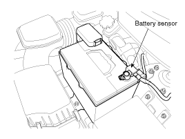

# Kia Sportage: Sensor de Bateria: Descrição e Operação

[Home](../../index.md) / [Manual de Serviço e Reparo do Kia Sportage SL](../sportage-482.md) / [Sistema Elétrico do Motor](sportage-530.md) / [Sistema de Carregamento](sportage-537.md) / Sensor de Bateria: Descrição e Operação

## Descrição

Os veículos têm muitos controladores que usam mais eletricidade.
Esses controladores controlam seus próprios sistemas com base em informações de diversos
sensores. É importante ter uma alimentação estável, pois há diversos sensores fornecendo uma variedade de informações. O sensor de bateria está montado no terminal (-) da bateria. Ele transmite a tensão da bateria, a corrente e a temperatura para o ECM. O ECM controla a geração de tensão com base em sinais de ciclo de duty.

> **Cuidado**
>
> - Quando ocorrer um problema no sinal do sensor de bateria, inspecione o consumo parasitário do veículo antes de inspecionar o sensor, pois o sensor entrará em comportamento anormal quando o consumo parasitário for superior a 100mA. (Consulte a inspeção do consumo parasitário do veículo)

> **Nota**
>
> - Realize o seguinte processo após a substituição do sensor de bateria.
> - Ligue e desligue o interruptor do acionamento.
> - Estacione o veículo por cerca de 4 horas.
> - Após 4 horas, verifique o SOC (Estado de Carga) da bateria usando o GDS.

> **Cuidado**
>
> - Para veículos equipados com sensor de bateria, tenha cuidado para não danificar o sensor de bateria quando a bateria for substituída ou recarregada.
> - Ao substituir a bateria, deve ser a mesma (tipo, capacidade e marca) que originalmente foi instalada no seu veículo. Se uma bateria de um tipo diferente for substituída, o sensor de bateria pode reconhecer a bateria como anormal.
> - Ao instalar o cabo de terceiro pino na posta negativa da bateria, aperte o suporte com a torção especificada de 4,0~6,0N.m (0,4~0,6kgf.m, 3,0~4,4lb-ft). Uma torção excessiva pode danificar o circuito interno do PCB e o terminal da bateria.
> - Ao recarregar a bateria, conecte o terminal negativo da bateria auxiliar ao corpo do veículo. Se o cabo negativo do carregador de bateria estiver conectado ao terminal negativo da bateria, o sensor de bateria pode cometer um erro. Neste caso, repita o processo acima para substituição do sensor de bateria (1~3) após desconectar e reconectar o conectador da bateria.
