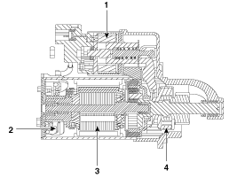

# Kia Sportage: Descrição e Operação

[Início](../../index.md) / [Manual de Serviço e Reparo do Kia Sportage SL](../sportage-482.md) / [Sistema Elétrico do Motor](sportage-530.md) / [Sistema de Início](sportage-546.md) / Descrição e Operação

## Descrição

O sistema de início inclui a bateria, o gerador, o relé, o interruptor de ignição, o interruptor de inibidor (AT), o interruptor do pedal da embreagem (MT), o interruptor do trinco da ignição, as fios de conexão e o cabo da bateria.

Quando a chave de ignição é girada para a posição de partida, ocorre o fluxo de corrente e a bobina do motor do gerador é energizada.

O plunger do relé e o lembrete da embreagem são ativados, e a pinhão da embreagem entra em contato com o rolete.

Os contatos fecham e o motor do gerador roda. Para prevenir o dano causado pela rotação excessiva do armador do gerador quando o motor é ligado, o pinhão do rolete entra em sobreressão.

1. Relé 2. Assembléia do escovamento 3. Armador 4. Clutch de sobreressão
