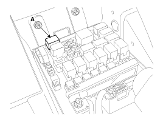
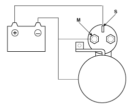
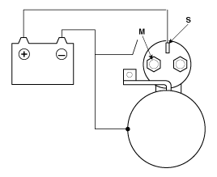
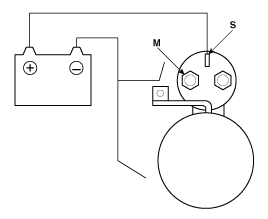
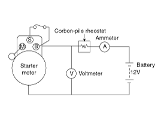

# Kia Sportage: Procedimentos de Reparo

[Início](../../index.md) / [Manual de Serviço e Reparo do Kia Sportage SL](../sportage-482.md) / [Sistema Elétrico do Motor](sportage-530.md) / [Sistema de Início](sportage-546.md) / Procedimentos de Reparo

## Diagnóstico da Circuito do Arranque

> **Nota**
>
> - A bateria deve estar em bom estado e completamente carregada.

1. Desconecte o relé do bomba de combustível (A) na caixa de fusíveis.

   

2. Com o manípulo do câmbio em N ou P (AT) ou pedal da embreagem pressionado (MT), ligue o interruptor de ignição na posição "START"

   Se o arranque normalmente girar o motor, o sistema de arranque está OK. Se o arranque não girar o motor, vá para o próximo passo.

   Se não se desengatar do dentado quando soltar a chave, verifique as seguintes coisas até encontrar a causa.

   | • | Falha do plunger do solenoid ou do interruptor. |
   | --- | --- |

   | • | Dentado sujo ou clutch sobrecarregável danificado. |
   | --- | --- |

3. Verifique o estado da bateria. Verifique as conexões elétricas na bateria, no cabo negativo da bateria conectado ao chassi, nas correias de terra do motor e no arranque. Então tente ligar o motor novamente.

   Se o arranque girar normalmente o motor, a reparação das conexões soltas resolveu o problema. O sistema de arranque está agora OK.

   Se o arranque ainda não girar o motor, vá para o próximo passo.

4. Desconecte o conectador do terminal S do solenoid.
   Conecte um cabo de pula-pula do terminal B do solenoid ao terminal S do solenoid.

   Se o arranque girar o motor, vá para o próximo passo.

   Se o arranque ainda não girar o motor, remova o arranque e faça as correções ou substitua conforme necessário.

5. Verifique os seguintes itens na ordem listada até encontrar a circulação aberta.

   | • | Verifique as fios e conectores entre a caixa de fusíveis/relés do motorista e o interruptor de ignição, e entre a caixa de fusíveis/relés do motorista e o arranque. |
   | --- | --- |

   | • | Verifique o interruptor de ignição (Consulte o grupo BE - Sistema de Ignição) |
   | --- | --- |

   | • | Verifique o conectador do interruptor de marcha do transmissão ou do interruptor de chave de ignição. |
   | --- | --- |

   | • | Inspeção do relé do arranque. |
   | --- | --- |

Teste do Solenoid do Arranque

1. Desconecte o fio do campo do motor do terminal M do interruptor do solenoid.

2. Conecte a bateria conforme mostrado. Se o pinion do arranque sair,
    está funcionando corretamente. Para evitar danos ao arranque, não deixe a bateria conectada por mais de 10 segundos.

   

3. Desconecte a bateria do terminal M.

   Se o pinion não se retrair, o bobinado de manutenção está funcionando
   corretamente. Para evitar danos ao arranque, não deixe a bateria
   conectada por mais de 10 segundos.

   

4. Desconecte a bateria também do chassi. Se o pinion
   se retrair imediatamente, está funcionando corretamente. Para evitar danos ao
   arranque, não deixe a bateria conectada por mais de 10 segundos.

   

Teste de Liberdade

1. Coloque o motor de arranque em um vise equipado com chifres macios e

conecte uma bateria carregada a 12 volts ao motor de partida da seguinte forma.

2. Conecte um amperímetro de teste (escala de 150 amperes) e resistores de carvão eletrolíticos conforme ilustrado.

3. Conecte um voltmetro (escala de 15 volts) entre o motor de partida.

   

4. Rotacione o resistor de carvão para a posição desligada.

5. Conecte o cabo da bateria ao corpo do motor de partida a partir do postiço negativo da bateria.

6. Ajuste até que a tensão da bateria mostrada pelo voltmetro leia 11,5 volts.

7. Confirme que a corrente máxima está dentro das especificações e que o motor de partida gira suavemente e livremente.

```
Corrente : 105A, MAX
Velocidade : 2.950 rpm, MIN
```
