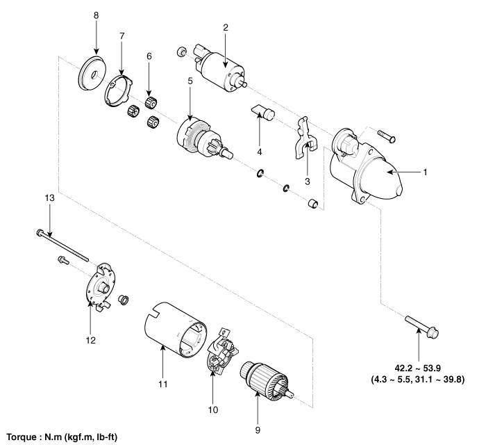

# Kia Sportage: Motor: Componentes e Localização dos Componentes

[Home](../../index.md) / [Manual de Serviço e Reparo do Kia Sportage SL](../sportage-482.md) / [Sistema Elétrico do Motor](sportage-530.md) / [Sistema de Arranque](sportage-546.md) / Componentes e Localização dos Componentes do Motor

## Componentes

| 1. Caixa frontal 2. Montagem do solenóide do arranque 3. Leva 4. Enchimento do leva 5. Montagem do eixo planetário 6. Montagem do engradeiro planetário 7. Enchimento | 8. Escudo 9. Montagem do amálgama 10. Montagem do suporte das escovas 11. Montagem do yoke 12. Caixa traseira 13. Parafuso transversal |
| --- | --- |
