# Kia Sportage: Motor: Procedimentos de Reparo

[Home](../../index.md) / [Manual de Serviço e Reparo do Kia Sportage SL](../sportage-482.md) / [Sistema Elétrico do Motor](sportage-530.md) / [Sistema de Início](sportage-546.md) / Procedimentos de Reparo do Motor

## Remoção e Instalação

1. Remova a capa do motor.

2. Desconecte o terminal negativo da bateria (A).

   ```
   Torque de aperto :
   4,0 ~ 6,0N.m (0,4 ~ 0,6kgf.m, 3,0 ~ 4,4lb-ft)
   ```

   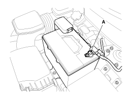

3. Remova a montagem do limpador de grade (Referência ao grupo EM).

4. Remova o módulo do controle de acelerador eletrônico (ETC) (Referência ao grupo FL).

5. Remova a manivela de admissão (Referência ao grupo EM).

6. Desconecte o cabo do motor (A) do terminal B do solene, depois desconecte o conectador (B) do terminal S.

7. Remova os 2 parafusos (C) que seguram o motor de partida, depois remova o motor de partida.

   ```
   Torque de aperto :
   42,2 ~ 53,9N.m (4,3 ~ 5,5kgf.m, 31,1 ~ 39,8lb-ft)
   ```

   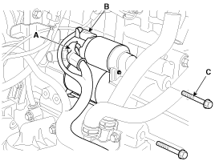

8. A instalação é o inverso da remoção.

## Desmontagem

1. Desconecte o terminal M (A) na montagem do interruptor magnético (B).

   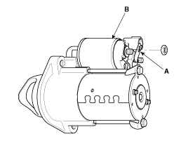

2. Depois de desafinar os parafusos (A), desmonte a montagem do interruptor magnético (B).

   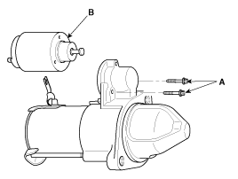

3. Desafine os parafusos através (A).

   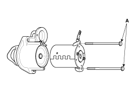

4. Remova a montagem do suporte do pincel (A), a yoke (B) e a armadura (C).

   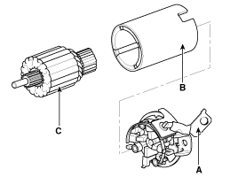

5. Remova a placa do leme (B) e o preenchimento do leme (A).

   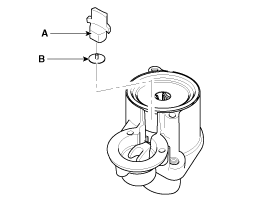

6. Desconecte o preenchimento (A) e a escudo (B).

   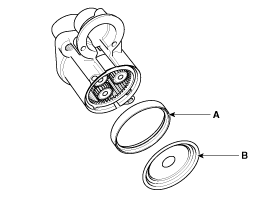

7. Desconecte o engranamento planetário (A).

   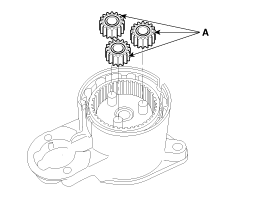

8. Desconecte a montagem do eixo planetário (ou montagem do reduzidor) (A) e o leme (B).

   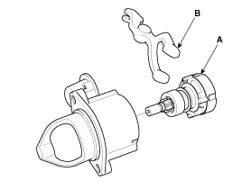

9. Com um fio de parafuso (B), empurre o parafuso (A).

   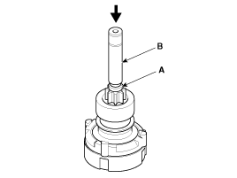

10. Após remover o anel de parada (A) usando tijolos de remoção de anel (B).

   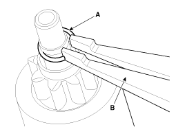

11. Desconecte o parafuso (A), a corrente de rotação (B), o engranamento interno (C), o eixo planetário (D) e/ou a folha de selo (E).

   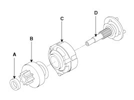

12. A montagem é o inverso da desmontagem.

   > **Nota**
   >
   > - Usando um ferramenta adequada de puxamento (A), puxe o parafuso de corrente de rotação (C) sobre o anel de parada (B).

   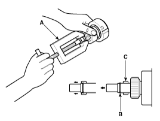

## Inspeção

Inspeção e Teste da Armadura

1. Remova o starter.

2. Desmonte o starter conforme mostrado no início deste procedimento.

3. Inspeção da armadura para desgaste ou danos causados pela contato com o
    magneto permanente. Se houver desgaste ou danos, substitua a armadura.

   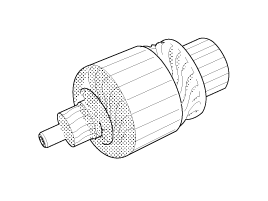

4. Verifique a superfície do commutador (A). Se a superfície estiver suja ou
   queimada, retifique com pano de esmeril ou lathe de acordo com as seguintes
   especificações, ou retifique com papel abrasivo #500 ou #600 (B).

   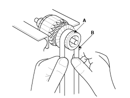

5. Medida do desvio do commutador (A).

   | • | Se o desvio do commutador estiver dentro do limite de serviço, inspecione o commutador para carbonização ou fósforo entre os segmentos. |
   | --- | --- |

   | • | Se o desvio do commutador estiver fora do limite de serviço, substitua a armadura. |
   | --- | --- |

   ```
   Desvio do commutador
   Padrão (Novo): 0,02mm (0,0007in.) máximo
   Limite de serviço: 0,05mm (0,0020in.)
   ```

   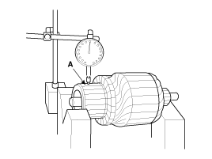

6. Verifique a profundidade do mica (A). Se o mica estiver muito alto (B),
   corte o mica com uma lâmina de sega para a profundidade correta. Corte toda
    a mica (C) entre os segmentos do commutador. O corte não deve ser muito
   profundo, estreito ou v-formado (D).

   ```
   Profundidade do mica do commutador
   Padrão (Novo): 0,7 ~ 0,9mm (0,0276 ~ 0,0354in)
   Limite: 0,4mm (0,0157 in.)
   ```

   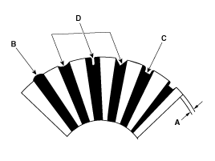

7. Verifique a continuidade entre os segmentos do commutador.
   Se uma circuito aberto existir entre quaisquer segmentos, substitua a armadura.

   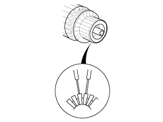

8. Verifique com um ohmímetro que não haja continuidade entre o commutador (A) e o núcleo do fio da armadura (B), e entre o commutador e o eixo da armadura (C). Se houver continuidade, substitua a armadura.

   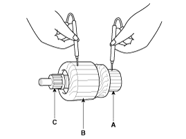

Inspeção dos Arrancadores

Arrancadores que estão danificados ou sujos devem ser substituídos.

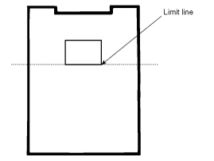

Teste do Arranque do Arrancador

Verifique que não haja continuidade entre a placa (-) (A)
e o suporte do pincel (+) (B). Se houver continuidade, substitua a montagem de suporte do pincel.

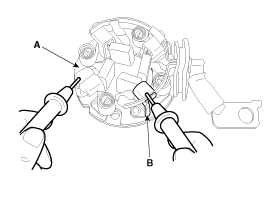

Inspeção do Clutch de Arranque

1. Deslize o clutch de arranque ao longo do eixo.

   Substitua se não deslizar suavemente.

2. Vire o clutch de arranque em ambas as direções.

   Ele trava em uma direção e roda suavemente na outra? Se não travar em nenhuma direção ou travar em ambas as direções, substitua.

   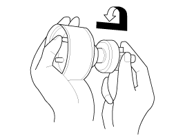

3. Se o dentes do engrenagem do arranque do starter estão danificados, substitua a montagem do clutch de arranque. (a engrenagem não está disponível separadamente).

   Verifique a condição do disco de rotação ou do anel do conversor de torque se os dentes da engrenagem do arranque do starter estiverem danificados.

Limpeza

1. Não imerga peças em solvente de limpeza. Imergir a montagem do yoke
   e/ou armadura danificará a isolamento. Limpe essas partes apenas com um pano.

2. Não imerga o conjunto de transmissão em solvente limpeza. A
   embreagem de sobrecarga está pré-óleo-lubrificada na fábrica e o solvente lavará a lubrificação da embreagem.

3. O conjunto de transmissão pode ser limpo com um pincel umedecido com solvente limpeza e secado com uma toalha.
