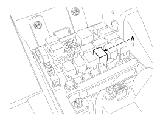
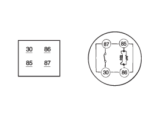

# Kia Sportage: Relé do Arranque: Procedimentos de Reparo

[Home](../../index.md) / [Manual de Serviço e Reparo do Kia Sportage SL](../sportage-482.md) / [Sistema Elétrico do Motor](sportage-530.md) / [Sistema de Arranque](sportage-546.md) / Procedimentos de Reparo do Relé do Arranque

## Inspeção

1. Remova a capa do caixa de fusíveis.

2. Remova o relé do arranque (A).

   

3. Usando um ohmmetro, verifique a continuidade entre cada terminal.

   | Terminal | Continuidade |
   | --- | --- |
   | 30 - 87 | NÃO |
   | 85 - 86 | SIM |

4. Aplicando 12V no terminal 85 e terra no terminal 86.

   Verifique a continuidade entre os terminais 30 e 87.

   

5. Se não houver continuidade, substitua o relé do arranque.

6. Instale o relé do arranque.

7. Instale a capa do caixa de fusíveis.
