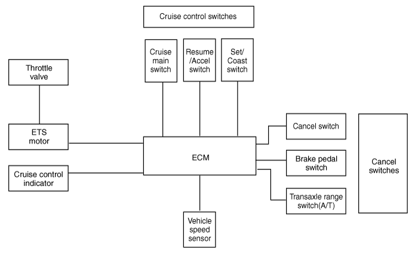

# Kia Sportage: Diagramas Schematicos

[Home](../../index.md) / [Manual de Serviço e Reparo do Kia Sportage SL](../sportage-482.md) / [Sistema Elétrico do Motor](sportage-530.md) / [Sistema de Controle de Velocidade Constante](sportage-553.md) / Diagramas Schematicos

## Diagrama de Bloco do Sistema

Esquema de Componentes e Funções

| Componente | Função |  |
| --- | --- | --- |
| Sensor de velocidade do veículo | Converte a velocidade do veículo em pulsos. |  |
| ECM | Recebe sinais dos sensores e interruptores de controle. |  |
| Indicador de Controle de Velocidade Constante | Ilumina quando o interruptor principal de CRUISE estiver ON (Integrado no cluster) |  |
| Interruptores de Controle de Velocidade Constante | Interruptor ON/OFF | Interruptor para alimentação do controle de velocidade automático. |
| Interruptor de Resumo/Aceleração | Controla as funções de controle de velocidade automático pelo interruptor de Resumo/Aceleração (Interruptor Set/Coast) |  |
| Interruptor Set/Coast |  |  |
| Interruptores Cancelar | Interruptor Cancelar | Envia sinais de cancelamento para o ECM. |
| Interruptor do pedal do freio |  |  |
| Interruptor do câmbio transaxle (AT) |  |  |
| Motor ETS | Regula o valveado do acelerador para a abertura estabelecida pelo ECM. |  |

* ETS : Sistema de Acelerador Eletrônico
