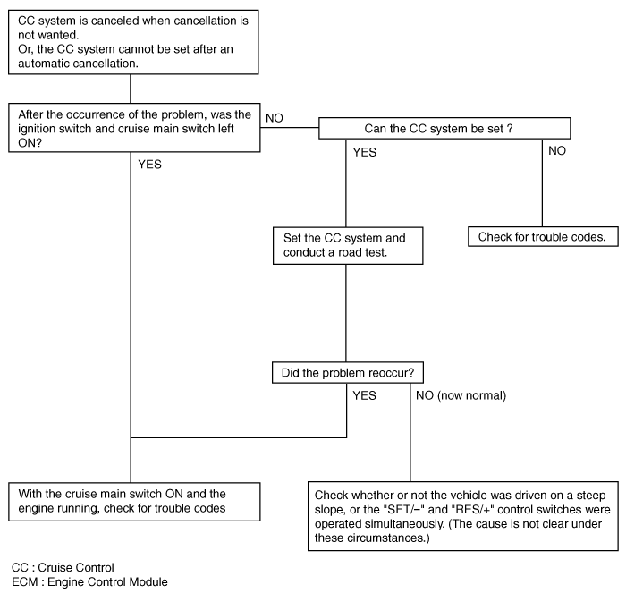

# Kia Sportage: Diagnóstico

[Home](../../index.md) / [Manual de Serviço e Reparo do Kia Sportage SL](../sportage-482.md) / [Sistema Elétrico do Motor](sportage-530.md) / [Sistema de Controle de Velocidade Constante](sportage-553.md) / Diagnóstico

## Diagramas de Sintomas de Falha

Sintoma de Falha 1

Sintoma de Falha 2

| Sintoma de Falha | Causa Provável | Remédio |
| --- | --- | --- |
| A velocidade do veículo definida oscila fortemente para cima ou para baixo "Surging" (aceleração e desaceleração repetidas e alternadas) ocorre após a definição | Falha no circuito do sensor de velocidade do veículo | Repare o sistema do sensor de velocidade do veículo, ou substitua a peça |
| Falha no circuito de entrada e saída do ECM | Verifique os sinais de entrada e saída no ECM |  |

Sintoma de Falha 3

| Sintoma de Falha | Causa Provável | Remédio |
| --- | --- | --- |
| O sistema CC não é cancelado quando o pedal do freio é pressionado | Conectividade danificada ou desconectada do sensor do pedal do freio | Repare o harness ou substitua o sensor do pedal do freio |
| Falha nos sinais de entrada e saída do ECM | Verifique os sinais de entrada e saída no ECM |  |

Sintoma de Falha 4

| Sintoma de Falha | Causa Provável | Remédio |
| --- | --- | --- |
| O sistema CC não é cancelado quando a alavanca de câmbio é movida para a posição "N" (no entanto, é cancelado quando o pedal do freio é pressionado) | Conectividade danificada ou desconectada do circuito de entrada da alavanca de inibição | Repare o harness ou conserte ou substitua a alavanca de inibição |
| Ajuste inadequado da alavanca de inibição |  |  |
| Falha nos sinais de entrada e saída do ECM | Verifique os sinais de entrada e saída no ECM |  |

Sintoma de Falha 5

| Sintoma de Falha | Causa Provável | Remédio |
| --- | --- | --- |
| Não é possível desacelerar (coast) usando o botão "SET/–" | Conectividade temporariamente danificada ou desconectada do circuito de entrada do botão "SET/–" | Repare o harness ou substitua o botão "SET/–" |
| Falha nos sinais de entrada e saída do ECM | Verifique os sinais de entrada e saída no ECM |  |

Sintoma de Falha 6

| Sintoma de Falha | Causa Provável | Remédio |
| --- | --- | --- |
| Não é possível acelerar ou retomar a velocidade usando o botão "RES/+" | Conectividade danificada ou desconectada, curto-circuito, ou circuito de entrada do botão "RES/+" | Repare o harness ou substitua o botão "RES/+" |
| Falha nos sinais de entrada e saída do ECM | Verifique os sinais de entrada e saída no ECM |  |

Sintoma de Falha 7

| Sintoma de Falha | Causa Provável | Remédio |
| --- | --- | --- |
| O sistema CC pode ser definido enquanto o veículo está em movimento a uma velocidade inferior a 40km/h (25mph), ou não há cancelamento automático nessa velocidade | Falha no circuito do sensor de velocidade do veículo | Repare o sistema do sensor de velocidade do veículo, ou substitua a peça |
| Falha nos sinais de entrada e saída do ECM | Verifique os sinais de entrada e saída no ECM |  |

Sintoma de Falha 8

| Sintoma de Falha | Causa Provável | Remédio |
| --- | --- | --- |
| A lâmpada indicadora do botão principal do CC não ilumina (mas o sistema CC está normal) | Conectividade danificada ou desconectada da lâmpada do botão principal do CC | Repare o harness ou substitua a peça. |
| Conectividade danificada ou desconectada do harness |  |  |
