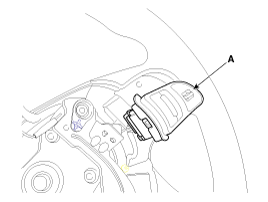
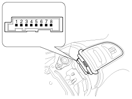

# Kia Sportage: Controle de Velocidade Cruise Control: Procedimentos de Reparo

[Home](../../index.md) / [Manual de Serviço e Reparo do Kia Sportage SL](../sportage-482.md) / [Sistema Elétrico do Motor](sportage-530.md) / [Sistema de Controle de Velocidade Cruise Control](sportage-553.md) / Procedimentos de Reparo do Controle de Velocidade Cruise Control

## Remoção e Instalação

1. Desconecte o terminal (-) da bateria.

   ```
   Torque de aperto:
   Sem sensor da bateria:
   7,8 ~ 9,8 N.m (0,8 ~ 1,0 kgf.m, 5,8 ~ 7,2 lb-ft)
   Com sensor da bateria:
   4,0 ~ 6,0 N.m (0,4 ~ 0,6 kgf.m, 3,0 ~ 4,4 lb-ft)
   ```

2. Remova o módulo do air-bag do volante. (Consulte o grupo RT)

3. Remova o volante. (Consulte o grupo ST)

4. Remova o interruptor de controle de velocidade (A) após desafivelar as 2 parafusagens e desconectar a conexão do interruptor.

   

5. A instalação deve ser feita na ordem inversa da remoção.

## Inspeção

Medição de Resistência

1. Desconecte a conexão do interruptor de controle de velocidade do interruptor.

   

2. Medir a resistência entre os terminais do interruptor de controle de velocidade quando cada interruptor de função estiver ON (interruptor pressionado).

   | Interruptor de função | Terminal | Resistência |
   | --- | --- | --- |
   | CANCEL | 6 - 7 | 0? ± 5% |
   | SET/– | 6 - 7 | 220? ± 5% |
   | RES/+ | 6 - 7 | 910? ± 5% |
   | ON/OFF | 7 - 8 | 3900? ± 5% |

3. Se não estiver dentro da especificação, substitua o interruptor.

Medição de Tensão

1. Conecte a conexão do interruptor de controle de velocidade ao interruptor.

2. Medir a tensão entre os terminais do conectador do harness quando cada interruptor de função estiver ON (interruptor pressionado).

   | Interruptor de função | Terminal | Tensão |
   | --- | --- | --- |
   | CANCEL | 6 - 7 | 0,0 ± 0,22V |
   | SET/– | 6 - 7 | 1,5 ± 0,22V |
   | RES/+ | 6 - 7 | 3,0 ± 0,22V |
   | ON/OFF | 7 - 8 | - |

3. Se não estiver dentro da especificação, inspecione a resistência do interruptor de controle de velocidade.

   O valor de medição de resistência não está dentro da especificação, substitua o interruptor e mede a tensão novamente.

4. Se a resistência estiver ok, mas a medição de tensão não estiver dentro da especificação, inspecione o fio de alimentação e as conexões entre o interruptor e o ECM.
