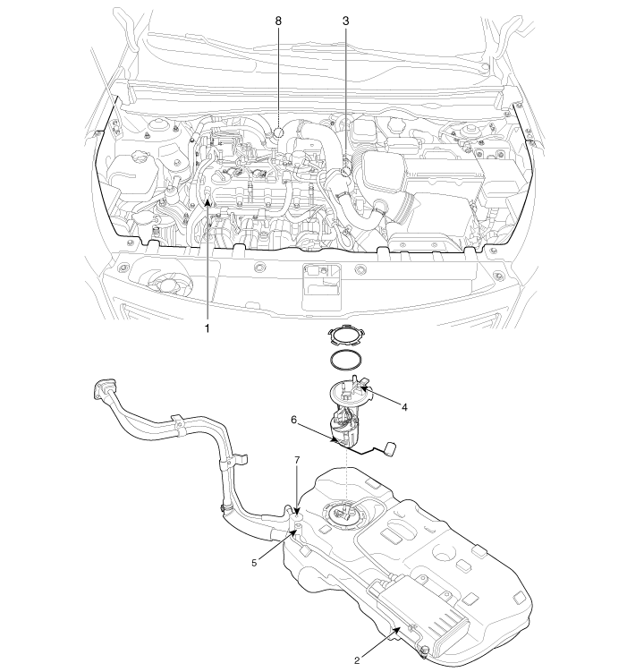

# Kia Sportage: Componentes e Localização dos Componentes

[Home](../../index.md) / [Manual de Serviço e Reparo do Kia Sportage SL](../sportage-482.md) / [Sistema de Controle da Emissão](sportage-559.md) / [Informações Gerais](sportage-560.md) / Componentes e Localização dos Componentes

## Localização dos Componentes

| 1. Válvula PCV 2. Canister 3. Válvula de controle de purga do solenoide (PCSV) 4. Sensor de pressão do tanque de combustível (FTPS) | 5. Válvula de fechamento do canister (CCV) 6. Sensor de nível do tanque de combustível (FLS) 7. Filtro de ar do tanque de combustível 8. Conversor catalítico (CCC) |
| --- | --- |

| 1. Válvula PCV | 2. Canister |
| --- | --- |
| 3. Válvula de controle de purga do solenoide (PCSV) | 4. Sensor de pressão do tanque de combustível (FTPS) |
| 5. Válvula de fechamento do canister (CCV) 7. Filtro de ar do tanque de combustível | 6. Sensor de nível do tanque de combustível (FLS) |
| 8. Conversor catalítico (CCC) |  |
