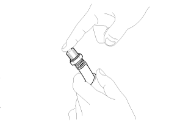

# Kia Sportage: Procedimentos de Reparo

[Início](../../index.md) / [Manual de Serviço e Reparo do Kia Sportage SL](../sportage-482.md) / [Sistema de Controle de Emissão](sportage-559.md) / [Sistema de Controle de Emissão do Casco do Motor](sportage-566.md) / Procedimentos de Reparo

## Inspeção

1. Após desconectar a mangueira de vapor do valve PCV, remova o valve PCV.

2. Reconecte o valve PCV à mangueira de vapor.

3. Inicie o motor e deixe-o em idle, depois cubra o final aberto do valve PCV com o polegar e verifique se é possível sentir o vácuo no tubo de admissão.

   > **Nota**
   >
   > - O plunger dentro do valve PCV se moverá de frente para trás sob vácuo.

   

4. Se o vácuo não for sentido, inspecione a operação do PCV. Se estiver operando corretamente, limpe ou substitua a mangueira de vapor.
