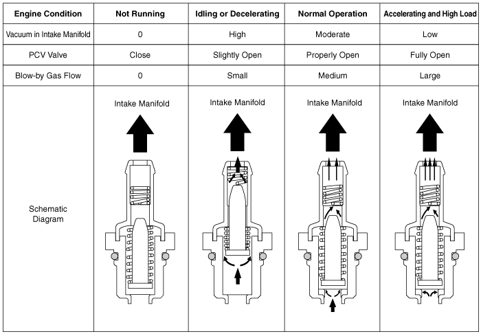

# Kia Sportage: Valvula de Ventilação Crânica Positiva (PCV): Descrição e Operação

[Início](../../index.md) / [Manual de Serviço e Reparo do Kia Sportage SL](../sportage-482.md) / [Sistema de Controle de Emissão](sportage-559.md) / [Sistema de Controle de Emissão do Crânio](sportage-566.md) / Valvula de Ventilação Crânica Positiva (PCV): Descrição e Operação

## Princípio de Operação

