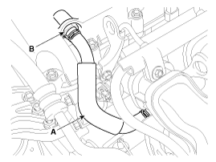
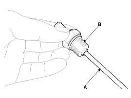

# Kia Sportage: Valvula de Ventilação Crânica Positiva (PCV): Procedimentos de Reparo

[Home](../../index.md) / [Manual de Serviço e Reparo do Kia Sportage SL](../sportage-482.md) / [Sistema de Controle de Emissão](sportage-559.md) / [Sistema de Controle de Emissão do Crânio](sportage-566.md) / Valvula de Ventilação Crânica Positiva (PCV): Procedimentos de Reparo

## Remoção

1. Desconecte a mangueira de vapor (A).

2. Remova a valvula PCV (B).

   

## Inspeção

1. Insira um palito fino (A) na valvula PCV (B) pelo lado threadado para verificar o movimento do plunger.

   

   > **Nota**
   >
   > - Se o plunger não mover (valvula PCV obstruída), limpe ou substitua a valvula.

## Instalação

1. A instalação é o inverso da remoção.

   ```
   Instalação da Valvula PCV:
   1,9 ~ 2,8 N.m (0,19 ~ 0,29 kgf.m, 1,4 ~ 2,1 lb-ft)
   ```
