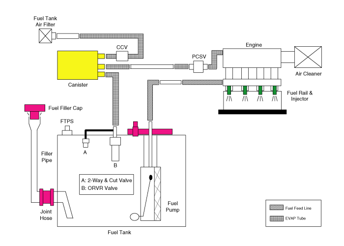
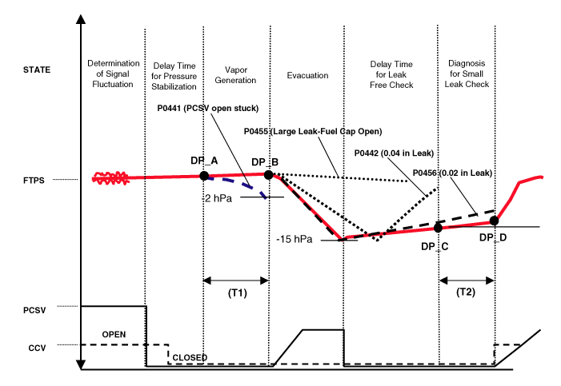
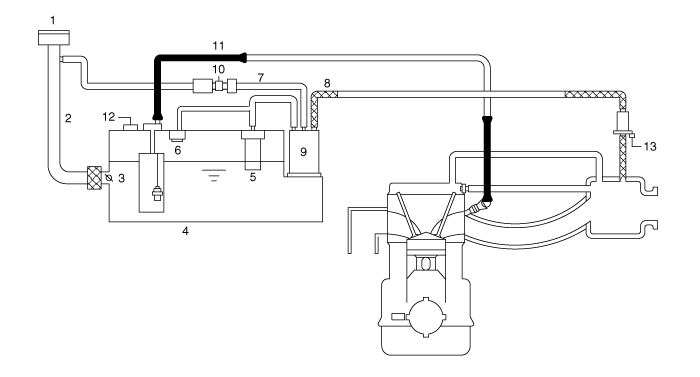

# Kia Sportage: Diagramas Esquemáticos

[Home](../../index.md) / [Manual de Serviço e Reparo do Kia Sportage SL](../sportage-482.md) / [Sistema de Controle das Emissões](sportage-559.md) / [Sistema de Controle das Emissões Evaporativas](sportage-571.md) / Diagramas Esquemáticos

## Diagrama Esquemático

Canister

O Canister é preenchido com carvão e absorve vapores de combustível evaporados do tanque de combustível. Os vapores de combustível coletados no canister são sugados para o manifold de admissão pelo ECM/PCM quando as condições apropriadas são estabelecidas.

Valvula de Controle de Purga (PCSV)

A Valvula de Controle de Purga (PCSV) está instalada no canal que conecta o canister ao manifold de admissão. É uma válvula de tipo de dever e é operada por sinal do ECM/PCM.

Para sugar os vapores absorvidos para o manifold de admissão, o ECM/PCM abrirá a PCSV, caso contrário, o canal permanecerá fechado.

Copo de Enchimento de Combustível

Um dispositivo de aperto com engrenagem no copo de enchimento de combustível reduz as chances de instalação incorreta, ao selar o copo. Após o selo do selo do copo de enchimento e da flange do bocal de enchimento entrar em contato, o engrenagem produz um clique alto indicando que o selo foi estabelecido.

Sensor de Pressão do Tanque de Combustível (FTPS)

O Sensor de Pressão do Tanque de Combustível (FTPS) é uma parte integral do sistema de monitoramento. O FTPS verifica a operação da Valvula de Controle de Purga (PCSV) e furos no Sistema de Emissão Evaporativa pelo monitoramento da pressão e nível de vácuo no tanque de combustível durante os ciclos de operação da PCSV.

Valvula de Fechamento do Canister (CCV)

A Valvula de Fechamento do Canister (CCV) está localizada entre o canister e o filtro de ar do tanque de combustível. Ela fecha a entrada de ar para o canister do Sistema de Emissão Evaporativa e também previne a fuga de vapores de combustível do Canister quando o veículo não está em operação.

Monitoramento do Sistema Evaporativo

O Sistema de Monitoramento de Emissão Evaporativa monitora a geração de vapores de combustível, a evacuação e um passo de verificação de vazamento. Primeiro, o sistema OBD-II verifica se a geração de vapores devido à temperatura do combustível é pequena o suficiente para iniciar o monitoramento. Em seguida, ele evacua o sistema evaporativo através da PCSV com rampa para manter um certo nível de vácuo. O último passo é verificar se há perda de vácuo devido a qualquer vazamento no sistema.

Verificação da Geração de Vapores

Durante o período de estabilização, a PCSV e o CCV estão fechados. A pressão do sistema é medida como pressão inicial (DP_A). Após um período definido (T1), a pressão do sistema (DP_B) é medida novamente e a diferença em relação à pressão inicial é calculada. Se essa diferença (DP_B - DP_A) for maior que o limiar, deve haver uma pressão de vapores excessiva e o monitoramento será interrompido para a próxima verificação. Caso contrário, se a diferença for menor que o limiar negativo, a PCSV será considerada como malfuncionante, como obstruída no estado aberto.

Evacuação

A PCSV é aberta com uma certa rampa para a pressão chegar a um certo nível. Se a pressão não puder ser reduzida abaixo de um limiar, o sistema será considerado como tendo uma tampa de enchimento de combustível aberta ou um grande vazamento.

Verificação de Vazamento

A PCSV é fechada e o sistema aguarda um período para obter

estabilidade da pressão. Durante o período de verificação (T2), o sistema mede
o início e o fim da pressão do sistema (DP_C, DP_D). O valor de diagnóstico é a
diferença de pressão corrigida pela taxa natural de geração de vapor (DP_B - DP_A)
do passo de verificação de geração de vapor.

Monitoramento do Sistema Evaporativo

Sistema de Controle de Emissão Evaporativa e ORVR

Este sistema consiste em um valve de enchimento, um valve de corte de combustível,
um valve de corte de combustível (para rolamento), um valve de dois caminhos (alívio de
pressão/vacuum), um separador de líquido/vapor de combustível, que é instalado ao lado
do tubo de enchimento, um canister de carvão, que está montado sob o membro do lado esquerdo
da parte inferior do chassi e protetor, tubos e conexões variadas.

Ao abastecer, o ar ambiente é aspirado pelo tubo de enchimento para
não emitir vapores de combustível no ar. O vapor de combustível na tanque é
então forçado a fluir para o canister através do valve de enchimento. O separador de
líquido/vapor de combustível isola o combustível líquido e passa o vapor puro para
o canister de carvão.

Enquanto o motor está em operação, o vapor retido no
canister é aspirado para o manifold de admissão e então para o câmbio de combustão do
motor. Usando este processo de purga, o canister de carvão é purgado e recupera sua
capacidade de absorção.

| 1. Capacete de Enchimento de Combustível 2. Tubo de Enchimento de Combustível 3. Valve de Corte de Combustível 4. Tanque de Combustível 5. Valve ORVR 6. Valve de Dois Caminhos & Corte 7. Tubo Evaporativo | 8. Tubo Evaporativo 9. Canister 10. Valve de Fechamento do Canister (CCV) 11. Linha de Suprimento de Combustível 12. Sensor de Pressão do Tanque de Combustível (FTPS) 13. Valve de Solenoide de Controle de Purga (PCSV) |
