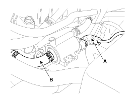
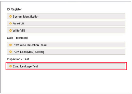
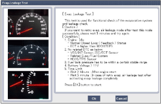

# Kia Sportage: Procedimentos de Reparo

[Home](../../index.md) / [Manual de Serviço e Reparo do Kia Sportage SL](../sportage-482.md) / [Sistema de Controle da Emissão](sportage-559.md) / [Sistema de Emissão Evaporativa](sportage-571.md) / Procedimentos de Reparo

## Inspeção

[System Inspection]

1. Desconecte a mangueira de vapor do manifold de admissão e conecte um bomba de vácuo na rosca do manifold de admissão.

   · Em Motor Frio [Temperatura do Coolante do Motor < 60°C (140°F)]

   | Condição de Operação do Motor | Vácuo Aplicado | Resultado |
   | --- | --- | --- |
   | Idle | Min. 20 inHg (Min. 0.7 kgf/cm?, Min. 67.7 kPa) | Vácuo mantido |
   | 3.000 rpm | | |

2. Verifique os seguintes pontos com vácuo aplicado na válvula de controle do sistema de purga (PCSV).

   · Em Motor Quente [Temperatura do Coolante do Motor > 80°C (176°F)]

   | Condição de Operação do Motor | Vácuo Aplicado | Resultado |
   | --- | --- | --- |
   | Idle | Min. 20 inHg (Min. 0.7 kgf/cm?, Min. 67.7 kPa) | Vácuo mantido |
   | Nos 3 minutos após o início do motor a 3.000 rpm | Tente aplicar vácuo | Vácuo liberado |
   | Nos 3 minutos após o início do motor a 3.000 rpm | Min. 20 inHg (Min. 0.7 kgf/cm?, Min. 67.7 kPa) | Vácuo será mantido por um momento, após o qual será liberado |

[PCSV Inspection]

1. Desligue o interruptor de ignição e desconecte o cabo negativo (-) da bateria.

2. Desconecte o conectador do PCSV (A).

3. Desconecte a mangueira de vapor (B) conectada ao manifold de admissão do PCSV.

   

4. Após conectar a bomba de vácuo na rosca, aplique vácuo.

5. Com a linha de controle do PCSV conectada ao solo, verifique a operação da válvula com a tensão da bateria aplicada ao PCSV (Aberto) e removida (Fechado).

   | Tensão da Bateria | Válvula | Vácuo |
   | --- | --- | --- |
   | Conectada | Aberto | Liberado |
   | Desconectada | Fechado | Mantido |

6. Mede a resistência do bobino do PCSV.

   ```
   Especificações:
   19,0 ~ 22,0? [20°C (68°F)]
   ```

[EVAP. Teste de Perda]

1. Selecione "Teste de Perda de Evap.".

   

2. Proceda com o teste de acordo com as introduções na tela.

   
