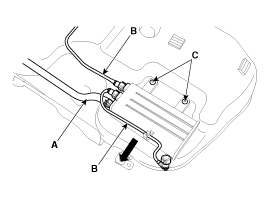
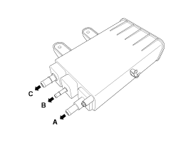

# Kia Sportage: Canister: Procedimentos de Reparo

[Home](../../index.md) / [Manual de Serviço e Reparo do Kia Sportage SL](../sportage-482.md) / [Sistema de Controle de Emissão](sportage-559.md) / [Sistema de Emissão Evaporativa](sportage-571.md) / Procedimentos de Reparo do Canister

## Remoção

1. Remova o tanque de combustível. (Consulte "Tanque de Combustível" no grupo FL.)

2. Desconecte o quick-connector do tubo de vapor (B) e a mangueira de ventilação (A).

3. Remova o canister na direção do seta após remover as engrenagens de fixação (C).

   

## Inspeção

1. Verifique os seguintes itens visualmente.

   - Fendas ou vazamentos no canister

   - Conexões soltas, distorções ou danos na mangueira/tubo de vapor

   

   A: Canister - Atmosfera

   B: Canister - Manifold de Admissão

   C: Canister - Tanque de Combustível

## Instalação

A instalação é o inverso da remoção.

```
Engrenagem de fixação do canister:
1,96 ~ 2,94 N.m (0,2 ~ 0,3 kgf.m, 1,45 ~ 2,17 lb-ft)
```
