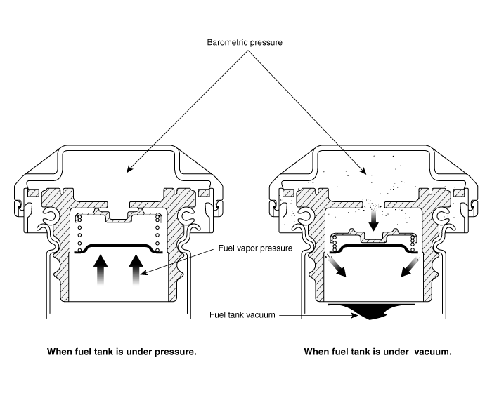

# Kia Sportage: Capo de Admissão de Combustível: Descrição e Operação

[Home](../../index.md) / [Manual de Serviço e Reparo do Kia Sportage SL](../sportage-482.md) / [Sistema de Controle de Emissão](sportage-559.md) / [Sistema de Controle de Emissão Evaporativa](sportage-571.md) / Capo de Admissão de Combustível: Descrição e Operação

## Descrição

Um dispositivo de aperto com engrenagem no capo de admissão de combustível com rosca reduz as chances de instalação incorreta, que selam o capo de admissão. Após o selante no capo de admissão e o flancos do pescoço do capo de admissão entrarem em contato, a engrenagem produz um som de clique alto indicando que o selo foi estabelecido.

