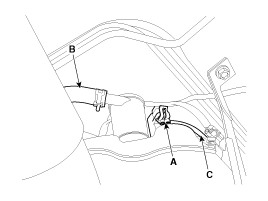
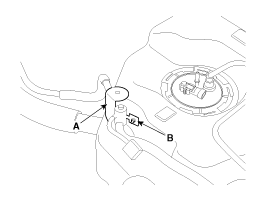
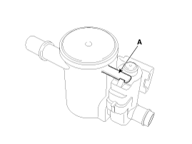
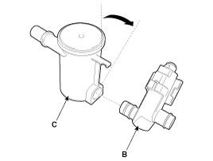

# Kia Sportage: Filtro de Ar do Tanque de Combustível: Procedimentos de Reparo

[Home](../../index.md) / [Manual de Serviço e Reparo do Kia Sportage SL](../sportage-482.md) / [Sistema de Controle de Emissão](sportage-559.md) / [Sistema de Emissão Evaporativa](sportage-571.md) / Procedimentos de Reparo do Filtro de Ar do Tanque de Combustível

## Remoção

1. Desligue a ignição e desconecte o cabo negativo (-) da bateria.

2. Levante o veículo com um garfo.

3. Desconecte o conectador do valveador de tanque de combustível (A).

4. Desconecte o hose de ventilação (B) e o hose de vapor (C).

   

5. Remova a montagem do filtro de ar do tanque de combustível e do valveador de tanque de combustível (A) após remover o parafuso de instalação (B).

   

6. Libere o leva (A), e então separe o valveador de tanque de combustível (B) do filtro de ar do tanque de combustível (C) após girá-lo na direção do seta na figura.

   

   

7. Instale um novo filtro de ar do tanque de combustível na ordem inversa.

## Instalação

A instalação é a inversa da remoção.

```
Parafuso do suporte do filtro de ar do tanque de combustível: 4,8 ~ 5,2 N.m (0,5 ~ 0,53 kgf.m, 3,54 ~ 3,84 lb-ft)
```
