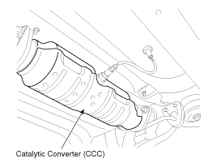

# Kia Sportage: Conversor Catalítico: Descrição e Operação

[Home](../../index.md) / [Manual de Serviço e Reparo do Kia Sportage SL](../sportage-482.md) / [Sistema de Controle de Emissão](sportage-559.md) / [Sistema de Emissão de Exaustão](sportage-578.md) / Conversor Catalítico: Descrição e Operação

## Descrição

O conversor catalítico do motor a gasolina é um catalisador de três vias. Oxida o monóxido de carbono e os hidrocarbonetos (HC), e separa o oxigênio dos oxidos de nitrogênio (NOx).

Existem dois tipos de catalisador de três vias; tipo Palette e tipo Monolith.

