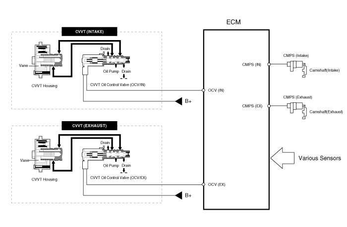
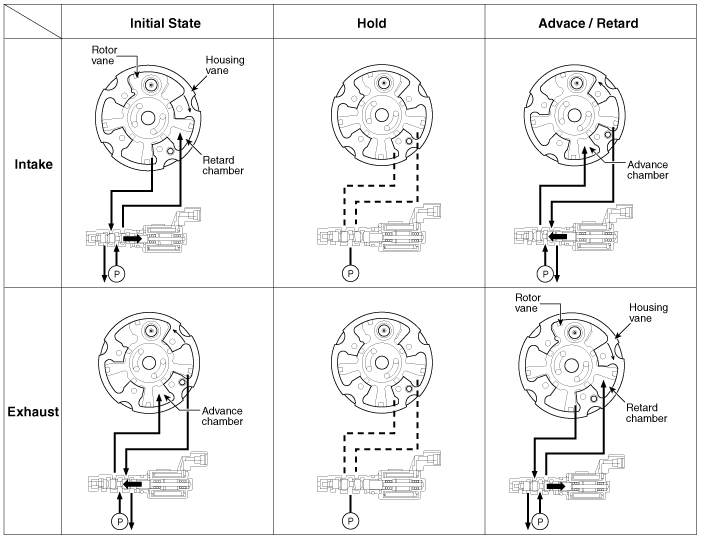
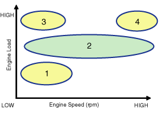

# Kia Sportage: Sistema CVVT (Timing Variável Continuamente Variável): Descrição e Operação

[Home](../../index.md) / [Manual de Serviço e Reparo do Kia Sportage SL](../sportage-482.md) / [Sistema de Controle de Emissão](sportage-559.md) / [Sistema de Emissão de Esgotos](sportage-578.md) / Sistema CVVT (Timing Variável Continuamente Variável): Descrição e Operação

## Descrição

O sistema de Timing Variável Continuamente Variável (CVVT) avança ou
retarda o timing dos válvulas de admissão e exaustão de acordo com o sinal de controle do ECM, que é calculado com base na velocidade do motor e no carregamento.

Controlando o CVVT, ocorre o overlap ou underlap das válvulas, o que melhora a economia de combustível e reduz as emissões de gases de escape (NOx, HC) e melhora o desempenho do motor através da redução da perda de bombagem, do efeito de EGR interno, da estabilidade da combustão, da eficiência volumétrica e do trabalho de expansão.

Este sistema consiste em

| – | o Valvulário de Controle de Óleo CVVT (OCV) que fornece óleo do motor ao faseador do cárter ou esvazia o óleo do motor do faseador do cárter de acordo com o sinal de controle PWM (Pulse Width Modulation) do ECM, |
| --- | --- |

| – | e o Faseador do Cárter, que varia o faseamento do cárter usando a força hidráulica do óleo do motor. |
| --- | --- |

O óleo do motor que sai do valvulário de controle de óleo CVVT varia o faseamento do cárter no sentido (Avanço de Admissão/Retardo de Exaustão) ou sentido oposto (Retardo de Admissão/Avanço de Exaustão) da rotação do motor, rotacionando o rotor conectado ao cárter do cárter dentro do faseador do cárter.

## Princípio de Operação

O CVVT tem o mecanismo de rotacionar o vano do rotor com a força hidráulica gerada pelo óleo do motor suprido ao câmara de avanço ou retardamento de acordo com o controle do valvulário de controle de óleo CVVT.

## [Modo do Sistema CVVT]

| (1) Baixa Velocidade / Baixo Carregamento | (2) Carregamento Parcial |
| --- | --- |
| (3) Baixa Velocidade / Alto Carregamento | (4) Alta Velocidade / Alto Carregamento |

| Condição de Direção | Válvula de Exaustão | Válvula de Admissão |  |  |
| --- | --- | --- | --- | --- |
| Timing da Válvula | Efeito | Timing da Válvula | Efeito |  |
| (1) Baixa Velocidade / Baixo Carregamento | Avanço Completo | * Melhoria da Estabilidade da Combustão * Overlap da Válvula * Melhoria da Estabilidade da Combustão | Retardo Completo | * Overlap da Válvula * Melhoria da Estabilidade da Combustão |
| (2) Carregamento Parcial | Retardo | * Aumento do Trabalho de Expansão * Redução da Perda de Bombagem * Redução de HC | Retardo | * Redução da Perda de Bombagem |
| (3) Baixa Velocidade / Alto Carregamento | Retardo | * Aumento do Trabalho de Expansão | Avanço | * Prevenção do Retrocesso do Ar de Admissão (Melhoria da Eficiência Volumétrica) |
| (4) Alta Velocidade / Alto Carregamento | Avanço | * Redução da Perda de Bombagem | Retardo | * Melhoria da Eficiência Volumétrica |
