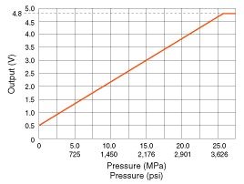

# Kia Sportage: Especificações

[Home](../../index.md) / [Manual de Serviço e Reparo do Kia Sportage SL](../sportage-482.md) / [Controle do Motor / Sistema de Combustível](sportage-582.md) / [Informações Gerais](sportage-583.md) / Especificações

## Especificações

Sistema de Entrega de Combustível

| Itens | Especificação |  |
| --- | --- | --- |
| Tanque de Combustível | Capacidade | 55 lit. (14,5 U.S.gal., 58,1 U.S.qt., 48,4 Imp.qt.) |
| Filtro de Combustível | Tipo | Tipo de papel |
| Pressão de Combustível | Linha de Pressão Baixa de Combustível | 493 ~ 507 kPa (5,0 ~ 5,2 kgf/cm?, 71,5 ~ 73,5 psi) |
| Linha de Pressão Alta de Combustível | 2,0 ~ 15,0 MPa (20,4 ~ 153,0 kgf/cm?, 290,1 ~ 2.175,6 psi) |  |
| Bomba de Combustível | Tipo | Elétrica, tipo de tanque |
| Puxado por | Motor elétrico |  |
| Bomba de Combustível de Pressão Alta | Tipo | Tipo mecânico |
| Puxado por | Câmara do motor |  |

Sensores

Sensor de Pressão do Manifold Absoluto (MAPS) #1

? Tipo: Sensor de pressão piezo-resistivo

? Especificação

| Pressão [kPa (kgf/cm?, psi)] | Voltagem de Saída (V) |
| --- | --- |
| 20,0 (0,20, 2,9) | 0,79 |
| 46,7 (0,47, 6,77) | 1,84 |
| 101,3 (1,03, 14,7) | 4,0 |

Sensor de Temperatura do Ar de Admissão (IATS)

? Tipo: Tipo de termistor

? Especificação

| Temperatura | Resistência (k?) |  |
| --- | --- | --- |
| °C | °F |  |
| -40 | -40 | 40,93 ~ 48,35 |
| -20 | -4 | 13,89 ~ 16,03 |
| 0 | 32 | 5,38 ~ 6,09 |
| 10 | 50 | 3,48 ~ 3,90 |
| 20 | 68 | 2,31 ~ 2,57 |
| 40 | 104 | 1,08 ~ 1,21 |
| 50 | 122 | 1,56 ~ 1,74 |
| 60 | 140 | 0,54 ~ 0,62 |
| 80 | 176 | 0,29 ~ 0,34 |

Sensor de Pressão do Manifold Absoluto (MAPS) #2

? Tipo: Sensor de pressão piezo-resistivo

? Especificação

| Pressão [kPa (kgf/cm?, psi)] | Voltagem de Saída (V) |
| --- | --- |
| 20,0 (0,20, 2,9) | 0,79 |
| 46,7 (0,47, 6,77) | 1,84 |
| 101,3 (1,03, 14,7) | 4,0 |

Sensor de Temperatura do Coolante do Motor (ECTS)

? Tipo: Tipo de termistor

? Especificação

| Temperatura | Resistência (k?) |  |
| --- | --- | --- |
| °C | °F |  |
| -40 | -40 | 48,14 |
| -20 | -4 | 14,13 ~ 16,83 |
| 0 | 32 | 5,79 |
| 20 | 68 | 2,31 ~ 2,59 |
| 40 | 104 | 1,15 |
| 60 | 140 | 0,59 |
| 80 | 176 | 0,32 |

Sensor de Posição do Acelerador (TPS) [integrado no módulo ETC]

? Tipo: Tipo de resistência variável

? Especificação

| Ângulo do Acelerador (°) | Voltagem de Saída (V) [Vref = 5,0V] |  |
| --- | --- | --- |
| TPS1 | TPS2 |  |
| 0 | 0 | 5,0 |
| 10 | 0,48 | 4,52 |
| 20 | 0,95 | 4,05 |
| 30 | 1,43 | 3,57 |
| 40 | 1,90 | 3,10 |
| 50 | 2,38 | 2,62 |
| 60 | 2,86 | 2,14 |
| 70 | 3,33 | 1,67 |
| 80 | 3,81 | 1,19 |
| 90 | 4,29 | 0,71 |
| 100 | 4,76 | 0,24 |
| 105 | 5,0 | 0 |

| Item | C.T | W.O.T |  |
| --- | --- | --- | --- |
| TPS1 | Ângulo do Acelerador (°) | 6,3 ~ 14,7 | 93,45 ~ 101,85 |
| Voltagem de Saída [Vref=5V] | 0,3 ~ 0,7 | 4,45 ~ 4,85 |  |
| TPS2 | Ângulo do Acelerador (°) | 90,3 ~ 98,7 | 3,15 ~ 11,55 |
| Voltagem de Saída [Vref=5V] | 4,3 ~4,7 | 0,15 ~ 0,55 |  |

| Item | Resistência (k?) |
| --- | --- |
| TPS | 0,875 ~ 1,625 [20°C(68°F)] |

Sensor de Posição da Câmara do Motor (CKPS)

? Tipo: Tipo de efeito Hall

Sensor de Posição da Câmara do Motor (CMPS)

? Tipo: Tipo de efeito Hall

Sensor de Chacoalhamento (KS)

? Tipo: Tipo de eletroacústico piezoelétrico

? Especificação

| Item | Especificação |
| --- | --- |
| Capacitância (pF) | 850 ~ 1.150 |

Sensor de Oxigênio Quente (HO2S) [Banco 1/Sensor 1]

? Tipo: Tipo de zircônia (ZrO2) [Linear]

| Item | Especificação |
| --- | --- |
| Resistência do Aquecedor (?) | 2,5 ~ 4,0 [20°C(69,8°F)] |

Sensor de Oxigênio Quente (HO2S) [Banco 1/Sensor 2]

? Tipo: Zircônia (ZrO2) [Binário]

? Especificação

| Razão A/F (?) | Saída de Voltagem (V) |
| --- | --- |
| RICHO | Aproximadamente 0,9 |
| MAGRO | Aproximadamente 0,04 |

| Item | Especificação |
| --- | --- |
| Resistência do Aquecedor (?) | 3,3 ~ 4,1 [21°C(69,8°F)] |

Sensor de Pressão do Tanque de Combustível (RPS)

? Tipo: Tipo piezoelétrico

? Especificação

Sensor de Posição do EWGA [integrado no Actuador de Porta de Esgoto Elétrico (EWGA)]

? Tipo: Efeito Hall, Tipo Não Contato

? Especificação

| Posição | Saída de Voltagem [V] | Ângulo de Operação[°] | Intervalo do Cilindro [mm], referência |
| --- | --- | --- | --- |
| Posição de Parada do Cilindro Mecânico (MCP) | 4,8 | 0 | 0 |
| Posição de Parada do Cilindro Elétrico (ECP) | 4,2 | 12 | 1,8 |
| Posição de Parada do Cilindro Aberto (EOP) | 1 | 79 | 16 |
| Posição de Parada do Cilindro Mecânico (MOP) | 0,5 | 90 | 18 |

Sensor de Temperatura do Óleo do CVVT (OTS)

? Tipo: Tipo termistor

? Especificação

| Temperatura [°C(°F)] | Resistência (k?) |
| --- | --- |
| -40(-40) | 52,15 |
| -20(-4) | 16,52 |
| 0(32) | 6 |
| 20(68) | 2,45 |
| 40(104) | 1,11 |
| 60(140) | 0,54 |
| 80(176) | 0,29 |

Sensor de Posição do Acelerador (APS)

? Tipo: Tipo resistivo variável

? Especificação

| Posição do Acelerador | Saída de Voltagem (V) |  |
| --- | --- | --- |
| APS1 | APS2 |  |
| C.T | 0,7 ~ 0,8 | 0,29 ~ 0,46 |

Sensor de Pressão do Tanque de Combustível (FTPS)

? Tipo: Tipo resistividade piezoelétrico

? Especificação

| Pressão [kPa (kgf/cm?, in H2O)] | Saída de Voltagem (V) |
| --- | --- |
| -6,67 (-0,068, -26,8) | 0,5 |
| 0 | 2,5 |
| +6,67 (0,068, 26,8) | 4,5 |

Atuadores

 injetor

? Especificação

| Item | Especificação |
| --- | --- |
| Resistência do Coil (?) | 1,25 [20°C(68°F)] |

Motor ETC [integrado no Module ETC]

? Especificação

| Item | Especificação |
| --- | --- |
| Resistência do Coil (?) | 1,2 ~ 1,8 [20°C(68°F)] |

Valvula de Controle de Purga (PCSV)

? Especificação

| Item | Especificação |
| --- | --- |
| Resistência do Coil (?) | 19,0 ~ 22,0 [20°C(68°F)] |

Valvula de Controle de Óleo do CVVT (OCV)

? Especificação

| Item | Especificação |
| --- | --- |
| Resistência do Coil (?) | 6,9 ~ 7,9 [20°C(68°F)] |

Regulador de Pressão de Combustível

? Especificação

| Item | Especificação |
| --- | --- |
| Resistência do Coil (?) | 0,5 [20°C(68°F)] |

Motor DC do EWGA [integrado no Actuador de Porta de Esgoto Elétrico (EWGA)]

? Especificação

| Item | Especificação |
| --- | --- |
| Resistência do Coil (?) | 1,48 ~ 1,96 [21°C(69,8°F)] |

Bobina de Ignição

? Tipo: Tipo de haste

? Especificação

| Item | Especificação |
| --- | --- |
| Resistência do Coil Primário (?) | 0,62 ± 10%[20°C(68°F)] |
| Resistência do Coil Secundário (k?) | 7,0 ± 15%[20°C(68°F)] |

Valvula de Controle RCV

? Especificação

| Item | Especificação |
| --- | --- |
| Resistência do Coil (?) | 28,3 ~ 31,1 [20°C(68°F)] |

Valvula de Fechamento do Canister (CCV)

? Especificação

| Item | Especificação |
| --- | --- |
| Resistência do Bobinado (?) | 19,8 ~ 21,8 [20°C(68°F)] |

## Padrão de Serviço

| Item | Especificação |  |  |
| --- | --- | --- | --- |
| Ajuste do Tempo de Ignição (°) | BTDC 6 ± 10 |  |  |
| Velocidade de Funcionamento em Idle (rpm) | A/C OFF | Neutral, N, P | 650 ± 100 |
| D-Range | 650 ± 100 |  |  |
| A/C ON | Neutral, N, P | 650 ± 100 |  |
| D-Range | 730 ± 100 |  |  |

## Torques de Aperto

Sistema de Controle do Motor

| Item | kgf.m | N.m | lb-ft |
| --- | --- | --- | --- |
| Parafuso de instalação do ECM | 1.0 ~ 1.2 | 9.8 ~ 11.8 | 7.2 ~ 8.7 |
| Parafuso de instalação do suporte do ECM | 1.9 ~ 2.4 | 18.6 ~ 23.5 | 13.7 ~ 17.4 |
| Parafuso de instalação do suporte do ECM | 1.0 ~ 1.2 | 9.8 ~ 11.8 | 7.2 ~ 8.7 |
| Parafuso de instalação do sensor de pressão absoluta do manifólio #1 | 1.0 ~ 1.2 | 9.8 ~ 11.8 | 7.2 ~ 8.7 |
| Parafuso de instalação do sensor de pressão absoluta do manifólio #2 | 1.0 ~ 1.2 | 9.8 ~ 11.8 | 7.2 ~ 8.7 |
| Parafuso de instalação do sensor de posição do crankshaft | 1.0 ~ 1.2 | 9.8 ~ 11.8 | 7.2 ~ 8.7 |
| Parafuso de instalação do cobertura do sensor de posição do crankshaft (M6) | 1.0 ~ 1.2 | 9.8 ~ 11.8 | 7.2 ~ 8.7 |
| Parafuso de instalação do cobertura do sensor de posição do crankshaft (M8) | 1.9 ~ 2.4 | 18.6 ~ 23.5 | 13.7 ~ 17.4 |
| Parafuso de instalação do sensor de posição do camshaft (Banque 1 / Intake) | 1.0 ~ 1.2 | 9.8 ~ 11.8 | 7.2 ~ 8.7 |
| Parafuso de instalação do sensor de posição do camshaft (Banque 1 / Exhaust) | 1.0 ~ 1.2 | 9.8 ~ 11.8 | 7.2 ~ 8.7 |
| Parafuso de instalação do sensor de knock | 1.9 ~ 2.4 | 18.6 ~ 23.5 | 13.7 ~ 17.4 |
| Parafuso de instalação do sensor de oxigênio aquecido (Banque 1 / sensor 1) | 4.0 ~ 5.0 | 39.2 ~ 49.1 | 28.9 ~ 36.2 |
| Parafuso de instalação do sensor de oxigênio aquecido (Banque 1 / sensor 2) | 4.0 ~ 5.0 | 39.2 ~ 49.1 | 28.9 ~ 36.2 |
| Parafuso de instalação do sensor de pressão do tanque de combustível | 1.8 ~ 2.2 | 18.0 ~ 22.0 | 13.3 ~ 16.2 |
| Parafuso de instalação do corpo do pedal acelerador | 0.8 ~ 1.0 | 7.8 ~ 9.8 | 5.8 ~ 7.2 |
| Parafuso de instalação do suporte do válvula de controle de purga | 1.0 ~ 1.2 | 9.8 ~ 11.8 | 7.2 ~ 8.7 |
| Parafuso de instalação do válvula de controle de CVVT (Banque 1 / Intake) | 1.0 ~ 1.2 | 9.8 ~ 11.8 | 7.2 ~ 8.7 |
| Parafuso de instalação do válvula de controle de CVVT (Banque 1 / Exhaust) | 1.0 ~ 1.2 | 9.8 ~ 11.8 | 7.2 ~ 8.7 |
| Parafuso de instalação do bobina de ignição | 1.0 ~ 1.2 | 9.8 ~ 11.8 | 7.2 ~ 8.7 |
| Parafuso de instalação do suporte da válvula de controle do RCV | 1.0 ~ 1.2 | 9.8 ~ 11.8 | 7.2 ~ 8.7 |
| Parafuso de instalação do sensor de temperatura do óleo do CVVT | 2.0 ~ 4.0 | 19.6 ~ 39.2 | 14.5 ~ 28.9 |

Sistema de Entrega de Combustível

| Item | kgf.m | N.m | lb-ft |
| --- | --- | --- | --- |
| Parafuso de instalação do tanque de combustível | 4.0 ~ 5.5 | 39.2 ~ 54.0 | 28.9 ~ 39.8 |
| Parafuso de instalação do suporte do conjunto do bocal do tanque | 0.4 ~ 0.6 | 3.9 ~ 5.9 | 2.9 ~ 4.3 |
| Parafuso de instalação do bocal do tanque | 0.8 ~ 1.2 | 7.8 ~ 11.8 | 5.8 ~ 8.7 |
| Parafuso de instalação do módulo do pedal acelerador | 1.7 ~ 2.6 | 16.7 ~ 25.5 | 12.3 ~ 18.8 |
| Parafuso de instalação do corpo do módulo do pedal acelerador | 0.8 ~ 1.2 | 7.8 ~ 11.8 | 5.8 ~ 8.7 |
| Parafuso de instalação do tubo de entrega | 1.9 ~ 2.4 | 18.6 ~ 23.5 | 13.7 ~ 17.4 |
| Parafuso de instalação do bomba de alta pressão do combustível | 1.3 ~ 1.5 | 12.8 ~ 14.7 | 9.4 ~ 10.9 |
| Parafuso de instalação do bocal de alta pressão do combustível | 2.7 ~ 3.3 | 26.5 ~ 32.4 | 19.5 ~ 23.9 |
| Parafuso de instalação do bloco funcional do bocal de alta pressão do combustível | 1.0 ~ 1.2 | 9.8 ~ 11.8 | 7.2 ~ 8.7 |
