# Kia Sportage: Diagnóstico

[Início](../../index.md) / [Manual de Serviço e Reparo do Kia Sportage SL](../sportage-482.md) / [Controle do Motor / Sistema de Combustível](sportage-582.md) / [Informações Gerais](sportage-583.md) / Diagnóstico

## Diagnóstico Básico

Guia de Diagnóstico Básico

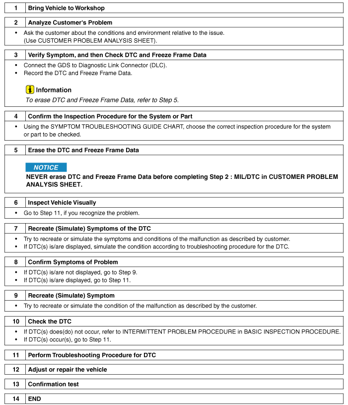

Análise de Problema do Cliente

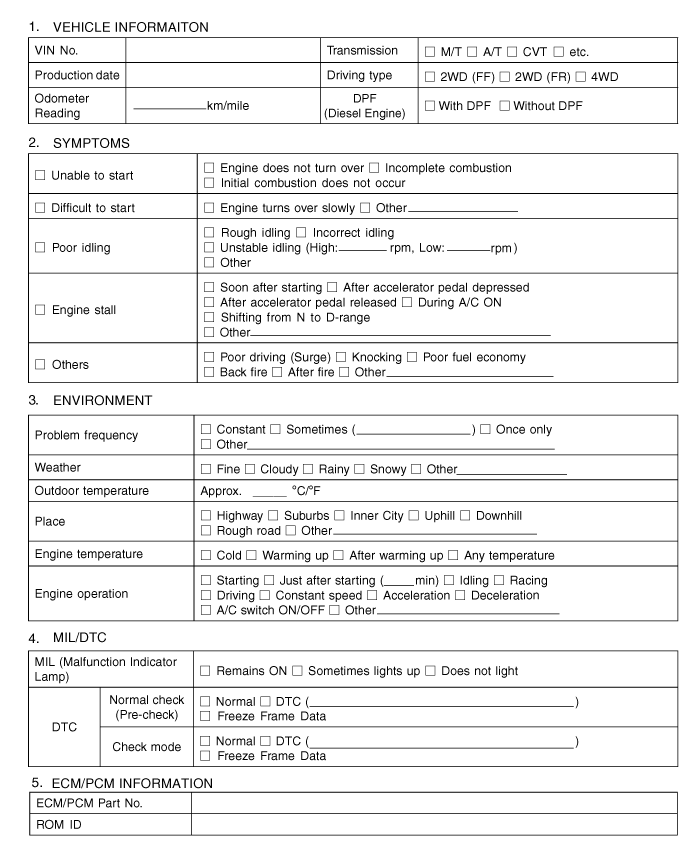

Procedimento de Inspeção Básica

Medição do Estado Elétrico de Peças Elétricas

A resistência medida após o veículo estar em operação pode ser alta ou baixa em temperaturas elevadas. Portanto, todas as resistências devem ser medidas em temperatura ambiente (20°C, 68°F), a menos que seja especificado o contrário.

> **Nota**
>
> - A resistência medida em temperaturas diferentes de 20°C, 68°F é um valor de referência.

Procedimento de Inspeção de Problemas Intermittentes

O caso mais difícil de diagnóstico é quando um sintoma de problema ocorre, mas não se repete durante a testagem. Um exemplo seria se um problema aparecer apenas quando o veículo estiver frio, mas não aparecer quando quente. Nesse caso, o técnico deve elaborar um "Análise de Problema do Cliente" e recrear (simular) o ambiente e as condições que ocorreram quando o veículo estava com o problema.

1. Limpar Código de Falha Diagnóstico (DFC).

2. Inspeção das conexões e verificação de terminais para conexões ruins, fios soltos, pinos torcidos, quebrados ou corroídos, e então verificar se as conexões estão sempre firmemente fixadas.

   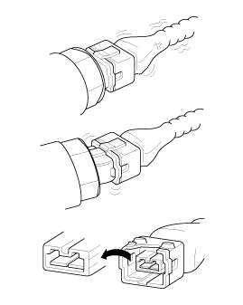

3. Agitar vertical e horizontalmente a conexão e o cabo de alimentação.

4. Reparar ou substituir o componente com problema.

5. Verificar se o problema desapareceu durante o teste de estrada.

? Simulação de Vibração

a. Sensores e Executores

   : Agitar suavemente sensores, executores ou relés com o dedo.

   > **Aviso**
   >
   > - Vibração forte pode quebrar sensores, executores ou relés

b. Conexões e Cabos

   : Agitar suavemente a conexão e o cabo de alimentação vertical e horizontalmente.

? Simulação de Calor

a. Aquecer componentes suspeitos de causar o mal funcionamento com um secador de cabelo ou outra fonte de calor.

   > **Aviso**
   >
   > - NÃO aqueça os componentes até o ponto de possíveis danos.
   > - NÃO aqueça o ECM diretamente.

? Simulação de Chuva

a. Encharcar o veículo para simular um dia chuvoso ou uma condição de alta umidade.

   > **Aviso**
   >
   > - NÃO encharque diretamente a câmara de combustão ou componentes elétricos.

? Simulação de Carga Elétrica

a. Ligar todos os sistemas elétricos para simular cargas elétricas excessivas (radios, ventiladores, luzes, desembaçador do vidro traseiro, etc.).

Procedimento de Inspeção de Conexões

1. Tratamento de Conexões

   a. Nunca puxar o cabo de alimentação ao desconectar as conexões.

    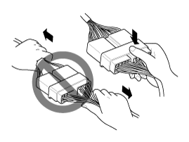

   b. Ao remover a conexão com travamento, pressionar ou puxar o travamento.

    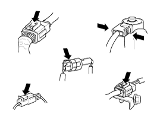

   c. Ouvir um clique ao travar as conexões. Este som indica que estão firmemente travadas.

    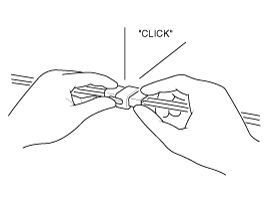

   d. Quando um testador é usado para verificar a continuidade ou medir a tensão, sempre inserir o probe do testador do lado do cabo de alimentação.

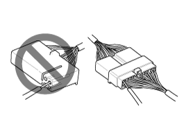

   e. Verifique os terminais do conector de proteção contra água do lado do conector. Conectores de proteção contra água não podem ser acessados do lado do fio.

    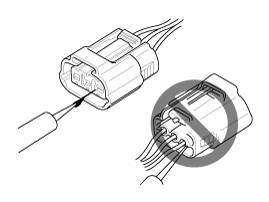

    > **Nota**
    >
    > - Use um fio fino para evitar danos ao terminal.
    > - Não danifique o terminal ao inserir a ponteira do teste.

2. Verificação do Conector

   a. Enquanto o conector estiver conectado:

    Segure o conector e verifique a condição de conexão e a eficiência do bloqueio.

   b. Quando o conector estiver desconectado:

    Verifique os terminais perdidos, os terminais soldados ou as fios centrais quebrados puxando levemente o fio.

    Verifique visualmente para ferrugem, contaminação, deformação e curvatura.

   c. Verifique a condição de aperto do terminal:

    Insira um terminal macho de substituição em um terminal fêmea e, em seguida, verifique as condições de aperto do terminal.

   d. Puxe levemente cada fio para garantir que cada fio esteja fixo no terminal.

    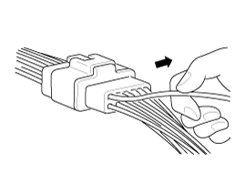

3. Método de Reparo do Terminal do Conector

   a. Limpe os pontos de contato usando um aspirador de pó e/ou um pano de oficina.

    > **Nota**
    >
    > - Nunca use papel abrasivo para polir os pontos de contato, caso contrário, o ponto de contato pode ser danificado.

   b. Em caso de pressão de contato anormal, substitua o terminal fêmeo.

Procedimento de Inspeção do Fio de Cabo

1. Antes de remover o fio de cabo, verifique a posição e a soldagem do fio de cabo para restaurá-lo corretamente.

2. Verifique se o fio de cabo está enrolado, puxado ou solto.

3. Verifique se a temperatura do fio de cabo está abnormalmente alta.

4. Verifique se o fio de cabo está girando, se movendo ou vibrando contra o bordo afiado de uma peça.

5. Verifique a conexão entre o fio de cabo e qualquer peça instalada.

6. Se a cobertura do fio de cabo estiver danificada; fixe, conserte ou substitua o fio de cabo.

Procedimento de Inspeção da Circuito Elétrico

? Verificação de Circuito Aberto

1. Procedimentos para Circuito Aberto

   | • | Verificação de Continuidade |
   | --- | --- |

   | • | Verificação de Tensão |
   | --- | --- |

   Se um circuito aberto ocorrer (como visto na [FIG. 1]), pode ser
   encontrado realizando o Passo 2 (Método de Verificação de Continuidade) ou Passo 3 (Método de Verificação de Tensão)
   conforme mostrado abaixo.

   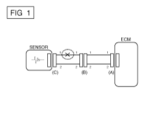

2. Método de Verificação de Continuidade

   > **Nota**
   >
   > - Ao medir a resistência, agite o fio de cabo acima e abaixo ou de lado a lado.

   ```
   Especificação (Resistência)
   1? ou menos > Circuito Normal
   1M? ou Superior > Circuito Aberto
   ```

   a. Desconecte os conectores (A), (C) e mede a resistência entre o conector (A) e (C) conforme mostrado na [FIG. 2].

    Na [FIG.2.] a resistência medida das linhas 1 e 2 é superior a 1M? e abaixo de 1? respectivamente. Especificamente, a linha 1 está aberta (a linha 2 está normal). Para encontrar o ponto exato de quebra, verifique as sub-linhas da linha 1 conforme descrito no próximo passo.

    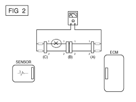

   b. Desconecte o conector (B) e mede a resistência entre

conectador (C) e (B1) e entre (B2) e (A) conforme mostrado em [FIG. 3].

    Neste caso, a resistência medida entre o conectador (C) e (B1) é maior que 1M? e a circuital aberta está entre o terminal 1 do conectador (C) e o terminal 1 do conectador (B1).

    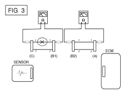

3. Método de Verificação de Tensão

   a. Com cada conectador ainda conectado, medir a tensão
    entre a massa do chassi e o terminal 1 de cada conectador (A), (B)
    e (C) conforme mostrado em [FIG. 4].

    A tensão medida de cada conectador é 5V, 5V e 0V respectivamente. Portanto, a circuital aberta está entre o conectador (C) e (B).

    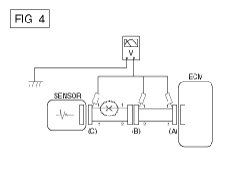

? Verificação de Curto Circuito

1. Método de Teste de Curto para Circuito de Terra

   | • | Verificação de Continuidade com Massa do Chassi |

   Se ocorrer curto para terra como mostrado em [FIG. 5], o
   ponto quebrado pode ser encontrado realizando o Passo 2 (Método de Verificação de Continuidade com Massa do Chassi) conforme abaixo.

   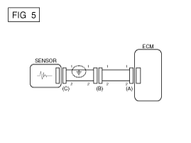

2. Método de Verificação de Continuidade (com Massa do Chassi)

   > **Nota**
   >
   > - Agite levemente o cabo de engate acima e abaixo, ou de lado a lado ao medir a resistência.

   ```
   Especificação (Resistência)
   1? ou menos > Curto para Terra
   1M? ou mais alto > Circuito Normal
   ```

   a. Desconectar os conectores (A), (C) e medir a resistência entre o conectador (A) e a massa do chassi conforme mostrado em [FIG. 6].

    A resistência medida das linhas 1 e 2 neste exemplo é
    abaixo de 1? e mais alto que 1M? respectivamente. Especificamente, o curto para terra é a linha 1 (a linha 2 é normal). Para encontrar o ponto exato quebrado, verifique a sub-linha da linha 1 conforme descrito no passo seguinte.

    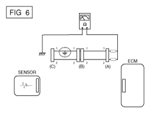

   b. Desconectar o conectador (B), e medir a resistência entre
    o conectador (A) e o chassi, e entre (B1) e o chassi conforme mostrado em [FIG. 7].

    A resistência medida entre o conectador (B1) e o chassi
    é 1? ou menos. O curto para terra está entre o terminal 1 do conectador (C) e o terminal 1 do conectador (B1).

    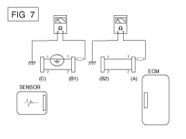

? Teste de Perda de Tensão

Este teste verifica a perda de tensão ao longo de um fio, ou através de uma conexão ou interruptor.

A. Conectar o cabo positivo de um voltmeter ao final do
   fio (ou ao lado do engate ou interruptor) mais próximo da bateria.

B. Conectar o cabo negativo ao outro final do fio. (ou ao outro lado do engate ou interruptor)

C. Operar o circuito.

D. O voltmeter mostrará a diferença de tensão entre
    os dois pontos. Uma diferença, ou queda de mais de 0,1 volts (50mV em circuitos de 5V),
   pode indicar um problema. Verifique o circuito para conexões soltas ou sujas.

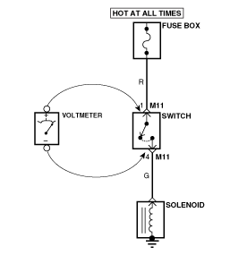

Guia de Troubleshooting de Sintomas

| Sintoma principal | Procedimento diagnóstico | Verifique também |
| --- | --- | --- |

| Início difícil de realizar (Motor não gira) | 1) Testar a bateria 2) Testar o gerador 3) Interruptor de inibição (AT) ou interruptor de partida da embreagem (MT) |  |
| 1) | Testar a bateria |  |
| 2) | Testar o gerador |  |
| 3) | Interruptor de inibição (AT) ou interruptor de partida da embreagem (MT) |  |
| Início difícil de realizar (Combustão incompleta) | 1) Testar a bateria 2) Verificar a pressão do combustível 3) Verificar o circuito de ignição 4) Diagnóstico do sistema de imobilizador (caso o lampião de imobilizador esteja piscando) | • DTC • Baixa compressão • Perda de ar de admissão • Cinto de sincronização solto ou quebrado • Combustível contaminado |
| 1) | Testar a bateria |  |
| 2) | Verificar a pressão do combustível |  |
| 3) | Verificar o circuito de ignição |  |
| 4) | Diagnóstico do sistema de imobilizador (caso o lampião de imobilizador esteja piscando) |  |
| • | DTC |  |
| • | Baixa compressão |  |
| • | Perda de ar de admissão |  |
| • | Cinto de sincronização solto ou quebrado |  |
| • | Combustível contaminado |  |
| Dificuldade de partida | 1) Testar a bateria 2) Verificar a pressão do combustível 3) Verificar o ECTS e o circuito (Verificar DTC) 4) Verificar o circuito de ignição 5) Inspeção e teste do corpo do acelerador 6) Verificar o ECTS e o circuito (Verificar DTC) | • DTC • Baixa compressão • Perda de ar de admissão • Combustível contaminado • Fagulha de ignição fraca |
| 1) | Testar a bateria |  |
| 2) | Verificar a pressão do combustível |  |
| 3) | Verificar o ECTS e o circuito (Verificar DTC) |  |
| 4) | Verificar o circuito de ignição |  |
| 5) | Inspeção e teste do corpo do acelerador |  |
| 6) | Verificar o ECTS e o circuito (Verificar DTC) |  |
| • | DTC |  |
| • | Baixa compressão |  |
| • | Perda de ar de admissão |  |
| • | Combustível contaminado |  |
| • | Fagulha de ignição fraca |  |
| Idling ruim (Inconstante, instável ou incorreto) | 1) Verificar a pressão do combustível 2) Verificar o injetor 3) Verificar o ajuste a longo prazo e acurado do injetor (Consultar DADOS DO CLIENTE) 4) Verificar o circuito de controle de velocidade de rotação do motor (Verificar DTC) 5) Inspeção e teste do corpo do acelerador 6) Verificar o ECTS e o circuito (Verificar DTC) | • DTC • Baixa compressão • Perda de ar de admissão • Combustível contaminado • Fagulha de ignição fraca |
| 1) | Verificar a pressão do combustível |  |
| 2) | Verificar o injetor |  |
| 3) | Verificar o ajuste a longo prazo e acurado do injetor (Consultar DADOS DO CLIENTE) |  |
| 4) | Verificar o circuito de controle de velocidade de rotação do motor (Verificar DTC) |  |
| 5) | Inspeção e teste do corpo do acelerador |  |
| 6) | Verificar o ECTS e o circuito (Verificar DTC) |  |
| • | DTC |  |
| • | Baixa compressão |  |
| • | Perda de ar de admissão |  |
| • | Combustível contaminado |  |
| • | Fagulha de ignição fraca |  |
| Motor estagnando | 1) Testar a bateria 2) Verificar a pressão do combustível 3) Verificar o circuito de controle de velocidade de rotação do motor (Verificar DTC) 4) Verificar o circuito de ignição 5) Verificar o circuito CKPS (Verificar DTC) | • DTC • Perda de ar de admissão • Combustível contaminado • Fagulha de ignição fraca |
| 1) | Testar a bateria |  |
| 2) | Verificar a pressão do combustível |  |
| 3) | Verificar o circuito de controle de velocidade de rotação do motor (Verificar DTC) |  |
| 4) | Verificar o circuito de ignição |  |
| 5) | Verificar o circuito CKPS (Verificar DTC) |  |
| • | DTC |  |
| • | Perda de ar de admissão |  |
| • | Combustível contaminado |  |
| • | Fagulha de ignição fraca |  |

| Desempenho ruim (Surge) | 1) Verificar a pressão do combustível 2) Inspeção e teste do Corpo do Acelerador 3) Verificar o circuito de ignição 4) Verificar o ECTS e o Circuito (Verificar DTC) 5) Testar o sistema de escape para possível restrição 6) Verificar o ajuste a longo prazo do trim do combustível e o ajuste a curto prazo do trim do combustível (Consultar CUSTOMER DATASTREAM) | • DTC • Baixa compressão • Vazamento de ar de admissão • Combustível contaminado • Chama de ignição fraca |
| 1) | Verificar a pressão do combustível |  |
| 2) | Inspeção e teste do Corpo do Acelerador |  |
| 3) | Verificar o circuito de ignição |  |
| 4) | Verificar o ECTS e o Circuito (Verificar DTC) |  |
| 5) | Testar o sistema de escape para possível restrição |  |
| 6) | Verificar o ajuste a longo prazo do trim do combustível e o ajuste a curto prazo do trim do combustível (Consultar CUSTOMER DATASTREAM) |  |
| • | DTC |  |
| • | Baixa compressão |  |
| • | Vazamento de ar de admissão |  |
| • | Combustível contaminado |  |
| • | Chama de ignição fraca |  |
| Respingo | 1) Verificar a pressão do combustível 2) Inspeção do líquido de resfriamento do motor 3) Inspeção do radiador e do ventilador elétrico de resfriamento 4) Verificar as chamas do pistão | • DTC • Combustível contaminado |
| 1) | Verificar a pressão do combustível |  |
| 2) | Inspeção do líquido de resfriamento do motor |  |
| 3) | Inspeção do radiador e do ventilador elétrico de resfriamento |  |
| 4) | Verificar as chamas do pistão |  |
| • | DTC |  |
| • | Combustível contaminado |  |
| Baixa economia de combustível | 1) Verificar as práticas de direção do cliente · A/C ligado em tempo integral ou no modo desentorpecimento? · As rodas estão com a pressão correta? · Existe um carregamento excessivamente pesado? · A aceleração é excessiva e frequente? 2) Verificar a pressão do combustível 3) Verificar o injetor 4) Testar o sistema de escape para possível restrição 5) Verificar o ECTS e o circuito | • DTC • Baixa compressão • Vazamento de ar de admissão • Combustível contaminado • Chama de ignição fraca |
| 1) | Verificar as práticas de direção do cliente · A/C ligado em tempo integral ou no modo desentorpecimento? · As rodas estão com a pressão correta? · Existe um carregamento excessivamente pesado? · A aceleração é excessiva e frequente? |  |
| 2) | Verificar a pressão do combustível |  |
| 3) | Verificar o injetor |  |
| 4) | Testar o sistema de escape para possível restrição |  |
| 5) | Verificar o ECTS e o circuito |  |
| • | DTC |  |
| • | Baixa compressão |  |
| • | Vazamento de ar de admissão |  |
| • | Combustível contaminado |  |
| • | Chama de ignição fraca |  |
| Dificuldade de abastecimento (Excesso de combustível durante o abastecimento) | 1) Testar o fechamento do canister 2) Inspeção do tubo de enchimento do combustível/furadeira · Enroscado, entupido ou bloqueado? · Furadeira de enchimento do combustível danificada 3) Inspeção do tubo de ventilação do tanque de combustível entre o canister e o filtro de ar do tanque de combustível 4) Verificar o canister | • Cano de enchimento do posto de combustível defeituoso (Se este problema ocorrer em um posto de combustível específico durante o abastecimento) |
| 1) | Testar o fechamento do canister |  |
| 2) | Inspeção do tubo de enchimento do combustível/furadeira · Enroscado, entupido ou bloqueado? · Furadeira de enchimento do combustível danificada |  |
| 3) | Inspeção do tubo de ventilação do tanque de combustível entre o canister e o filtro de ar do tanque de combustível |  |
| 4) | Verificar o canister |  |
| • | Cano de enchimento do posto de combustível defeituoso (Se este problema ocorrer em um posto de combustível específico durante o abastecimento) |  |
