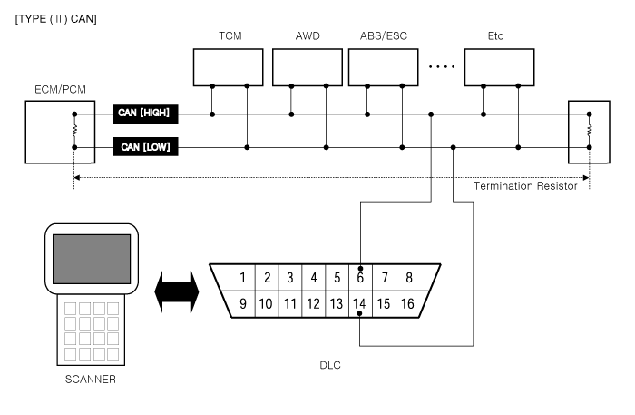
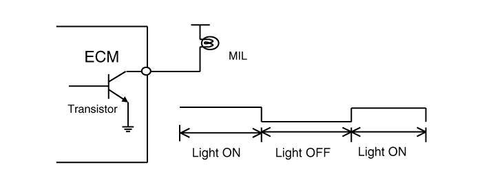

# Kia Sportage: Descrição e Operação

[Home](../../index.md) / [Manual de Serviço e Reparo do Kia Sportage SL](../sportage-482.md) / [Controle do Motor / Sistema de Combustível](sportage-582.md) / [Sistema de Controle do Motor](sportage-587.md) / Descrição e Operação

## Revisão OBD-II

1. **Visão Geral**

O Conselho de Recursos Ambientais da Califórnia (CARB) começou a regulamentar a Diagnóstico a bordo (OBD) para veículos vendidos na Califórnia a partir do modelo de 1988. A primeira fase, OBD-I, exigiu o monitoramento do sistema de medição de combustível, do sistema de Recirculação de Gases de Emissão (EGR) e de outros componentes relacionados à emissão. O Lâmpada de Indicação de Falha (MIL) foi exigido para acender e alertar o motorista sobre a falha e a necessidade de reparo do sistema de controle de emissões. Associado ao MIL estava um código de falha ou Código de Problema de Diagnóstico (DTC) identificando a área específica da falha.

O sistema OBD foi proposto pelo CARB para melhorar a qualidade do ar ao identificar veículos que excedem os padrões de emissão. A aprovação da Emenda à Lei Federal de Aire Limpo de 1990 também incentivou o Agente de Proteção Ambiental (EPA) a desenvolver requisitos de diagnóstico a bordo. As regulamentações OBD-II do CARB foram seguidas até 1999, quando as regulamentações federais foram utilizadas.

O sistema OBD-II atende aos requisitos governamentais ao monitorar o sistema de controle de emissões. Quando um sistema ou componente excede o limite de emissão ou opera fora da tolerância, um DTC será armazenado e o MIL iluminado.

O executivo de diagnóstico é um programa de computador no Módulo de Controle do Motor do Motor (ECM) ou Módulo de Controle do Potência (PCM) que coordena o sistema de auto-monitoramento OBD-II. Este programa controla todos os monitores e interações, operação do DTC e MIL, dados de quadro de congelação e interface com ferramenta de escaneamento.

Dados de quadro de congelação descrevem condições do motor armazenadas, como estado do motor, estado do controle do combustível, ignição, RPM, carga e status quente no momento em que a primeira falha é detectada. Condições anteriormente armazenadas serão substituídas apenas se uma falha de combustível ou desalinhamento for detectada. Esses dados são acessíveis com a ferramenta de escaneamento para auxiliar no reparo do veículo.

O centro do sistema OBD-II é um microprocessador chamado Módulo de Controle do Motor (ECM) ou Módulo de Controle do Potência (PCM).

O ECM ou PCM recebe entrada de sensores e outros componentes eletrônicos (interruptores, relés e outros) com base em informações recebidas e programadas em sua memória (memória de acesso aleatório de manutenção, entre outros), o ECM ou PCM gera sinais de saída para controlar diversos relés, solenóides e atuadores.

2. **Configuração de hardware e termos relacionados**

1) **GST (Ferramenta de escaneamento genérica)**

2) **MIL (Lâmpada de Indicação de Falha) - Atividade do MIL por transistor**

A Lâmpada de Indicação de Falha (MIL) está conectada entre o terminal da Lâmpada de Indicação de Falha do ECM ou PCM e a alimentação da bateria (amplificador coletor aberto).

Em大多数汽车中，MIL将安装在仪表板上。灯放大器不会因短路而损坏。

灯的功率损耗远大于测试器中MIL和灯的总损耗可能会导致故障指示。

? No ligar do veículo ON e na revolução do motor (RPM) < MIN. RPM, o MIL é acionado para uma verificação ótica pelo condutor.

3) Iluminação do MIL

Quando o ECM ou PCM detectar uma falha relacionada à emissão durante o primeiro ciclo de condução, os DTC e os dados do motor são armazenados na memória de quadro de congelamento. O MIL é iluminado apenas quando o ECM ou PCM detectar a mesma falha relacionada ao DTC em dois ciclos de condução consecutivos.

4) Exclusão do MIL

- Falhas de Desligamento e Sistema de Combustível: Para falhas de desligamento ou sistema de combustível, o MIL pode ser excluído se a mesma falha não se repetir durante a monitorização em três ciclos de condução subsequentes e consecutivos em que as condições forem semelhantes às em que a falha foi detectada pela primeira vez.
- Todas as Outras Falhas: Para todas as outras falhas, o MIL pode ser apagado após três ciclos de condução subsequentes e consecutivos durante os quais o sistema de monitorização responsável pela iluminação do MIL funciona sem detectar a falha e se nenhuma outra falha foi identificada que possa independentemente iluminar o MIL de acordo com os requisitos acima.

5) Exclusão de um código de falha

O sistema de diagnóstico pode excluir um código de falha se a mesma falha não for registrada novamente em pelo menos 40 ciclos de aquecimento do motor e o MIL não estiver iluminado para esse código de falha.

6) Linha de Comunicação (CAN)

- Topologia da Rede: Estrutura da linha (rede)
- Conectividade: Fio duplo enrolado
- Comprimento do cabo DLC fora do painel: Máx. 5m
- Taxa de Transferência de Dados
  - Diagnóstico: 500 kbps
  - Modo de Serviço (Atualização, Gravação do VIN): 500 ou 1 Mbps

7) Ciclo de condução

Um ciclo de condução consiste em ligar o motor e desligar o motor.

8) Ciclo de aquecimento

Um ciclo de aquecimento significa uma operação do veículo suficiente para que a temperatura do líquido de resfriamento do motor suba pelo menos 40 graus Fahrenheit a partir do início do motor e atinja uma temperatura mínima de pelo menos 160 graus Fahrenheit.

9) Formato do DTC

- Código de Falha de Diagnóstico (SAE J2012)
- Os DTCs utilizados em veículos OBD-II começam com uma letra e são seguidos por quatro números.
  - A letra no início do DTC identifica a função do dispositivo monitorado que falhou. Um "P" indica um dispositivo de potência, "C" indica um dispositivo de chassis. "B" é para um dispositivo do corpo e "U" indica um código de rede ou ligação de dados. O primeiro número indica se o código é genérico (comum a todos os fabricantes) ou se é específico do fabricante. Um "0" & "2" indicam genérico, "1" indica específico do fabricante. O segundo número indica o sistema afetado, com um número entre 1 e 7.

A seguir está uma lista mostrando os números atribuídos a cada sistema.

- 1 : Medição de combustível e ar
- 2 : Medição de combustível e ar (apenas falhas do circuito injetor)

| • | 3 : Sistema de ignição ou falha de fagulhamento |
| --- | --- |

| • | 4 : Controles auxiliares de emissão |
| --- | --- |

| • | 5 : Controles de velocidade do veículo e sistema de controle do idle |
| --- | --- |

| • | 6 : Circuito de saída do computador |
| --- | --- |

| • | 7 : Transmissão |
| --- | --- |

Os últimos dois dígitos do DTC indicam o componente ou seção do sistema onde a falha ocorreu.

10) Lista de dados de congelamento

Quando um evento de congelamento é acionado por um DTC relacionado à emissão, o ECM ou PCM armazena várias informações do veículo como estavam no momento em que a falha ocorreu. O número do DTC, junto com os dados do motor, podem ser úteis para auxiliar um técnico na localização da causa da falha. Uma vez que os dados da ocorrência da primeira ciclo de condução DTC são armazenados na memória de congelamento, eles permanecerão lá mesmo quando a falha ocorrer novamente (segundo ciclo de condução) e o MIL for acionado.

| • | Lista de Dados de Congelamento |
| --- | --- |

a. Valor de Carga Calculada

b. Velocidade do Motor

c. Ajuste de Combustível

d. Pressão de Combustível (se disponível)

e. Velocidade do Veículo (se disponível)

f. Temperatura do Radiador

g. Pressão do Manômetro de Admissão (se disponível)

h. Operação em Loop Fechado ou Aberto

i. Código de Falha

3. Teste de Disponibilidade OBD-II

[Kia Motors Drive Cycle]

O Drive Cycle da Kia OBD-II está projetado para executar e concluir os monitores OBD-II. Para completar um monitor específico para a verificação de reparo, siga o mapa do Drive Cycle abaixo.

O Drive Cycle da Kia OBD-II consiste em dois modos (Modo 1 e Modo 2) e o Modo 2 é para realizar a diagnóstico do catalisador apenas no EMS da Dephi.

| – | EMS Continental, Bosch ou Kefico : O Drive Cycle do Modo 1 deve ser feito uma vez para diagnóstico de todos os sistemas. |
| --- | --- |

| – | EMS Dephi : O Drive Cycle do Modo 2 deve ser feito duas vezes seguidas após o Modo 1 ser feito uma vez para diagnóstico de todos os sistemas |
| --- | --- |

| • | Modo 1 |
| --- | --- |

| • | Modo 2 |
| --- | --- |

| Modo | Número | Operação | Velocidade (mph) | Duração (s) | E/Tempo (s) | Observações |
| --- | --- | --- | --- | --- | --- | --- |
| Modo 1 | 1 | Início do Motor | 0 | 0 | 0 | ECT @ Start 32~104°F |
| 2 | Idle (N) | 0 | 30 | 30 | Neutral Range |  |
| 3 | Idle (D) | 0 | 270 | 300 | D Range |  |
| 4 | Aceleração | 0 > 50 | 15 | 315 |  |  |
| 5 | Velocidade Constante | 50 | 230 | 545 |  |  |
| 6 | Deceleração | 50 > 45 | 5 | 550 |  |  |
| 7 | Velocidade Constante | 45 | 5 | 555 |  |  |
| 8 | Aceleração | 45 > 55 | 5 | 560 |  |  |
| 9 | Velocidade Constante | 55 | 5 | 565 |  |  |
| 10 | Deceleração | 55 > 45 | 5 | 570 |  |  |
| 11 | Velocidade Constante | 45 | 5 | 575 |  |  |
| 12 | Repita 8 a 11 dez vezes. | - | 180 | 755 |  |  |
| 13 | Aceleração | 45 > 55 | 5 | 760 |  |  |
| 14 | Velocidade Constante | 55 | 5 | 765 |  |  |
| 15 | Deceleração | 55 > 0 | 45 | 810 |  |  |
| 16 | Idle (D) | 0 | 120 | 930 | D Range |  |
| 17 | Idle (N) | 0 | 760 | 1690 | Neutral Range |  |
| 18 | Aceleração | 0 > 55 | 15 | 1705 |  |  |
| 19 | Velocidade Constante | 55 | 60 | 1765 |  |  |
| 20 | Deceleração | 55 > 0 | 15 | 1780 |  |  |

| 21 | Idling (D) | 0 | 60 | 1840 | D Range |  |
| 22 | Aceleração | 0 > 55 | 15 | 1855 |  |  |
| 23 | Velocidade constante | 55 | 60 | 1915 |  |  |
| 24 | Deceleração | 55 > 0 | 15 | 1930 |  |  |
| 25 | Idling (D) | 0 | 60 | 1990 | D Range |  |
| 26 | Aceleração | 0 > 40 | 15 | 2005 |  |  |
| 27 | Velocidade constante | 40 | 15 | 2020 |  |  |
| 28 | Aceleração | 40 > 50 | 15 | 2035 |  |  |
| 29 | Velocidade constante | 50 | 5 | 2040 |  |  |
| 30 | Deceleração | 50 > 40 | 15 | 2055 |  |  |
| 31 | Velocidade constante | 40 | 60 | 2115 |  |  |
| 32 | Repita 28 a 31 cinco vezes. | - | 380 | 2495 |  |  |
| 33 | Aceleração | 40 > 50 | 15 | 2510 |  |  |
| 34 | Velocidade constante | 50 | 5 | 2515 |  |  |
| Modo 1 | 35 | Deceleração | 50 > 0 | 40 | 2555 |  |
| 36 | Idling (D) | 0 | 25 | 2580 | D Range |  |
| Modo 2 | 1 | Início do motor | 0 | 0 | 0 |  |
| 2 | Idling (N) | 0 | 30 | 30 | Faixa Neutra |  |
| 3 | Idling (D) | 0 | 210 | 240 | D Range |  |
| 4 | Aceleração | 0 > 49 | 16 | 256 |  |  |
| 5 | Deceleração | 49 > 47 | 2 | 258 | Levante o pé do acelerador : APS = 0 |  |
| 6 | Velocidade constante | 47 | 10 | 268 |  |  |
| 7 | Aceleração | 47 > 55 | 4 | 272 | Aceleração média ou profunda |  |
| 8 | Deceleração | 55 > 52 | 3 | 275 | Levante o pé do acelerador : APS = 0 |  |
| 9 | Velocidade constante | 52 | 10 | 285 |  |  |
| 10 | Deceleração | 52 > 45 | 3 | 288 | Levante o pé do acelerador : APS = 0 |  |
| 11 | Aceleração | 45 > 47 | 2 | 290 |  |  |
| 12 | Repita 6 a 11 doze vezes. | - | 330 | 620 |  |  |
| 13 | Velocidade constante | 47 | 57 | 677 |  |  |
| 14 | Deceleração | 47 > 0 | 8 | 685 |  |  |
| 15 | Idling (D) | 0 | 60 | 745 | D Range |  |
| 16 | Aceleração | 0 > 50 | 15 | 760 |  |  |
| 17 | Velocidade constante | 50 | 90 | 850 |  |  |
| 18 | Deceleração | 50 > 0 | 10 | 860 |  |  |
| 19 | Repita 15 a 18 duas vezes. | - | 175 | 1035 |  |  |
| 20 | Idling (D) | 0 | 90 | 1125 | D Range |  |

1) Monitoramento do catalisador

O monitoramento da eficiência do catalisador é uma estratégia de teste automático
dentro do ECM ou PCM que usa o Sensor de Óxido Quente Aquecido (HO2S) downstream
para determinar quando um catalisador caiu abaixo do nível mínimo de eficácia
em sua capacidade de controlar as emissões de escape.

2) Monitoramento de falha de injeção

Falha é definida como a falta de combustão adequada no cilindro devido à falta de chama,
medida inadequada de combustível ou compreensão inadequada. Qualquer combustão que não ocorra
no cilindro no tempo adequado também é uma falha. O monitoramento de detecção de falha detecta
falhas de injeção, ignição ou mecânicas. O objetivo é proteger o catalisador de danos permanentes
e alertar o cliente sobre uma falha de emissão ou uma falha de inspeção/mantenimento
iluminando o MIL. Quando uma falha é detectada, um software especial chamado de quadro congelado
é ativado. O quadro congelado captura o estado de operação do veículo quando um defeito é detectado
da estratégia de detecção de falha.

3) Monitoramento do sistema de combustível

O monitoramento do sistema de combustível é uma estratégia de teste automático
dentro do ECM ou PCM que usa o Sensor de Óxido Quente Aquecido (HO2S) downstream
para determinar quando um catalisador caiu abaixo do nível mínimo de eficácia
em sua capacidade de controlar as emissões de escape.

ECM ou PCM que monitora a tabela de combustível adaptativa O sistema de controle do combustível usa a tabela de combustível adaptativa para compensar a variabilidade normal dos componentes do sistema de combustível causada pelo desgaste ou envelhecimento. Durante a operação normal do veículo, se o sistema de combustível parecer estar desviado para baixo ou para cima, a tabela adaptativa de valores ajustará as cálculos de entrega de combustível para remover o desvio.

4) Monitoramento do sistema de resfriamento do motor

O monitoramento do sistema de resfriamento é uma estratégia de teste automático dentro do ECM ou PCM que monitora o ECTS (Sensor de Temperatura do Coolante do Motor) e o termostato sobre a continuidade do circuito, o intervalo de saída, e os erros de falha lógicos.

5) Monitoramento do sensor O2

As regras OBD-II exigem o monitoramento do sensor O2 aquecido de entrada (H2OS) para detectar se a deterioração do sensor excedeu os limites. Um sensor adicional HO2S está localizado após o Conversor Catalítico Trifásico de Aquecimento durante o Aquecimento (WU-TWC) para determinar a eficiência do catalisador.

Embora o sensor O2 aquecido de saída seja similar ao usado para o controle do combustível, ele funciona de forma diferente. O sensor HO2S de saída é monitorado para determinar se uma tensão é gerada. Essa tensão é comparada a um intervalo de tensão aceitável calibrado.

6) Monitoramento do sistema de emissões evaporativas

O monitoramento EVAP. é uma estratégia de teste automático dentro do ECM ou PCM que testa a integridade do sistema EVAP.. O sistema completo de emissões evaporativas detecta uma fuga ou fugas que, em conjunto, são maiores ou iguais a uma fuga causada por um orifício de 0,040 polegadas e 0,020 polegadas de diâmetro.

7) Monitoramento do sistema de ar condicionado

O monitoramento do sistema de ar condicionado é uma estratégia de teste automático dentro do ECM ou PCM que monitora a falha de todos os componentes do sistema de ar condicionado enquanto o ar condicionado está ligado.

8) Monitoramento de componentes completos

O monitoramento de componentes completos é uma estratégia de teste automático dentro do ECM ou PCM que detecta falhas de qualquer componente eletrônico do conjunto de potência ou sistema que forneça entrada para o ECM ou PCM e não seja exclusivamente uma entrada para qualquer outro monitor OBD-II.

9) Monitoramento de componentes do sistema de ar condicionado

Requisito:

Se um veículo incorporar uma estratégia de controle do motor que altera o controle do combustível e/ou da ignição fora do estado de parada quando o sistema de ar condicionado estiver ligado, o sistema OBD II deve monitorar todos os componentes eletrônicos do sistema de ar condicionado para falhas que causam o sistema a não invocar o controle alternativo enquanto o sistema de ar condicionado estiver ligado ou invocar o controle alternativo enquanto o sistema de ar condicionado estiver desligado.

Adicionalmente, o sistema OBD II deve monitorar todas as falhas de componentes do sistema de ar condicionado que são usados como parte da estratégia de diagnóstico de qualquer outro sistema ou componente monitorado.

Plano de implementação:

Não foi incorporada nenhuma estratégia de controle do motor que altere o controle do combustível e/ou da ignição fora do estado de parada quando o sistema de ar condicionado estiver ligado. A falha de componentes do sistema de ar condicionado não é usada como parte da estratégia de diagnóstico de outros sistemas ou componentes monitorados.
