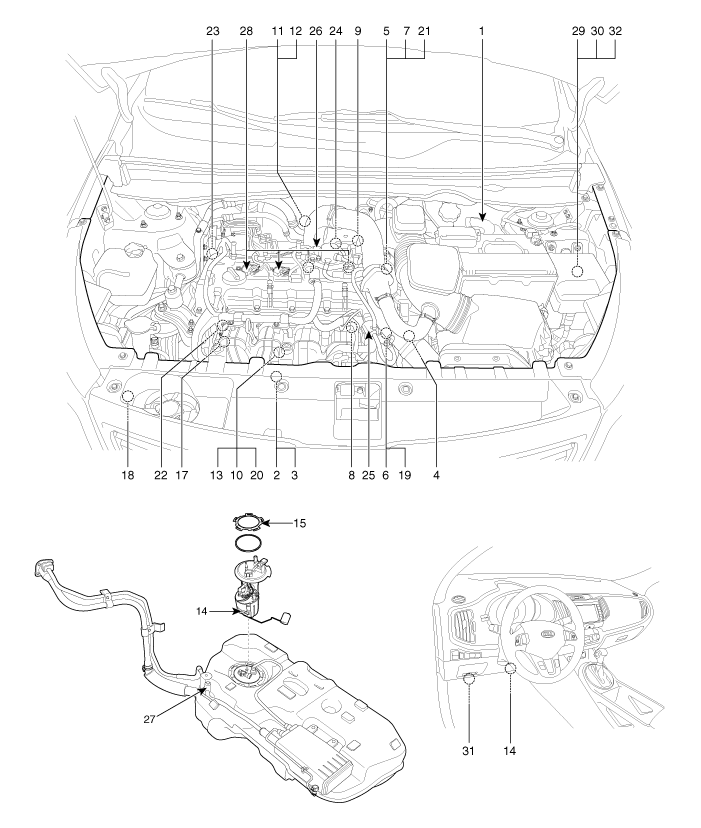

# Sistema de Controle do Motor — Componentes e localização

[Home](../../index.md) / [Manual de Serviço e Reparo](../sportage-482.md) / [Sistema de Controle do Motor / Sistema de Combustível](sportage-582.md) / [Sistema de Controle do Motor](sportage-587.md) / Componentes e localização

## Diagrama

## Legenda

| Nº | Componente |
| --- | --- |
| 1 | Módulo de Controle do Motor (ECM) |
| 2 | Sensor de Pressão do Manifold Absoluto (MAPS) #1 |
| 3 | Sensor de Temperatura do Ar Intalado (IATS) |
| 4 | Sensor de Pressão do Manifold Absoluto (MAPS) #2 |
| 5 | Sensor de Temperatura do Coolante do Motor (ECTS) |
| 6 | Sensor de Posição do Acelerador (TPS) [integrado no Módulo ETC] |
| 7 | Sensor de Posição do Crankshaft (CKPS) |
| 8 | Sensor de Posição do Camshaft (CMPS) [Cilindro 1 / Intalado] |
| 9 | Sensor de Posição do Camshaft (CMPS) [Cilindro 1 / Exaustão] |
| 10 | Sensor de Chacoalhada (KS) |
| 11 | Sensor de Oxigênio Quente (HO2S) [Cilindro 1 / Sensor 1] |
| 12 | Sensor de Oxigênio Quente (HO2S) [Cilindro 1 / Sensor 2] |
| 13 | Sensor de Pressão do Ralo (RPS) |
| 14 | Sensor de Posição do Acelerador (APS) |
| 15 | Sensor de Nível do Tanque de Combustível (FTPS) |
| 16 | Sensor de Nível do Tanque de Combustível (FLS) |
| 17 | Sensor de Temperatura do Óleo do CVVT (OTS) |
| 18 | Transdutor de Pressão do Sistema de Arrefecimento (APT) |
| 19 | Motor do Módulo ETC [integrado no Módulo ETC] |
| 20 | Injetor |
| 21 | Valvula de Controle do Sistema de Purga (PCSV) |
| 22 | Valvula de Controle do Óleo do CVVT (OCV) [Cilindro 1 / Intalado] |
| 23 | Valvula de Controle do Óleo do CVVT (OCV) [Cilindro 1 / Exaustão] |
| 24 | Atuador de Porta de Esgoto Elétrica (EWGA) |
| 25 | Valvula de Controle do RCV |
| 26 | Regulador de Pressão do Tanque de Combustível |
| 27 | Valvula de Fechamento do Canister (CCV) |
| 28 | Bobina de Ignição |
| 29 | Relé Principal |
| 30 | Relé do Bomba de Combustível |
| 31 | Conector de Linha de Dados (DLC) [16-pin] |
| 32 | Conector Multifuncional de Verificação [20-pin] |
