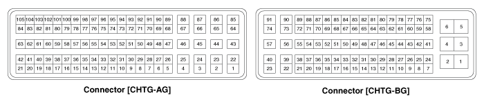
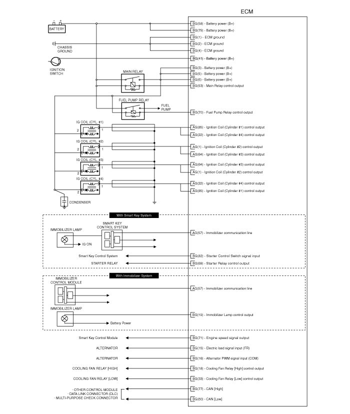
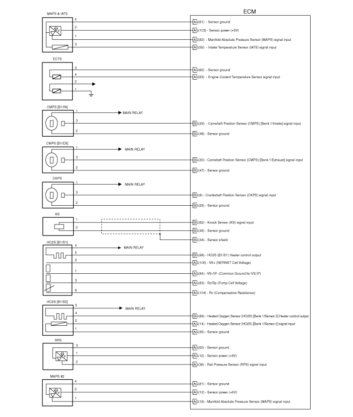
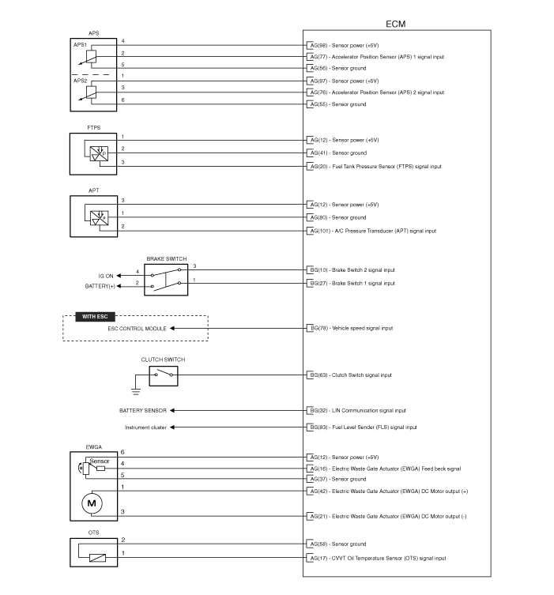
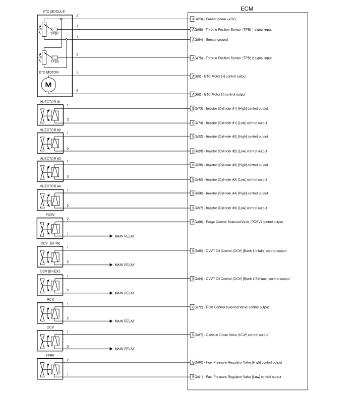

# Kia Sportage: Módulo de Controle do Motor (ECM): Diagramas Esquemáticos

[Início](../../index.md) / [Manual de Serviço e Revisão do Kia Sportage SL](../sportage-482.md) / [Sistema de Controle do Motor / Sistema de Combustível](sportage-582.md) / [Sistema de Controle do Motor](sportage-587.md) / Diagramas Esquemáticos do Módulo de Controle do Motor (ECM)

## ECM Terminal E Entrada/Saída

Função do Terminal do ECM

Conector [CHTG-AG]

| Número de Pin | Descrição | Conectado a |
| --- | --- | --- |
| 1 | Saída de Controle do Coil de Ignição (Cilindro #2) [Sem Chave Inteligente] | Coil de Ignição (Cilindro #2) |
| Saída de Controle do Coil de Ignição (Cilindro #3) [Com Chave Inteligente] | Coil de Ignição (Cilindro #3) |  |
| 2 | - |  |
| 3 | - |  |
| 4 | - |  |
| 5 | Saída de Controle do Motor ETC [+] | Motor ETC |  |
| 6 | Saída de Controle do Motor ETC [-] | Motor ETC |  |
| 7 | - |  |
| 8 | - |  |
| 9 | - |  |
| 10 | - |  |
| 11 | - |  |
| 12 | Sensores de Potência (+5V) | Atuador de Porta de Esgoto Elétrico (EWGA) |
| Sensor de Pressão da Linha de Combustível (RPS) |  |  |
| Transdutor de Pressão do Sistema de Ar Condicionado (APT) |  |  |
| Sensor de Pressão Absoluta do Manifold #2 (MAPS) |  |  |
| Sensor de Pressão do Tanque de Combustível (FTPS) |  |  |
| 13 | - |  |
| 14 | Entrada de Sinal do Sensor de Oxigênio Quente (HO2S) [Banco 1/Sensor 2] | Sensor de Oxigênio Quente (HO2S) [Banco 1/Sensor 2] |
| 15 | - |  |
| 16 | Sinal de Retroalimentação do Atuador de Porta de Esgoto Elétrico (EWGA) | Atuador de Porta de Esgoto Elétrico (EWGA) |
| Sensor de Temperatura do Óleo do CVVT (OTS) |  |  |
| 17 | Entrada de Sinal do Sensor de Pressão Absoluta do Manifold #2 (MAPS) | Sensor de Pressão Absoluta do Manifold #2 (MAPS) |
| 18 | Entrada de Sinal do Sensor de Pressão Absoluta do Manifold #2 (MAPS) | Sensor de Pressão Absoluta do Manifold #2 (MAPS) |
| 19 | - |  |
| 20 | Entrada de Sinal do Sensor de Pressão do Tanque de Combustível (FTPS) | Sensor de Pressão do Tanque de Combustível (FTPS) |
| 21 | Saída de Controle do Motor DC do Atuador de Porta de Esgoto Elétrico (EWGA) (-) | Atuador de Porta de Esgoto Elétrico (EWGA) |
| Saída de Controle do Coil de Ignição (Cilindro #4) [Sem Chave Inteligente] | Coil de Ignição (Cilindro #4) |  |
| Saída de Controle do Coil de Ignição (Cilindro #1) [Com Chave Inteligente] | Coil de Ignição (Cilindro #1) |  |
| 22 | - |  |
| 23 | - |  |
| 24 | - |  |
| 25 | - |  |
| 26 | - |  |
| 27 | - |  |
| 28 | - |  |
| 29 | - |  |
| 30 | - |  |
| 31 | - |  |
| 32 | - |  |
| 33 | Sensores de Potência (+5V) | Sensor de Posição do Acelerador (TPS) 1,2 |
| 34 | - |  |
| 35 | Sensores de Terra | Sensor de Oxigênio Quente (HO2S) [Banco 1/Sensor 2] |
| 36 | - |  |
| 37 | Sensores de Terra | Atuador de Porta de Esgoto Elétrico (EWGA) |
| 38 | - |  |
| 39 | Entrada de Sinal do Sensor de Pressão da Linha de Combustível (RPS) | Sensor de Pressão da Linha de Combustível (RPS) |
| 40 | - |  |
| 41 | Sensores de Terra | Sensor de Pressão do Tanque de Combustível (FTPS) |
| 42 | Saída de Controle do Motor DC do Atuador de Porta de Esgoto Elétrico (EWGA) (+) | Atuador de Porta de Esgoto Elétrico (EWGA) |
| 43 | - |  |
| 44 | - |  |
| 45 | - |  |
| 46 | - |  |
| 47 | - |  |
| 48 | - |  |
| 49 | - |  |
| 50 | - |  |
| 51 | - |  |
| 52 | - |  |
| 53 | - |  |
| 54 | Sensores de Terra | Sensor de Posição do Acelerador (TPS) 1,2 |
| 55 | Sensores de Terra | Sensor de Posição do Acelerador (APS) 2 |
| 56 | Sensores de Terra | Sensor de Posição do Acelerador (APS) 1 |
| 57 | Linha de Comunicação do Imobilizador | Módulo de Controle da Chave Inteligente [Chave Inteligente] |
| Módulo de Controle do Imobilizador [Imobilizador] |  |  |
| 58 | Sensores de Terra | Sensor de Temperatura do Óleo do CVVT (OTS) |
| 59 | Entrada de Sinal do Sensor de Temperatura do Ar Intalado (IATS) | Sensor de Temperatura do Ar Intalado (IATS) |
| 60 | Sensores de Terra | Sensor de Pressão da Linha de Combustível (RPS) |

| 61 | Sensor de terra | Sensor de Pressão do Manifold Absoluto (MAPS) |
| Sensor de Temperatura do Ar Intalado (IATS) |  |  |
| 62 | Sensor de terra | Sensor de Temperatura do Coolante do Motor (ECTS) |
| 63 | Sinal de entrada do Sensor de Temperatura do Coolante do Motor (ECTS) | Sensor de Temperatura do Coolante do Motor (ECTS) |
| 64 | Saída de controle do Coil de Ignição (Cilindro #3) [Sem Chave Inteligente] | Coil de Ignição (Cilindro #3) |
| Saída de controle do Coil de Ignição (Cilindro #2) [Com Chave Inteligente] | Coil de Ignição (Cilindro #2) |  |
| 65 | - |  |
| 66 | - |  |
| 67 | - |  |
| 68 | - |  |
| 69 | - |  |
| 70 | - |  |
| 71 | - |  |
| 72 | - |  |
| 73 | - |  |
| 74 | - |  |
| 75 | Sinal de entrada do Sensor de Posição do Throttle (TPS) 2 | Sensor de Posição do Throttle (TPS) 2 |
| 76 | Sinal de entrada do Sensor de Posição do Acelerador (APS) 2 | Sensor de Posição do Acelerador (APS) 2 |
| 77 | Sinal de entrada do Sensor de Posição do Acelerador (APS) 1 | Sensor de Posição do Acelerador (APS) 1 |
| 78 | - |  |
| 79 | - |  |
| 80 | Sensor de terra | Transdutor de Pressão do A/C (APT) |
| 81 | Sensor de terra | Sensor de Pressão do Manifold Absoluto (MAPS) #2 |
| 82 | Sinal de entrada do Sensor de Pressão do Manifold Absoluto (MAPS) | Sensor de Pressão do Manifold Absoluto (MAPS) |
| 83 | Rc/Rp (Votação da Célula de Bomba) | Sensor de Oxigênio Quente [Banco 1/Sensor 1] |
| 84 | VS-/IP- (Votação Comum para VS, IP) | Sensor de Oxigênio Quente [Banco 1/Sensor 1] |
| 85 | Saída de controle do Coil de Ignição (Cilindro #1) [Sem Chave Inteligente] | Coil de Ignição (Cilindro #1) |
| Saída de controle do Coil de Ignição (Cilindro #4) [Com Chave Inteligente] | Coil de Ignição (Cilindro #4) |  |
| 86 | - |  |
| 87 | - |  |
| 88 | - |  |
| 89 | - |  |
| 90 | - |  |
| 91 | - |  |
| 92 | - |  |
| 93 | - |  |
| 94 | - |  |
| 95 | - |  |
| 96 | Sinal de entrada do Sensor de Posição do Throttle (TPS) 1 | Sensor de Posição do Throttle (TPS) 1 |
| 97 | Fornece energia ao sensor (+5V) | Sensor de Posição do Acelerador (APS) 2 |
| 98 | Fornece energia ao sensor (+5V) | Sensor de Posição do Acelerador (APS) 1 |
| 99 | - |  |
| 100 | - |  |
| 101 | Sinal de entrada do Transdutor de Pressão do A/C (APT) | Transdutor de Pressão do A/C (APT) |
| 102 | - |  |
| 103 | Fornece energia ao sensor (+5V) | Sensor de Pressão do Manifold Absoluto (MAPS) |
| 104 | Rc (Resistência Compensadora) | Sensor de Oxigênio Quente [Banco 1/Sensor 1] |
| 105 | VS+ (Votação da Célula NERNST) | Sensor de Oxigênio Quente [Banco 1/Sensor 1] |

Conector [CHTG-BG]

| Número do Pin | Descrição | Conectado a |
| --- | --- | --- |
| 1 | Terra do ECM | Terra do Chassi |
| 2 | Terra do ECM | Terra do Chassi |
| 3 | Energia da Bateria (B+) | Relé Principal |
| 4 | Terra do ECM | Terra do Chassi |
| 5 | Energia da Bateria (B+) | Relé Principal |
| 6 | Energia da Bateria (B+) | Relé Principal |
| 7 | - |  |
| 8 | Sinal de entrada do Sensor de Posição do Crankshaft (CKPS) | Sensor de Posição do Crankshaft (CKPS) |
| 9 | - |  |
| 10 | Sinal de entrada do Interruptor do Freio 2 | Interruptor do Freio |
| 11 | - |  |
| 12 | - |  |
| 13 | - |  |
| 14 | Sinal de carga elétrica [ limpador ] | Relé do Limpador |
| 15 | Sinal de carga elétrica (FR) | Alternador |
| 16 | Saída PWM do Alternador (COM) | Alternador |
| 17 | - |  |

| 18 | Saída de controle do Relé do Fan de Refrigeração [Alto] | Relé do Fan de Refrigeração [Alto] |
| 19 | Saída de controle da Luz do Imobilizador | Luz do Imobilizador [Sem Sistema de Início do Motor por Botão] |
| 20 | - |  |
| 21 | - |  |
| 22 | Saída de controle do Injetor (Cilindro #2) [Alto] | Injetor (Cilindro #2) |
| 23 | Saída de controle do Injetor (Cilindro #2) [Baixo] | Injetor (Cilindro #2) |
| 24 | - |  |
| 25 | Sinal de terreno | Sensor de Posição do Crankshaft (CKPS) |
| 26 | - |  |
| 27 | Sinal de entrada do Interruptor de Freio 1 | Interruptor de Freio |
| 28 | - |  |
| 29 | Sinal de entrada do Sensor de Posição do Camshaft (CMPS) [Banco 1/Intalação] | Sensor de Posição do Camshaft (CMPS) [Banco 1/Intalação] |
| 30 | Sinal de entrada do Sensor de Posição do Camshaft (CMPS) [Banco 1/Exalação] | Sensor de Posição do Camshaft (CMPS) [Banco 1/Exalação] |
| 31 | - |  |
| 32 | Sinal de comunicação LIN | Sensor da Bateria |
| 33 | Saída de controle do Relé do Fan de Refrigeração [Baixo] | Relé do Fan de Refrigeração [Baixo] |
| 34 | - |  |
| 35 | - |  |
| 36 | - |  |
| 37 | - |  |
| 38 | - |  |
| 39 | Saída de controle do Injetor (Cilindro #3) [Alto] | Injetor (Cilindro #3) |
| 40 | Saída de controle do Injetor (Cilindro #3) [Baixo] | Injetor (Cilindro #3) |
| 41 | Fornecedor de energia da Bateria (B+) | Interruptor da Ignição |
| 42 | - |  |
| 43 | - |  |
| 44 | Sinal de escudo | Sensor de Desvio (KS) |
| 45 | Sinal de terreno | Sensor de Desvio (KS) |
| 46 | Sinal de terreno | Sensor de Posição do Camshaft (CMPS) [Banco 1/Intalação] |
| 47 | Sinal de terreno | Sensor de Posição do Camshaft (CMPS) [Banco 1/Exalação] |
| 48 | - |  |
| 49 | - |  |
| 50 | - |  |
| 51 | - |  |
| 52 | - |  |
| 53 | Saída de controle do Relé Principal | Relé Principal |
| 54 | - |  |
| 55 | - |  |
| 56 | Saída de controle do Injetor (Cilindro #4) [Alto] | Injetor (Cilindro #4) |
| 57 | Saída de controle do Injetor (Cilindro #4) [Baixo] | Injetor (Cilindro #4) |
| 58 | Fornecedor de energia da Bateria (B+) | Bateria |
| 59 | - |  |
| 60 | Sinal CAN [Baixo] | Outro módulo de controle, Conector de Dados (DLC), Conector de Verificação Multipropósito |
| 61 | - |  |
| 62 | Sinal de entrada do Sensor de Desvio (KS) | Sensor de Desvio (KS) |
| 63 | Sinal de entrada do Interruptor da Cauda [M/T] | Interruptor da Cauda [M/T] |
| 64 | - |  |
| 65 | - |  |
| 66 | - |  |
| 67 | - |  |
| 68 | - |  |
| 69 | Saída de controle do Relé do Arranque | Relé do Arranque [Com Chave Inteligente] |
| 70 | Saída de controle do Relé do Bomba de Combustível | Relé da Bomba de Combustível |
| 71 | Sinal de velocidade do motor | Módulo de Controle da Chave Inteligente |
| 72 | Saída de controle do Válvula Solenoide do VFS | Válvula Solenoide do VFS |
| 73 | Saída de controle do Injetor (Cilindro #1) [Alto] | Injetor (Cilindro #1) |
| 74 | Saída de controle do Injetor (Cilindro #1) [Baixo] | Injetor (Cilindro #1) |
| 75 | Fornecedor de energia da Bateria (B+) | Bateria |
| 76 | - |  |
| 77 | Sinal CAN [Alto] | Outro módulo de controle, Conector de Dados (DLC), Conector de Verificação Multipropósito |
| 78 | Sinal de entrada da Velocidade do Veículo | Unidade de Controle do ESC [Com ESC] |
| 79 | - |  |
| 80 | - |  |
| 81 | - |  |
| 82 | Sinal de entrada do Interruptor de Controle do Arranque | Módulo de Controle da Chave Inteligente [Com Chave Inteligente] |
| 83 | Sinal de entrada do Enviador de Nível de Combustível (FLS) | Enviador de Nível de Combustível (FLS) |

| 84 | Valvula de Controle de Óleo CVVT (OCV) [Banco 1/Exaustão] control output | Valvula de Controle de Óleo CVVT (OCV) [Banco 1/Exaustão] |
| 85 | Valvula de Controle de Óleo CVVT (OCV) [Banco 1/Inalação] control output | Valvula de Controle de Óleo CVVT (OCV) [Banco 1/Inalação] |
| 86 | Solenoide de Valvula de Purga (PCSV) control output | Solenoide de Valvula de Purga (PCSV) |
| 87 | Valvula de Fechamento do Canister (CCV) control output | Valvula de Fechamento do Canister (CCV) |
| 88 | Sensor de Oxigênio Quente (HO2S) [Banco 1/Sensor 1] control output | Sensor de Oxigênio Quente (HO2S) [Banco 1/Sensor 1] |
| 89 | Sensor de Oxigênio Quente (HO2S) [Banco 1/Sensor 2] control output | Sensor de Oxigênio Quente (HO2S) [Banco 1/Sensor 2] |
| 90 | Regulador de Pressão de Combustível [Alto] control output | Regulador de Pressão de Combustível |
| 91 | Regulador de Pressão de Combustível [Baixo] control output | Regulador de Pressão de Combustível |

ECM Terminal Input/Output Signal

Conector [CHTG-AG]

| Número de Pin | Descrição | Condição | Tipo | Nível |
| --- | --- | --- | --- | --- |
| 1 | Saída de controle do Coil de Ignição (Cilindro #2) [Sem Chave Inteligente] | Motor Rodando | Pulso | Vpico = 360 ~ 440V |
| Saída de controle do Coil de Ignição (Cilindro #3) [Com Chave Inteligente] | 125 (333Hz em idle) |  |  |  |
| 2 | - |  |  |  |
| 3 | - |  |  |  |
| 4 | - |  |  |  |
| 5 | Saída de controle do Motor ETC [+] | Motor Rodando | Pulso | Alto: Tensão da Bateria |
| Baixo: Máx.1.0V |  |  |  |  |
| 6 | Saída de controle do Motor ETC [-] | Motor Rodando | Pulso | Alto: Tensão da Bateria |
| Baixo: Máx.1.0V |  |  |  |  |
| 7 | - |  |  |  |
| 8 | - |  |  |  |
| 9 | - |  |  |  |
| 10 | - |  |  |  |
| 11 | - |  |  |  |
| 12 | Sensores de Poder (+5V) | IG OFF | DC | Máx. 0.5V |
| IG ON | 4.75 ~ 5.25V |  |  |  |
| 13 | - |  |  |  |
| 14 | Sinal de entrada do Sensor de Oxigênio Quente (HO2S) [Banco 1/Sensor 2] | Idle | DC | Rico : 0.6 ~ 1.0V |
| Magro : Máx 0.4V |  |  |  |  |
| 15 | - |  |  |  |
| 16 | Sinal de retorno do Atuador de Porta de Resíduos Elétrico (EWGA) |  |  |  |
| 17 | Sinal de entrada do Sensor de Temperatura do Óleo CVVT (OTS) |  |  |  |
| 18 | Sinal de entrada do Sensor de Pressão do Manifold Absoluto (MAPS)#2 |  |  |  |
| 19 | - |  |  |  |
| 20 | Sinal de entrada do Sensor de Pressão do Tanque de Combustível (FTPS) | Idle | Analógico | -0.3 ~ 5.2V |
| 21 | Saída DC do Motor do Atuador de Porta de Resíduos Elétrico (EWGA) (-) |  |  |  |
| 22 | Saída de controle do Coil de Ignição (Cilindro #4) [Sem Chave Inteligente] | Motor Rodando | Pulso | Vpico = 360 ~ 440V |
| Saída de controle do Coil de Ignição (Cilindro #1) [Com Chave Inteligente] | 125 (333Hz em idle) |  |  |  |
| 23 | - |  |  |  |
| 24 | - |  |  |  |
| 25 | - |  |  |  |
| 26 | - |  |  |  |
| 27 | - |  |  |  |
| 28 | - |  |  |  |
| 29 | - |  |  |  |
| 30 | - |  |  |  |
| 31 | - |  |  |  |
| 32 | - |  |  |  |
| 33 | Sensores de Poder (+5V) | IG OFF | DC | Máx. 0.5V |
| IG ON | 4.75 ~ 5.25V |  |  |  |
| 34 | - |  |  |  |
| 35 | Sensores de Terreno | Idle | DC | -0.3 ~ 0.5V |
| 36 | - |  |  |  |
| 37 | Sensores de Terreno |  |  |  |
| 38 | - |  |  |  |
| 39 | Sinal de entrada do Sensor de Pressão do Ralo (RPS) | Idle | Analógico | -0.3 ~ 5.2V |
| 40 | - |  |  |  |

| 41 | Sensor ground | Parada | DC | -0,3 ~ 0,5V |
| 42 | Atuador Elétrico de Desperdício de Combustível (AEDC) DC Motor output (+) |  |  |  |
| 43 | - |  |  |  |
| 44 | - |  |  |  |
| 45 | - |  |  |  |
| 46 | - |  |  |  |
| 47 | - |  |  |  |
| 48 | - |  |  |  |
| 49 | - |  |  |  |
| 50 | - |  |  |  |
| 51 | - |  |  |  |
| 52 | - |  |  |  |
| 53 | - |  |  |  |
| 54 | Sensor ground | Parada | DC | -0,3 ~ 0,5V |
| 55 | Sensor ground | Parada | DC | -0,3 ~ 0,5V |
| 56 | Sensor ground | Parada | DC | -0,3 ~ 0,5V |
| 57 | Linha de Comunicação do Imobilizador |  |  |  |
| 58 | Sensor ground |  |  |  |
| 59 | Sensor de Temperatura do Ar Intalado (SAAI) signal input | Parada | Analógico | 0 ~ 5,0V (2,55V na Parada) |
| 60 | Sensor ground | Parada | DC | -0,3 ~ 0,5V |
| 61 | Sensor ground | Parada | DC | -0,3 ~ 0,5V |
| 62 | Sensor ground | Parada | DC | -0,3 ~ 0,5V |
| 63 | Sensor de Temperatura do Coolante do Motor (STCM) signal input | Parada | Analógico | 0,5 ~ 4,5V (1,02V na Parada) |
| 64 | Bobina de Ignição (Cilindro #3) control output [Sem Chave Inteligente] | Motor Rodando | Pulsado | Vpico = 360 ~ 440V |
| Bobina de Ignição (Cilindro #2) control output [Com Chave Inteligente] | 125 (333Hz na Parada) |  |  |  |
| 65 | - |  |  |  |
| 66 | - |  |  |  |
| 67 | - |  |  |  |
| 68 | - |  |  |  |
| 69 | - |  |  |  |
| 70 | - |  |  |  |
| 71 | - |  |  |  |
| 72 | - |  |  |  |
| 73 | - |  |  |  |
| 74 | - |  |  |  |
| 75 | Sensor de Posição do Acelerador (SPA) 2 signal input | C.T | Analógico | 4,2 ~ 5,0V |
| A.T.O | 3,3 ~ 3,8V |  |  |  |
| 76 | Sensor de Posição do Acelerador (SPA) 2 signal input | C.T | Analógico | Máx. 1,0V |
| A.T.O | 1,5 ~ 3,0V |  |  |  |
| 77 | Sensor de Posição do Acelerador (SPA) 1 signal input | C.T | Analógico | Máx. 1,0V |
| A.T.O | Mín. 4,0V |  |  |  |
| 78 | - |  |  |  |
| 79 | - |  |  |  |
| 80 | Sensor ground | Parada | DC | -0,3 ~ 0,5V |
| 81 | Sensor ground |  |  |  |
| 82 | Sensor de Pressão do Manifold Absoluto (SPMA) signal input | Parada | Analógico | 0,8 ~ 1,6V (1,37V na Parada) |
| 83 | Rc/Rp (Votação da Célula de Bomba) | Parada | Analógico | Normal: 450±50 mV Rico: Máx. Normal+150 mV Magro: Mín. Normal-150 mV |
| 84 | VS-/IP- (Terreno Comum para VS, IP) | Parada | Analógico | Referência para V_IP, V_N |
| 85 | Bobina de Ignição (Cilindro #1) control output [Sem Chave Inteligente] | Motor Rodando | Pulsado | Vpico = 360 ~ 440V |
| Bobina de Ignição (Cilindro #4) control output [Com Chave Inteligente] | 125 (333Hz na Parada) |  |  |  |
| 86 | - |  |  |  |
| 87 | - |  |  |  |
| 88 | - |  |  |  |
| 89 | - |  |  |  |
| 90 | - |  |  |  |
| 91 | - |  |  |  |
| 92 | - |  |  |  |
| 93 | - |  |  |  |
| 94 | - |  |  |  |
| 95 | - |  |  |  |
| 96 | Sensor de Posição do Acelerador (SPA) 1 signal input | C.T | Analógico | 0,3 ~ 0,9V |
| A.T.O | 1,5 ~ 3,0V |  |  |  |
| 97 | Sensor power (+5V) | IG OFF | DC | Máx. 0,5V |
| IG ON | 4,75 ~ 5,25V |  |  |  |
| 98 | Sensor power (+5V) | IG OFF | DC | Máx. 0,5V |
| IG ON | 4,75 ~ 5,25V |  |  |  |
| 99 | - |  |  |  |
| 100 | - |  |  |  |
| 101 | Transdutor de Pressão do Sistema de Arrefecimento (TPS) signal input |  |  |  |
| 102 | - |  |  |  |

| 103 | Sensor power (+5V) | IG OFF | DC | Máx. 0,5V |
| IG ON | 4,75 ~ 5,25V |  |  |  |
| 104 | Rc (Resistência Compensatória) | Idle | Analog | ¦Rc-Rc/Rp¦<±0,1V |
| 105 | VS+ (Votação NERNST) | Idle | Analog | Normal: 450±50 mV Rico: Máx. Normal+150 mV Magro: Min. Normal-150 mV |

Conector [CHTG-BG]

| Número de Pin | Descrição | Condição | Tipo | Nível |
| --- | --- | --- | --- | --- |
| 1 | Ground do ECM | Idle | DC | -0,3 ~ 0,5V |
| 2 | Ground do ECM | Idle | DC | -0,3 ~ 0,5V |
| 3 | Poder da bateria (B+) | IG OFF | DC | Máx. 1,0V |
| IG ON | Tensão da Bateria |  |  |  |
| 4 | Ground do ECM | Idle | DC | -0,3 ~ 0,5V |
| 5 | Poder da bateria (B+) | IG OFF | DC | Máx. 1,0V |
| IG ON | Tensão da Bateria |  |  |  |
| 6 | Poder da bateria (B+) | IG OFF | DC | Máx. 1,0V |
| IG ON | Tensão da Bateria |  |  |  |
| 7 | - |  |  |  |
| 8 | Entrada de sinal do Sensor de Posição do Crankshaft (CKPS) | Motor Rodando | Pulso | Alto : 4,5 ~ 5,5V |
| Baixo : -0,3 ~ 0,5V |  |  |  |  |
| Frequência: 850Hz (Idle), 3,000Hz (3,000rpm) |  |  |  |  |
| 9 | - |  |  |  |
| 10 | Entrada de sinal do Interruptor de Freio 2 | Freio OFF | DC | Tensão da Bateria |
| Freio ON | Máx. 0,5V |  |  |  |
| 11 | - |  |  |  |
| 12 | - |  |  |  |
| 13 | - |  |  |  |
| 14 | Entrada de sinal do Carregador Elétrico [Desembaçador] |  |  |  |
| 15 | Entrada de sinal do Carregador Elétrico (FR) | Luz OFF | DC | Tensão da Bateria |
| Luz ON | -0,3 ~ 0,5V |  |  |  |
| 16 | Saída de sinal PWM do Alternador (COM) | Idle | Pulso | Alto: Tensão da Bateria |
| Baixo: Máx. 1,5V |  |  |  |  |
| Frequência: 125Hz |  |  |  |  |
| 17 | - |  |  |  |
| 18 | Saída de controle do Relé do Fan de Refrigeração [Alto] | Relé OFF | DC | Tensão da Bateria |
| Relé ON | Máx. 1,0V |  |  |  |
| 19 | Saída de controle da Luz do Imobilizador | Luz OFF | DC | Tensão da Bateria |
| Luz ON | -0,3 ~ 1,2V |  |  |  |
| 20 | - |  |  |  |
| 21 | - |  |  |  |
| 22 | Saída de controle do Injetor (Cilindro #2) [Alto] | Motor Rodando | PWM |  |
| 23 | Saída de controle do Injetor (Cilindro #2) [Baixo] | Motor Rodando | Pulso |  |
| 24 | - |  |  |  |
| 25 | Ground do Sensor | Idle | DC | -0,3 ~ 0,5V |
| 26 | - |  |  |  |
| 27 | Entrada de sinal do Interruptor de Freio 1 | Freio OFF | DC | Máx. 0,5V |
| Freio ON | Tensão da Bateria |  |  |  |
| 28 | - |  |  |  |
| 29 | Entrada de sinal do Sensor de Posição do Camaroto (CMPS) [Banca 1/Intake] | Motor Rodando | Pulso | Alto: 4,5 ~ 5,5V |
| Baixo: -0,3 ~ 0,5V |  |  |  |  |
| Frequência: 7Hz (Idle), 25Hz (3,000rpm) |  |  |  |  |
| 30 | Entrada de sinal do Sensor de Posição do Camaroto (CMPS) [Banca 1/Exhaust] | Motor Rodando | Pulso | Alto: 4,5 ~ 5,5V |
| Baixo: -0,3 ~ 0,5V |  |  |  |  |
| Frequência: 7Hz (Idle), 25Hz (3,000rpm) |  |  |  |  |
| 31 | - |  |  |  |
| 32 | Sinal de comunicação LIN |  |  |  |
| 33 | Saída de controle do Relé do Fan de Refrigeração [Baixo] | Relé OFF | DC | Tensão da Bateria |
| Relé ON | -0,3 ~ 1,2V |  |  |  |
| 34 | - |  |  |  |
| 35 | - |  |  |  |
| 36 | - |  |  |  |
| 37 | - |  |  |  |
| 38 | - |  |  |  |
| 39 | Saída de controle do Injetor (Cilindro #3) [Alto] | Motor Rodando | PWM |  |

| 40 | Injector (Cilindro #3) [Baixo] control output | Motor Rodando | Pulsado |  |
| 41 | Poder da bateria (B+) | IG OFF | DC | Máx. 1,0V |
| IG ON | Tensão da bateria |  |  |  |
| 42 | - |  |  |  |
| 43 | - |  |  |  |
| 44 | Sensor shield | Idle | DC | -0,3 ~ 0,5V |
| 45 | Sensor ground | Idle | DC | -0,3 ~ 0,5V |
| 46 | Sensor ground | Idle | DC | -0,3 ~ 0,5V |
| 47 | Sensor ground | Idle | DC | -0,3 ~ 0,5V |
| 48 | - |  |  |  |
| 49 | - |  |  |  |
| 50 | - |  |  |  |
| 51 | - |  |  |  |
| 52 | - |  |  |  |
| 53 | Saída de controle do relé principal | Relé OFF | DC | Tensão da bateria |
| Relé ON | -0,3 ~ 1,2V |  |  |  |
| 54 | - |  |  |  |
| 55 | - |  |  |  |
| 56 | Saída de controle do injetor (Cilindro #4) [Alto] | Motor Rodando | PWM |  |
| 57 | Saída de controle do injetor (Cilindro #4) [Baixo] | Motor Rodando | Pulsado |  |
| 58 | Poder da bateria (B+) | IG OFF | DC | Máx. 1,0V |
| IG ON | Tensão da bateria |  |  |  |
| 59 | - |  |  |  |
| 60 | CAN [Baixo] | Recessivo | Pulsado | 2,0 ~ 3,0V |
| Dominante | 2,75 ~ 4,5V |  |  |  |
| 61 | - |  |  |  |
| 62 | Entrada de sinal do sensor de choque (KS) | Choque | Frequência variável | -0,3 ~ 0,3V |
| Normal | 0V |  |  |  |
| 63 | Entrada de sinal do interruptor de embreagem (S/W) | S/W OFF | DC | Tensão da bateria |
| S/W ON | -0,3 ~ 0,5V |  |  |  |
| 64 | - |  |  |  |
| 65 | - |  |  |  |
| 66 | - |  |  |  |
| 67 | - |  |  |  |
| 68 | - |  |  |  |
| 69 | Saída de controle do relé do starter | Relé OFF | DC | Tensão da bateria |
| Relé ON | -0,3 ~ 1,2V |  |  |  |
| 70 | Saída de controle do relé do bomba de combustível | Relé OFF | DC | Tensão da bateria |
| Relé ON | -0,3 ~ 1,2V |  |  |  |
| 71 | Saída de sinal de velocidade do motor | Motor Rodando | Frequência | Alto: Tensão da bateria |
| Baixo: -0,3 ~ 1,0V |  |  |  |  |
| Frequência: 26Hz (Idle), 106Hz (3,000rpm) |  |  |  |  |
| 72 | Saída de controle do válvula solene do RCV Control |  |  |  |
| 73 | Saída de controle do injetor (Cilindro #1) [Alto] | Motor Rodando | PWM |  |
| 74 | Saída de controle do injetor (Cilindro #1) [Baixo] | Motor Rodando | Pulsado |  |
| 75 | Poder da bateria (B+) | IG OFF | DC | Máx. 1,0V |
| IG ON | Tensão da bateria |  |  |  |
| 76 | - |  |  |  |
| 77 | CAN [Alto] | Recessivo | Pulsado | 2,0 ~ 3,0V |
| Dominante | 2,75 ~ 4,5V |  |  |  |
| 78 | Entrada de sinal da velocidade do veículo |  |  |  |
| 79 | - |  |  |  |
| 80 | - |  |  |  |
| 81 | - |  |  |  |
| 82 | Entrada de sinal do interruptor de controle do starter (S/W) | S/W OFF | DC | -0,3 ~ 0,5V |
| S/W ON | Tensão da bateria |  |  |  |
| 83 | Entrada de sinal do envio de combustível (FLS) |  |  |  |
| 84 | Saída de controle do válvula solene do CVVT Oil Control Valve (OCV) [Banco 1/Exaustão] | Idle | Pulsado | Alto: Tensão da bateria |
| Baixo: -0,3 ~ 1,0V |  |  |  |  |
| Frequência: 300Hz |  |  |  |  |
| 85 | Saída de controle do válvula solene do CVVT Oil Control Valve (OCV) [Banco 1/Inalação] | Idle | Pulsado | Alto: Tensão da bateria |
| Baixo: -0,3 ~ 1,0V |  |  |  |  |
| Frequência: 300Hz |  |  |  |  |
| 86 | Saída de controle do válvula solene do Purge Control Solenoid Valve (PCSV) | Inativo Ativo | Pulsado | Alto: Tensão da bateria |
| Baixo: Máx. 1,0V |  |  |  |  |
| Vpico: 42,0 ~ 60,0V |  |  |  |  |
| Frequência: 20Hz |  |  |  |  |

| 87 | Valvula de Fechamento do Canister (CCV) de Saída de Controle | Ativo Inativo | Pulsado | Alto: Tensão da Bateria |
| Baixo: Máx. 1,0V |  |  |  |  |
| Vpico: 42,0 ~ 60,0V |  |  |  |  |
| 88 | Sensor de Oxigênio Quente (HO2S) [Banco 1/Sensor 1] de Saída de Controle do Aquecedor | Motor em Funcionamento | Pulsado | Alto: Tensão da Bateria |
| Baixo: -0,3 ~ 1,0V |  |  |  |  |
| Frequência: 8 ~ 10Hz |  |  |  |  |
| Duty: 0 ~ 100% |  |  |  |  |
| 89 | Sensor de Oxigênio Quente (HO2S) [Banco 1/Sensor 2] de Saída de Controle do Aquecedor | Motor em Funcionamento | Pulsado | Alto: Tensão da Bateria |
| Baixo: -0,3 ~ 1,0V |  |  |  |  |
| Frequência: 8 ~ 10Hz |  |  |  |  |
| Duty: 0 ~ 100% |  |  |  |  |
| 90 | Valvula de Regulação da Pressão do Combustível [Alta] de Saída de Controle | Motor em Funcionamento | PWM |  |
| 91 | Valvula de Regulação da Pressão do Combustível [Baixa] de Saída de Controle | Motor em Funcionamento | Pulsado |  |

## Diagrama do Circuito

