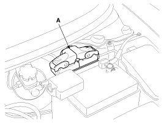
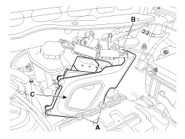
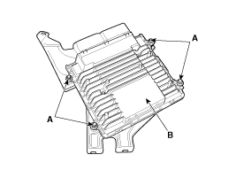

# Kia Sportage: Módulo de Controle do Motor (ECM): Procedimentos de Reparo

[Home](../../index.md) / [Manual de Serviço e Reparo do Kia Sportage SL](../sportage-482.md) / [Sistema de Controle do Motor / Sistema de Combustível](sportage-582.md) / [Sistema de Controle do Motor](sportage-587.md) / Procedimentos de Reparo do Módulo de Controle do Motor (ECM)

## Remoção

1. Desligue o interruptor de ignição e desconecte o cabo negativo (-) da bateria.

2. Desconecte o Conector do ECM (A).

   

3. Remova a bateria (Consulte "Sistema de Admissão e Exaustão" no grupo EM).

4. Remova as varetas de fixação (A) e o parafuso (B), e então remova a montagem do ECM (C).

   

5. Remova os parafusos de instalação (A), e então remova o ECM (B) do suporte.

   

## Instalação

1. A instalação é o inverso da remoção.

   ```
   Parafuso de instalação do Módulo de Controle do Motor (ECM):
   9,8 ~ 11,8 N.m (1,0 ~ 1,2 kgf.m, 7,2 ~ 8,7 lb-ft)
   Parafuso de suporte do Módulo de Controle do Motor (ECM):
   9,8 ~ 11,8 N.m (1,0 ~ 1,2 kgf.m, 7,2 ~ 8,7 lb-ft)
   ```

## Procedimento de Verificação de Problemas no Módulo de Controle do Motor (ECM)

1. TESTE DA CIRCUITOS DE CHÃO DO Módulo de Controle do Motor (ECM): Medir a resistência entre o Módulo de Controle do Motor (ECM) e o chão do chassis usando o conector do harness do ECM na face traseira como ponto de verificação do lado do ECM. Se o problema for encontrado, realize a reparação.

   ```
   Especificação: Menor que 1?
   ```

2. TESTE DO CONECTOR DO Módulo de Controle do Motor (ECM): Desconecte o conector do ECM e verifique visualmente os terminais de chão do lado do ECM e do lado do harness para pinos torcidos ou baixa pressão de contato. Se o problema for encontrado, realize a reparação.

3. Se o problema não for encontrado nos passos 1 e 2, o Módulo de Controle do Motor (ECM) pode estar danificado. Se for o caso, certifique-se de que não houvessem DTCs antes de trocar o ECM por um novo, e então verifique o veículo novamente. Se DTCs foram encontrados, examine isso primeiro antes de trocar o ECM.

4. RE-TESTE DO Módulo de Controle do Motor (ECM) Original: Instale o Módulo de Controle do Motor (ECM) original (pode estar quebrado) em um veículo conhecido como bom e verifique o veículo. Se o problema ocorrer novamente, substitua o Módulo de Controle do Motor (ECM) original por um novo. Se o problema não ocorrer, este é um problema intermitente (Consulte o "Procedimento de Verificação de Problemas Intermitentes" no Procedimento de Verificação Básica).

## Ajuste

| • | Após substituir o ECM do veículo com o imobilizador, é necessário realizar o seguinte procedimento. |
| --- | --- |

|  | [Se for instalar um ECM usado] |
| --- | --- |

| 1) | Realize o procedimento "Modo Neutro do ECM" usando GDS. (Consulte "Sistema Elétrico do Corpo - Sistema de Imobilizador - Procedimentos de Reparo") |
| --- | --- |

| 2) | Após concluir o "Modo Neutro do ECM", realize o procedimento "Ensino da Chave" usando GDS. (Consulte "Sistema Elétrico do Corpo - Sistema de Imobilizador - Procedimentos de Reparo") |
| --- | --- |

|  | [Se for instalar um ECM novo] Realize o procedimento "Ensino da Chave" usando GDS. (Consulte "Sistema Elétrico do Corpo - Sistema de Imobilizador - Procedimentos de Reparo") |
| --- | --- |

| • | Após substituir o ECM do veículo com o sistema de chave inteligente (início por botão), é necessário realizar o seguinte procedimento. |
| --- | --- |

|  | [Se for instalar um ECM usado] |
| --- | --- |

| 1) | Realize o procedimento "Modo Neutro do ECM" usando GDS. (Consulte "Sistema Elétrico do Corpo - Sistema de Chave Inteligente - Procedimentos de Reparo") |
| --- | --- |

| 2) | Após concluir o "Modo Neutro do ECM", ligue e desligue o IGN usando a chave inteligente ou o botão de início. Então, o ECM aprenderá automaticamente as informações da chave inteligente. |
| --- | --- |

|  | [Se for instalar um ECM novo] Ligue e desligue o IGN usando a chave inteligente ou o botão de início. Então, o ECM aprenderá automaticamente as informações da chave inteligente. |
| --- | --- |

| • | Após substituir o módulo ETC ou o ECM, o valor adaptativo do ETC deve ser redefinido / reaprendido. (Consulte "Sistema de Controle do Motor - ETC - Ajuste") |
| --- | --- |
