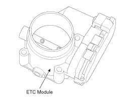
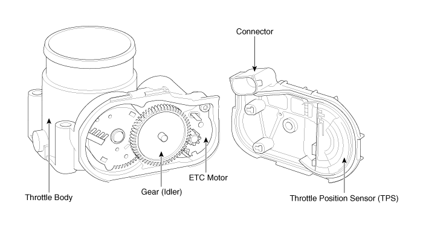
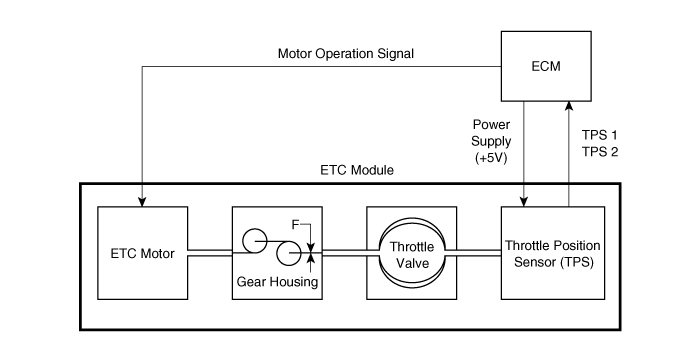

# Kia Sportage: Sistema ETC (Electronic Throttle Control): Descrição e Operação

[Home](../../index.md) / [Manual de Serviço e Reparo do Kia Sportage SL](../sportage-482.md) / [Controle do Motor / Sistema de Combustível](sportage-582.md) / [Sistema de Controle do Motor](sportage-587.md) / Sistema ETC (Electronic Throttle Control): Descrição e Operação

## Descrição

O Sistema de Controle do Throttle Eletrônico (ETC) consiste em um
corpo de throttle com um motor de controle integrado e um sensor de posição do throttle (TPS). Em vez de uma tradicional corda de throttle, um Sensor de Posição do Acelerador (APS) é usado para receber a entrada do motorista. O ECM usa o sinal do APS para calcular o ângulo de throttle alvo; a posição do throttle é então ajustada através do controle do ECM do motor ETC. O sinal do TPS é usado para fornecer feedback sobre a posição do throttle ao ECM. Usando o ETC, é possível um controle preciso sobre a posição do throttle; a necessidade de módulos/cordas de controle de cruzeiro externos é eliminada.

## Diagrama Esquemático

