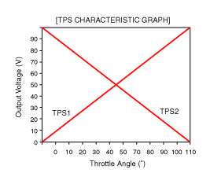

# Kia Sportage: Sistema ETC (Electronic Throttle Control): Especificações

[Home](../../index.md) / [Manual de Serviço e Reparo do Kia Sportage SL](../sportage-482.md) / [Controle do Motor / Sistema de Combustível](sportage-582.md) / [Sistema de Controle do Motor](sportage-587.md) / Sistema ETC (Electronic Throttle Control): Especificações

## Especificação

[Sensor de Posição do Acelerador (TPS)]

| Ângulo do Acelerador (°) | Tensão de Saída (V) [Vref = 5,0V] |  |
| --- | --- | --- |
| TPS1 | TPS2 |  |
| 0 | 0,0 | 5,0 |
| 10 | 0,48 | 4,52 |
| 20 | 0,95 | 4,05 |
| 30 | 1,43 | 3,57 |
| 40 | 1,90 | 3,10 |
| 50 | 2,38 | 2,62 |
| 60 | 2,86 | 2,14 |
| 70 | 3,33 | 1,67 |
| 80 | 3,81 | 1,19 |
| 90 | 4,29 | 0,71 |
| 100 | 4,76 | 0,24 |
| 105 | 5,0 | 0 |

| Item | C.T | W.O.T |  |
| --- | --- | --- | --- |
| TPS1 | Ângulo do Acelerador (°) | 6,3 ~ 14,7 | 93,45 ~ 101,85 |
| Tensão de Saída [Vref=5V] | 0,3 ~ 0,7 | 4,45 ~ 4,85 |  |
| TPS2 | Ângulo do Acelerador (°) | 90,3 ~ 98,7 | 3,15 ~ 11,55 |
| Tensão de Saída [Vref=5V] | 4,3 ~4,7 | 0,15 ~ 0,55 |  |

| Item | Resistência do Sensor (k?) |
| --- | --- |
| TPS | 0,875 ~ 1,625 [20°C(68°F)] |

[Motor ETC]

| Item | Especificação |
| --- | --- |
| Resistência do Bobinado (?) | 1,2 ~ 1,8 [20°C(68°F)] |
