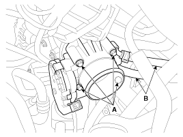
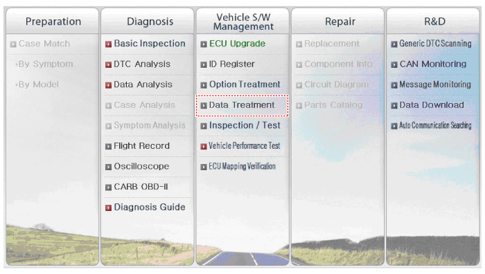
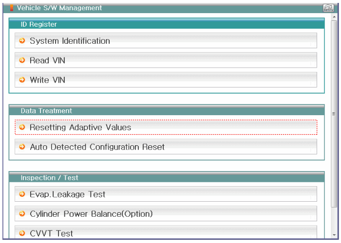
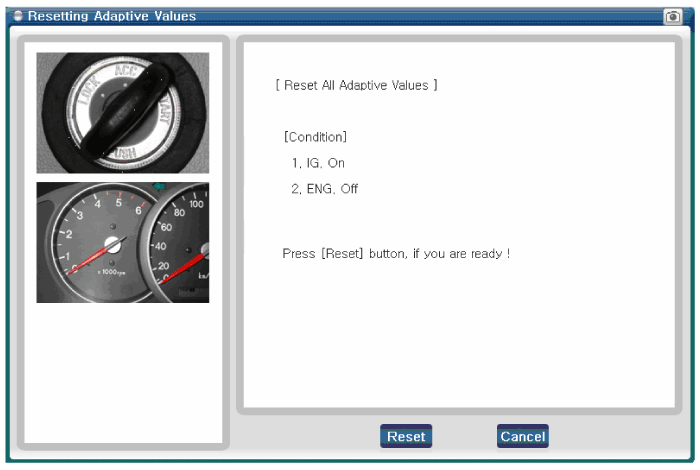
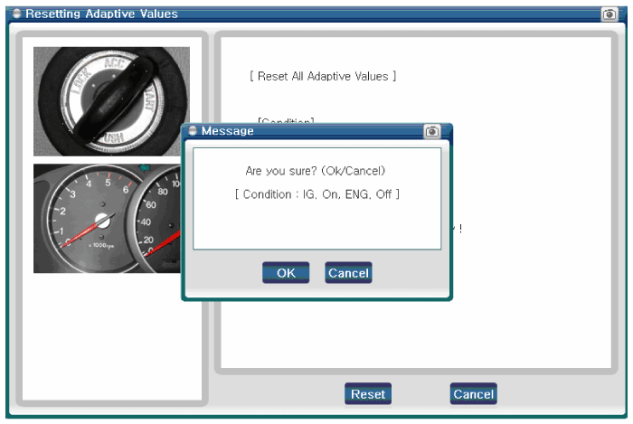
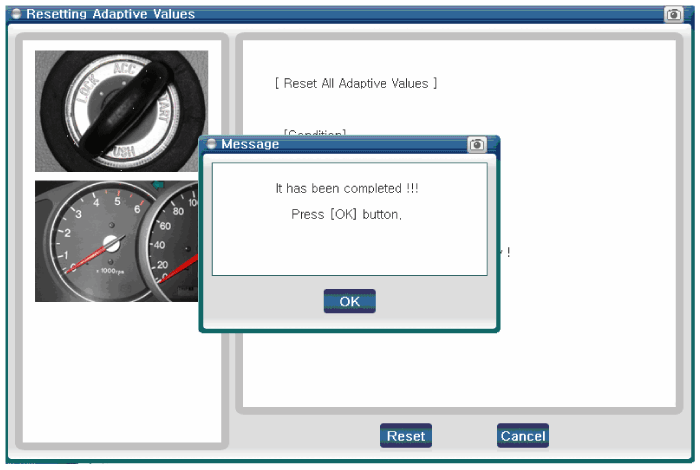

# Kia Sportage: Sistema ETC (Controlador Eletrônico da Turbinagem): Procedimentos de Reparo

[Home](../../index.md) / [Manual de Serviço e Reparo do Kia Sportage SL](../sportage-482.md) / [Controle do Motor / Sistema de Combustível](sportage-582.md) / [Sistema de Controle do Motor](sportage-587.md) / Sistema ETC (Controlador Eletrônico da Turbinagem): Procedimentos de Reparo

## Inspeção

Sensor de Posição do Acelerador (TPS)

1. Conecte o GDS na Conector de Interface de Dados (CID).

2. Inicie o motor e medir a tensão de saída do TPS 1 e 2 no C.T. e W.O.T.

   ```
   Especificação: Consulte “Especificação”
   ```

3. Desligue a chave do ignição e desconecte o escaninho do CID.

4. Desconecte o conector do módulo ETC e medir a resistência entre os terminais 1 e 2 do módulo ETC.

   ```
   Especificação: Consulte “Resistência do Sensor”
   ```

Motor ETC

1. Desligue a chave do ignição.

2. Desconecte o conector do módulo ETC.

3. Medir a resistência entre os terminais 3 e 6 do módulo ETC.

4. Verifique se a resistência está dentro da especificação.

   ```
   Especificação: Consulte “Especificação”
   ```

## Remoção

1. Desligue a chave do ignição e desconecte o cabo negativo (-) da bateria.

2. Remova o resonador e a mangueira de admissão de ar (Consulte “Sistema de Admissão e Exaustão” no grupo EM).

3. Desconecte o conector do módulo ETC.

4. Desconecte as mangueiras de arrefecimento (B).

5. Remova as parafusos de instalação (A), e então remova o módulo ETC do motor.

   

## Instalação

> **Cuidado**
>
> - Instale o componente com as torques especificadas.
> - Tenha em mente que danos internos podem ocorrer se o componente cair. Se o componente cair, inspecione antes de instalar.

1. A instalação é o inverso da remoção.

   ```
   Torque do parafuso de instalação do corpo do acelerador eletrônico:
   9,8 ~ 11,8 N.m (1,0 ~ 1,2 kgf.m, 7,2 ~ 8,7 lb-ft)
   ```

## Ajuste

Após a substituição do módulo ETC ou do ECM, o valor adaptativo do ETC deve ser redefinido / reaprendido de acordo com o procedimento a seguir.

1. Verifique os códigos de diagnóstico (DTC) e limpe se existirem.

2. Selecione "Tratamento de Dados", para redefinir o valor adaptativo do ETC.

   

3. Selecione "Redefinir valores adaptativos".

   

4. Selecione "Redefinir", então aguarde 10 segundos após desligar a chave do ignição (Relay OFF).

   

   

   

5. Aguarde 5 segundos após ligar a chave do ignição (valor adaptativo do ETC reaprendido).

   Se equipado com o Sistema de Início do Motor por Botão, pressione o botão de início/parada do motor 2 vezes sem pressionar o pedal do freio. Isto permitirá que o ECM aprenda automaticamente a posição da válvula de acelerador; então aguarde aproximadamente 5 segundos.

   ```
   Condições de Habilitação: Bateria > 10V, Temperatura do Ar de Admissão >
   5,3°C (41,5°F), 5,3°C (41,5°F) < Temperatura do Óleo do Motor <
   99,8°C (211,6°F)
   ```

6. Inicie o motor.

7. Reverifique os códigos de diagnóstico (DTC).
