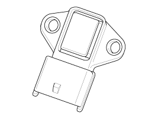

# Kia Sportage: Sensor de Pressão Absoluta do Manifold (MAPS): Descrição e Operação

[Home](../../index.md) / [Manual de Serviço e Reparo do Kia Sportage SL](../sportage-482.md) / [Controle do Motor / Sistema de Combustível](sportage-582.md) / [Sistema de Controle do Motor](sportage-587.md) / Sensor de Pressão Absoluta do Manifold (MAPS): Descrição e Operação

## Descrição

Sensor de Pressão Absoluta do Manifold (MAPS) é um sensor de tipo velocidade-densidade e está instalado no tanque de surto. Ele detecta a pressão absoluta do tanque de surto e transmite o sinal analógico proporcional à pressão para o ECM. Usando esse sinal, o ECM calcula a quantidade de ar inalado e a velocidade do motor.

O MAPS consiste em um elemento piezoelétrico e uma IC híbrida que amplifica o sinal de saída do elemento. O elemento é do tipo diâfragma de silício e adapta o efeito de resistor variável sensível à pressão do semi-conductor. Como 100% de vácuo e a pressão do manifólio são aplicados, respectivamente, a ambos os lados do sensor, este sensor pode emitir um sinal analógico usando a variação de silício proporcional ao mudança de pressão.

