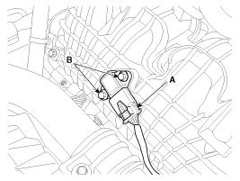
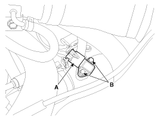

# Kia Sportage: Sensor de Pressão Absoluta do Manifold (MAPS): Procedimentos de Reparo

[Início](../../index.md) / [Manual de Serviço e Reparo do Kia Sportage SL](../sportage-482.md) / [Controle do Motor / Sistema de Combustível](sportage-582.md) / [Sistema de Controle do Motor](sportage-587.md) / Sensor de Pressão Absoluta do Manifold (MAPS): Procedimentos de Reparo

## Inspeção

1. Conecte o GDS na Conector de Linha de Dados (DLC).

2. Medir a tensão de saída do MAPS em idle e IG ON.

   ```
   Especificação: Consulte "Especificação"
   ```

## Remoção

1. Desligue o interruptor de ignição e desconecte o cabo negativo (-) da bateria.

2. Desconecte o conector do sensor de pressão do manifolds (A).

3. Remova as varetas de fixação (B), e então remova o sensor do tanque de surto.

   [MAPS #1]

   

   [MAPS #2]

   

## Instalação

> **Cautela**
>
> - Instale o componente com as torques especificados.
> - Tenha em mente que danos internos podem ocorrer se o componente for solto. Se o componente foi solto, inspecione antes de instalar.

> **Cautela**
>
> - Insira o sensor na abertura de instalação e tenha cuidado para não danificar.

1. A instalação é o inverso da remoção.

   ```
   Tornar de fixação do sensor de pressão do manifolds:
   9,8 ~ 11,8 N.m (1,0 ~ 1,2 kgf.m, 7,2 ~ 8,7 lb-ft)
   ```
