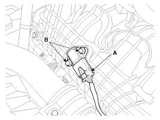

# Kia Sportage: Sensor de Temperatura do Ar Intalado (IATS): Procedimentos de Reparo

[Home](../../index.md) / [Manual de Serviço e Reparo do Kia Sportage SL](../sportage-482.md) / [Controle do Motor / Sistema de Combustível](sportage-582.md) / [Sistema de Controle do Motor](sportage-587.md) / Sensor de Temperatura do Ar Intalado (IATS): Procedimentos de Reparo

## Inspeção

1. Desligue o interruptor de ignição.

2. Desconecte o conector do sensor de temperatura do ar intalado (IATS).

3. Mede a resistência entre os terminais 3 e 4 do sensor de temperatura do ar intalado (IATS).

4. Verifique que a resistência esteja dentro da especificação.

   ```
   Especificação: Consulte “Especificação”
   ```

## Remoção

1. Desligue o interruptor de ignição e desconecte o cabo negativo (-) da bateria.

2. Desconecte o conector do sensor de pressão absoluta do manifold (A).

3. Remova as varetas de fixação (B), e, em seguida, remova o sensor do tanque de injeção.

   

## Instalação

> **Cuidado**
>
> - Instale o componente com as torques especificadas.
> - Tenha em mente que danos internos podem ocorrer se o componente cair. Se o componente cair, inspecione antes de instalar.

> **Cuidado**
>
> - Insira o sensor na abertura de instalação e tenha cuidado para não danificar.

1. A instalação é o inverso da remoção.

   ```
   Torque do parafuso de fixação do sensor de pressão absoluta do manifold:
   9,8 ~ 11,8 N.m (1,0 ~ 1,2 kgf.m, 7,2 ~ 8,7 lb-ft)
   ```
