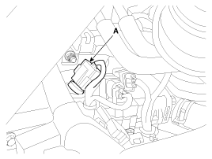
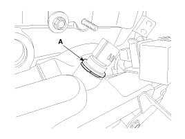

# Kia Sportage: Sensor de Temperatura do Coolante do Motor (ECTS): Procedimentos de Reparo

[Home](../../index.md) / [Manual de Serviço e Reparo do Kia Sportage SL](../sportage-482.md) / [Controle do Motor / Sistema de Combustível](sportage-582.md) / [Sistema de Controle do Motor](sportage-587.md) / Sensor de Temperatura do Coolante do Motor (ECTS): Procedimentos de Reparo

## Inspeção

1. Desligue o interruptor de ignição.

2. Remova o ECTS (Consulte "Remoção").

3. Imerso o termistor do sensor no coolante do motor, mede a resistência entre os terminais 3 e 4 do ECTS.

4. Verifique que a resistência esteja dentro da especificação.

   ```
   Especificação: Consulte “Especificação”
   ```

## Remoção

1. Desligue o interruptor de ignição e desconecte o cabo negativo (-) da bateria.

2. Desconecte o conectador do sensor de temperatura do coolante do motor (A).

   

3. Remova o gancho elástico (A), e então retire o sensor da montagem de controle da temperatura da água.

   

   > **Cuidado**
   >
   > - Note que o coolante do motor pode fluir da montagem de controle da temperatura da água ao remover o sensor.

4. Suplemente o coolante do motor (Consulte “Sistema de Refrigeração” no grupo EM).

## Instalação

> **Cuidado**
>
> - Instale o componente com as torques especificadas.
> - Note que danos internos podem ocorrer se o componente cair. Se o componente cair, inspecione antes de instalar.

> **Cuidado**
>
> - Aplicar o coolante do motor ao anel de vedação (O-ring).

> **Cuidado**
>
> - Insira o sensor na fenda de instalação e preste atenção para não danificar.

1. A instalação é o inverso da remoção.
