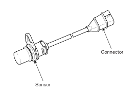

# Kia Sportage: Sensor de Posição do Crankshaft (CKPS): Descrição e Operação

[Home](../../index.md) / [Manual de Serviço e Reparo do Kia Sportage SL](../sportage-482.md) / [Controle do Motor e Sistema de Combustível](sportage-582.md) / [Sistema de Controle do Motor](sportage-587.md) / Sensor de Posição do Crankshaft (CKPS): Descrição e Operação

## Descrição

Sensor de Posição do Crankshaft (CKPS) detecta a posição do crankshaft e é um dos sensores mais importantes do sistema de controle do motor. Se não houver entrada de sinal CKPS, o motor pode parar devido à falta do sinal CKPS. Este sensor é instalado no bloco do cilindro ou na caixa transmissor e gera corrente alternada por meio do fluxo magnético criado pelo sensor e pela roda-alvo quando o motor está em funcionamento.

A roda-alvo consiste em 58 slots e 2 slots ausentes em 360 graus CA (Angulo de Crankshaft).

