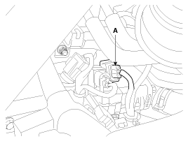
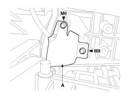
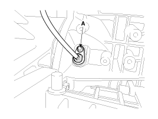

# Kia Sportage: Sensor de Posição do Crankshaft (CKPS): Procedimentos de Reparo

[Home](../../index.md) / [Manual de Serviço e Reparo do Kia Sportage SL](../sportage-482.md) / [Controle do Motor / Sistema de Combustível](sportage-582.md) / [Sistema de Controle do Motor](sportage-587.md) / Sensor de Posição do Crankshaft (CKPS): Procedimentos de Reparo

## Inspeção

1. Verifique o sinal de onda do CMPS e do CKPS usando o GDS.

   ```
   Especificação: Consulte “Onda de Sinal”
   ```

## Remoção

1. Desligue o interruptor de ignição e desconecte o cabo negativo (-) da bateria.

2. Desconecte o conectador do sensor de posição do crânio (A).

   

3. Remova o protetor (A).

   

4. Remova o parafuso de instalação (A), e então remova o sensor de posição do crânio.

   

## Instalação

> **Cuidado**
>
> - Instale o componente com as torques especificadas.
> - Tenha em mente que danos internos podem ocorrer se o componente cair. Se o componente cair, inspecione antes de instalar.

> **Cuidado**
>
> - Aplicar óleo de motor no anel de borracha.

> **Cuidado**
>
> - Insira o sensor no orifício de instalação com cuidado para não danificar.

1. A instalação é o inverso da remoção.

   ```
   Parafuso de instalação do sensor de posição do crânio: 9,8 ~ 11,8 N.m (1,0 ~ 1,2 kgf.m, 7,2 ~ 8,7 lb-ft)
   Parafuso de instalação do protetor do sensor de posição do crânio (M6): 9,8 ~ 11,8 N.m (1,0 ~ 1,2 kgf.m, 7,2 ~ 8,7 lb-ft)
   Parafuso de instalação do protetor do sensor de posição do crânio (M8): 18,6 ~ 23,5 N.m (1,9 ~ 2,4 kgf.m, 13,7 ~ 17,4 lb-ft)
   ```
