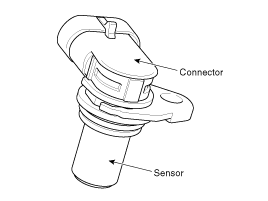

# Kia Sportage: Sensor de Posição do Camisa (CMPS): Descrição e Operação

[Home](../../index.md) / [Manual de Serviço e Reparo do Kia Sportage SL](../sportage-482.md) / [Controle do Motor / Sistema de Combustível](sportage-582.md) / [Sistema de Controle do Motor](sportage-587.md) / Sensor de Posição do Camisa (CMPS): Descrição e Operação

## Descrição

Sensor de Posição do Camisa (CMPS) é um sensor hall e detecta a posição do camisa usando um elemento hall.

Ele está relacionado com o Sensor de Posição do Eixo do Câmbio (CKPS) e
detecta a posição do pistão de cada cilindro que o CKPS não
pode detectar.

O CMPS é instalado na cobertura do motor e usa um disco-alvo instalado no camisa. O Sensor de Posição do Camisa é um sensor de efeito hall. Ao passar o disco-alvo pelo sensor hall, o campo magnético muda no sensor. O sensor então troca um sinal
que cria uma onda quadrada.

