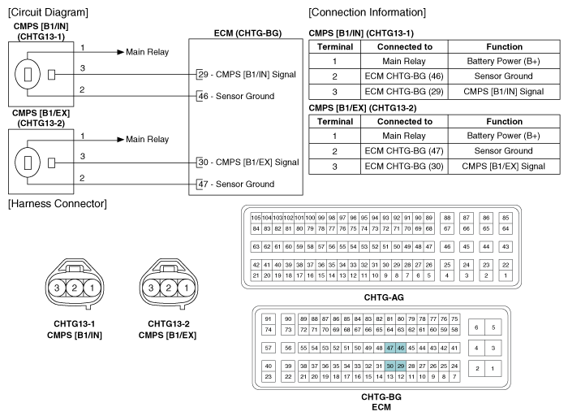

# Kia Sportage: Sensores de Posição do Camaroto (CMPS): Diagramas Schematicos

[Home](../../index.md) / [Manual de Serviço e Reparo do Kia Sportage SL](../sportage-482.md) / [Controle do Motor e Sistema de Combustível](sportage-582.md) / [Sistema de Controle do Motor](sportage-587.md) / Sensores de Posição do Camaroto (CMPS): Diagramas Schematicos

## Diagrama Elétrico

