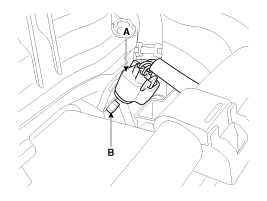
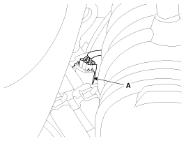

# Kia Sportage: Sensor de Posição do Camaroto (CMPS): Procedimentos de Reparo

[Home](../../index.md) / [Manual de Serviço e Reparo do Kia Sportage SL](../sportage-482.md) / [Controle do Motor / Sistema de Combustível](sportage-582.md) / [Sistema de Controle do Motor](sportage-587.md) / Sensor de Posição do Camaroto (CMPS): Procedimentos de Reparo

## Inspeção

1. Verifique o sinal de onda do CMPS e do CKPS usando o GDS.

   ```
   Especificação: Consulte “Onda de Sinal”
   ```

## Remoção

> **Aviso**
>
> - NÃO remova o sensor de posição do camaroto enquanto o motor estiver em funcionamento ou logo após o motor ter sido desligado. A peça e a óleo do motor estão quentes e podem causar queimaduras.

[Bank 1 / Intalação de Admissão]

1. Desligue o interruptor de ignição e desconecte o cabo negativo (-) da bateria.

2. Desconecte o conector do sensor de posição do camaroto (A).

3. Remova a viga de fixação (B) e, em seguida, remova a peça.

   

[Bank 1 / Exaustão]

1. Desligue o interruptor de ignição e desconecte o cabo negativo (-) da bateria.

2. Remova a capa de proteção do aquecedor (Consulte "Sistema de Admissão e Exaustão" no grupo EM).

3. Desconecte o conector do sensor de posição do camaroto (A).

4. Remova o suporte e a proteção.

5. Remova a viga de fixação e, em seguida, remova a peça.

   

## Instalação

> **Cautela**
>
> - Instale o componente com as torques especificadas.
> - Tenha em atenção que danos internos podem ocorrer se a peça cair. Se a peça tiver caído, inspecione antes de instalar.

> **Cautela**
>
> - Aplicar óleo do motor ao anel de vedação.

> **Cautela**
>
> - Insira a peça no orifício de instalação com cuidado para não danificar.

> **Cautela**
>
> - Tenha cuidado para não danificar a caixa de proteção do sensor e o conector.
> - Tenha cuidado para não danificar o anel de vedação.

1. A instalação é o inverso da remoção.

   ```
   Torque do parafuso de instalação do sensor de posição do camaroto:
   9,8 ~ 11,8 N.m (1,0 ~ 1,2 kgf.m, 7,2 ~ 8,7 lb-ft)
   ```
