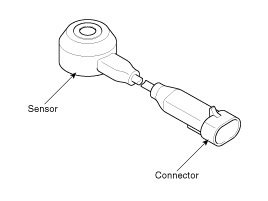

# Kia Sportage: Sensor de Choque (KS): Descrição e Operação

[Home](../../index.md) / [Manual de Serviço e Reparo do Kia Sportage SL](../sportage-482.md) / [Controle do Motor / Sistema de Combustível](sportage-582.md) / [Sistema de Controle do Motor](sportage-587.md) / Sensor de Choque (KS): Descrição e Operação

## Descrição

O choque é um fenômeno caracterizado por vibrações e ruídos indesejáveis e pode causar danos ao motor. O Sensor de Choque (KS) é instalado no bloco do cilindro e detecta o choque do motor.

Quando ocorre choque, a vibração do bloco do cilindro é aplicada como pressão ao elemento piezoeletrico. Quando ocorre um choque, o sensor produz um sinal de tensão. O ECM atrasa o tempo de ignição quando ocorre choque. Se o choque desaparecer após o atraso do tempo de ignição, o ECM avançará o tempo de ignição. Este controle sequencial pode melhorar a potência, o torque e a economia de combustível do motor.

