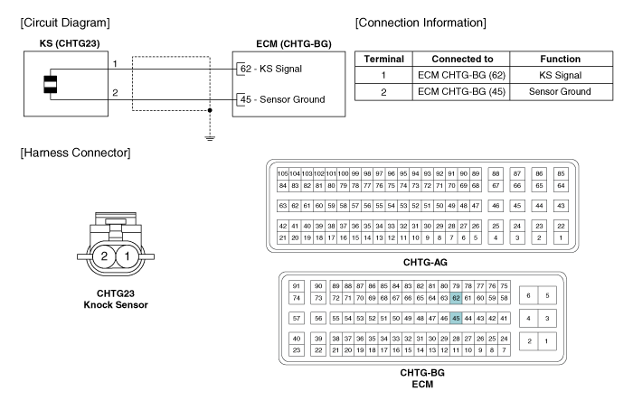

# Kia Sportage: Sensor de Choque (KS): Diagramas Esquemáticos

[Home](../../index.md) / [Manual de Serviço e Reparo do Kia Sportage SL](../sportage-482.md) / [Controle do Motor / Sistema de Combustível](sportage-582.md) / [Sistema de Controle do Motor](sportage-587.md) / Sensor de Choque (KS): Diagramas Esquemáticos

## Diagrama Esquemático

