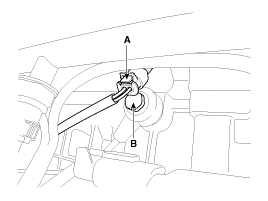

# Kia Sportage: Sensor de Choque (KS): Procedimentos de Reparo

[Home](../../index.md) / [Manual de Serviço e Reparo do Kia Sportage SL](../sportage-482.md) / [Controle do Motor e Sistema de Combustível](sportage-582.md) / [Sistema de Controle do Motor](sportage-587.md) / Sensor de Choque (KS): Procedimentos de Reparo

## Remoção

1. Desligue a chave do ignição e desconecte o cabo negativo (-) da bateria.

2. Remova o manifold de admissão (Consulte o “Sistema de Admissão e Exaustão” no grupo EM).

3. Desconecte o conector do sensor de choque (A).

4. Remova a viga de instalação (B), e então remova o sensor do bloco do motor.

   

## Instalação

> **Cuidado**
>
> - Instale o componente com as torques especificadas.
> - Tenha em mente que danos internos podem ocorrer se o componente for solto. Se o componente foi solto, inspecione antes de instalar.

1. A instalação é o inverso da remoção.

   ```
   Torque do parafuso de instalação do sensor de choque:
   18,6 ~ 23,5 N.m (1,9 ~ 2,4 kgf.m, 13,7 ~ 17,4 lb-ft)
   ```
