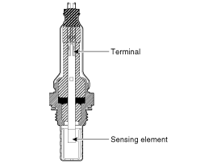

# Kia Sportage: Sensor Oxigênio Quente (HO2S): Descrição e Operação

[Início](../../index.md) / [Manual de Serviço e Reparo do Kia Sportage SL](../sportage-482.md) / [Controle do Motor / Sistema de Combustível](sportage-582.md) / [Sistema de Controle do Motor](sportage-587.md) / Sensor Oxigênio Quente (HO2S): Descrição e Operação

## Descrição

O Sensor Oxigênio Quente (HO2S) é composto por zircônio e alumina e está instalado tanto antes quanto depois do Conversor Catalítico de Manifold. A saída de tensão do sensor varia de acordo com a proporção ar/combustível.

O sensor deve estar quente para operar normalmente. Para manter seu calor, o sensor possui um aquecedor controlado pelo ECM por meio de um sinal de ciclo de duty cycle. Quando a temperatura do gases de escape é menor do que o valor especificado, o aquecedor aquece o cabo do sensor.

