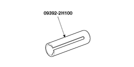
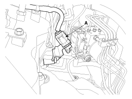
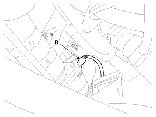
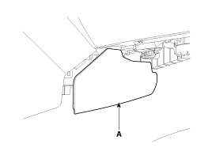
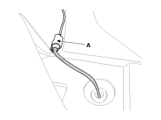
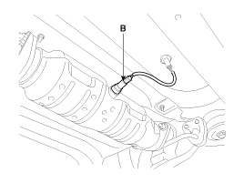

# Kia Sportage: Sensor Oxigênio Quente (HO2S): Procedimentos de Reparo

[Home](../../index.md) / [Manual de Serviço e Reparo do Kia Sportage SL](../sportage-482.md) / [Controle do Motor / Sistema de Combustível](sportage-582.md) / [Sistema de Controle do Motor](sportage-587.md) / Sensor Oxigênio Quente (HO2S): Procedimentos de Reparo

## Inspeção

1. Desligue a chave do motor.

2. Desconecte o conector do sensor oxigênio quente (HO2S).

3. Mede a resistência entre os terminais 4 e 5 [B1/S1] do sensor oxigênio quente (HO2S).

4. Mede a resistência entre os terminais 3 e 4 [B1/S2] do sensor oxigênio quente (HO2S).

5. Verifique se a resistência está dentro da especificação.

   ```
   Especificação: Consulte a “Especificação”
   ```

## Remoção

[Bank 1 / Sensor 1]

1. Desligue a chave do motor e desconecte o cabo negativo (-) da bateria.

2. Desconecte o conector (A) e, em seguida, remova o sensor (B).

   > **Nota**
   >
   > - Note que o SST (Part No.: 09392-2H100) é útil na remoção do sensor oxigênio quente aquecido.

   

   

   

[Bank 1 / Sensor 2]

1. Desligue a chave do motor e desconecte o cabo negativo (-) da bateria.

2. Remova a capa do painel (A).

   

3. Desconecte o conector (A) e, em seguida, remova o sensor (B).

   > **Nota**
   >
   > - Note que o SST (Part No.: 09392-2H100) é útil na remoção do sensor oxigênio quente aquecido.

   

   

## Instalação

> **Cautela**
>
> - Instale o componente com as torques especificadas.
> - Note que danos internos podem ocorrer se o componente cair. Neste caso, use-o após a inspeção.

> **Cautela**
>
> - Não use limpador, spray ou graxa no elemento de detecção e no conector do sensor, pois os componentes de óleo neles podem afetar o desempenho do sensor.
> - O sensor e sua alimentação podem ser danificados em caso de contato com o sistema de escape (Manifold de Exaustão, Catalisador, etc.).

1. A instalação é o inverso da remoção.

   ```
   Instalação do sensor oxigênio quente [Bank 1/Sensor1]:
   39,2 ~ 49,1 N.m (4,0 ~ 5,0 kgf.m, 28,9 ~ 36,2 lb-ft)
   Instalação do sensor oxigênio quente [Bank 1/Sensor2]:
   39,2 ~ 49,1 N.m (4,0 ~ 5,0 kgf.m, 28,9 ~ 36,2 lb-ft)
   ```
