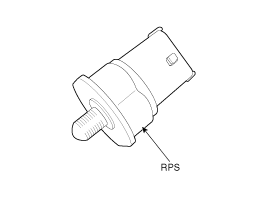

# Kia Sportage: Sensor de Pressão do Tanque de Combustível (RPS): Descrição e Operação

[Início](../../index.md) / [Manual de Serviço e Reparo do Kia Sportage SL](../sportage-482.md) / [Controle do Motor / Sistema de Combustível](sportage-582.md) / [Sistema de Controle do Motor](sportage-587.md) / Sensor de Pressão do Tanque de Combustível (RPS): Descrição e Operação

## Descrição

O Sensor de Pressão do Tanque de Combustível (RPS) é instalado no tubo de entrega e mede a pressão instantânea do combustível no tubo de entrega. O elemento de detecção (elemento semiconductor) integrado no sensor converte a pressão em sinal de tensão. Usando esse sinal, o ECM pode controlar a quantidade e o tempo de injetão corretos e ajustar a pressão do combustível com o valve-regulador de pressão do combustível se a pressão alvo e a pressão real calculada pelo sinal de saída do RPS forem diferentes.

