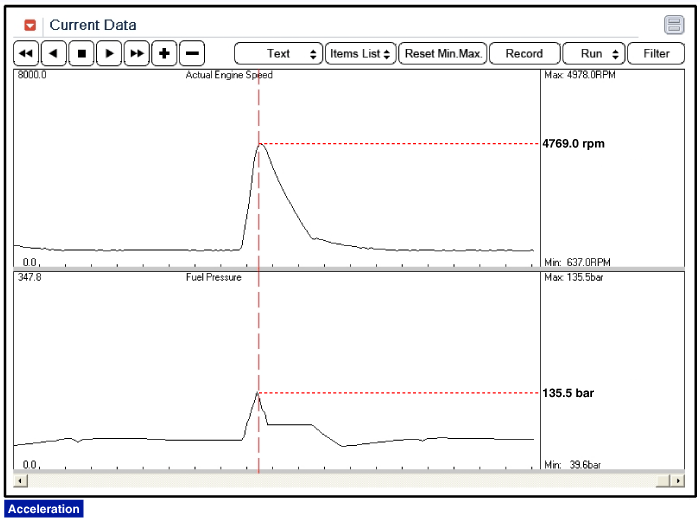

# Kia Sportage: Sensor de Pressão do Tanque de Combustível (RPS): Diagnóstico

[Início](../../index.md) / [Manual de Serviço e Reparo do Kia Sportage SL](../sportage-482.md) / [Controle do Motor / Sistema de Combustível](sportage-582.md) / [Sistema de Controle do Motor](sportage-587.md) / Diagnóstico do Sensor de Pressão do Tanque de Combustível (RPS)

## Forma de Sinal

