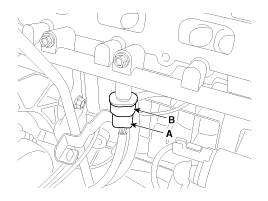

# Kia Sportage: Sensor de Pressão do Rail (RPS): Procedimentos de Reparo

[Home](../../index.md) / [Manual de Serviço e Reparo do Kia Sportage SL](../sportage-482.md) / [Controle do Motor / Sistema de Combustível](sportage-582.md) / [Sistema de Controle do Motor](sportage-587.md) / Sensor de Pressão do Rail (RPS): Procedimentos de Reparo

## Inspeção

1. Conecte o GDS no Conector de Linha de Dados (DLC).

2. Medir a tensão de saída do RPS em idle e em várias velocidades de rotação do motor.

   | Condição | Tensão de Saída (V) |
   | --- | --- |
   | Idle | Aproximadamente 1,2 |
   | 1.500 rpm | 2,0 ~ 2,2 |
   | 6.300 rpm | Aproximadamente 2,8 |

## Remoção

1. Desligue a chave do motor e desconecte o cabo negativo (-) da bateria.

2. Libere a pressão residual na linha de combustível (Consulte o Sistema de Entrega de Combustível - Procedimentos de Reparo - "Libere a Pressão Residual na Linha de Combustível").

   > **Cuidado**
   >
   > - Ao remover o relé do bomba de combustível, um Código de Falha Diagnóstico (CFD) pode ocorrer. Exclua o código com o GDS após a conclusão do trabalho de "Libere a Pressão Residual na Linha de Combustível".

3. Remova o manifold de admissão (Consulte o "Sistema de Admissão e Exaustão" no grupo EM).

4. Desconecte a conexão do sensor de pressão do rail (A), e então remova o sensor (B) do tubo de entrega.

   

## Instalação

> **Cuidado**
>
> - Instale o componente com as torques especificados.
> - Tenha em mente que danos internos podem ocorrer se o componente for solto. Se o componente foi solto, inspecione antes de instalar.

1. A instalação é o contrário da remoção.

   ```
   Instalação do Sensor de Pressão do Rail: 18,0 ~ 22,0 N.m (1,8 ~ 2,2 kgf.m, 13,3 ~ 16,2 lb-ft)
   ```
